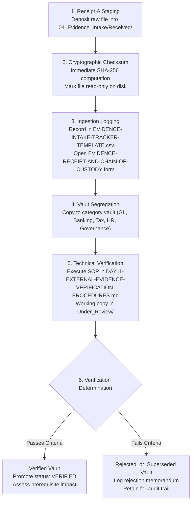

# GATE 1: EXTERNAL EVIDENCE SUBMISSION & INTAKE GUIDE

**Project:** Aura Workforce by Growmar — Horizon Portal  
**Phase:** Phase 3 — Teams and Insight  
**Workstream:** Gate 1 Governance Blocker Closure  
**Document ID:** `04_Evidence_Intake/EVIDENCE-SUBMISSION-GUIDE.md`  
**Governing Standard:** Policy E Tripartite Evidence Framework  
**Current Governance State:** `GATE 1 LOCKED — FINANCIAL EXECUTION NOT AUTHORIZED`  
**Stage 4B Status:** `NOT AUTHORIZED`  

---

## 1. Purpose of the Evidence Intake Process

This guide provides operational instructions for corporate stakeholders, system administrators, and financial reviewers on the submission, intake, custody, and verification of external evidence required to resolve Gate 1 governance blockers.

Under statutory financial accounting standards (Companies Act, 2013; Section 65B, Indian Evidence Act, 1872; ICAI Guidance Notes on Internal Financial Controls), software-internal database records cannot self-substantiate external commercial transactions. Horizon Portal requires independent external primary substantiation across General Ledger, Commercial Banking, Statutory Tax Remittance, HR Master Data, and Corporate Governance before Gate 1 can be considered for unlocking.

---

## 2. The 14 Canonical Evidence Artifacts

Every submitted file must map to one of the 14 pre-approved canonical evidence IDs. Unmapped, unsolicited, or amorphous documents will not be processed.

| Canonical ID | Artifact Name & Description | Primary Issuing Authority | Required Reporting Period | Accepted File Formats | Target Vault Path |
|---|---|---|---|---|---|
| **EVID-GL-01** | Official Corporate ERP Chart of Accounts | Corporate Controller (`FIN-CTRL`) / ERP Admin | Active FY 2025–26 & FY 2026–27 | `.json`, `.csv`, `.pdf` (certified system export) | `04_Evidence_Intake/GL/` |
| **EVID-GL-02** | Historical ERP GL Trial Balances & Journal Vouchers | Corporate Controller (`FIN-CTRL`) / General Accounting | Apr 2025 – Sep 2026 (18 Months) | `.pdf` (digitally certified export; period `CLOSED`, version `POST-CLOSING`) | `04_Evidence_Intake/GL/` |
| **EVID-GL-03** | Wage Expense Postings (Payroll Journals — Illustratively `GL-6100`) | Corporate Controller (`FIN-CTRL`) / Payroll Accounting | Apr 2026 – Sep 2026 (6 Itemized Runs) | `.xlsx`, `.csv`, `.pdf` | `04_Evidence_Intake/GL/` |
| **EVID-BNK-01** | Commercial Bank Statements (Consolidated Debits) | Corporate Treasurer (`TREAS-CORP`) / Commercial Bank | Apr 2025 – Sep 2026 (18 Months) | `.pdf` (bank-stamped or digitally signed) | `04_Evidence_Intake/Banking/` |
| **EVID-BNK-02** | Beneficiary Payment Instruction, Clearing and Settlement Reconciliation Records | Corporate Treasurer (`TREAS-CORP`) / Commercial Disbursement Bank Clearing Ops | Apr 2026 – Sep 2026 (Runs 13–18; 2,469 Payslips) | `.csv`, `.xlsx` | `04_Evidence_Intake/Banking/` |
| **EVID-BNK-03** | Treasury Returned / Bounced Payment Records (Bank Advices + Treasury Log) | Corporate Treasurer (`TREAS-CORP`) & Commercial Bank | Apr 2025 – Sep 2026 (18 Months) | `.csv`, `.xlsx`, `.pdf` | `04_Evidence_Intake/Banking/` |
| **EVID-BNK-04** | Corporate Treasurer Banking Model Formal Sign-Off | Corporate Treasurer (`TREAS-CORP`) | Permanent Policy | `.pdf` (signed policy determination) | `04_Evidence_Intake/Banking/` |
| **EVID-TAX-01** | EPFO Electronic Challan cum Return (ECR) & TRRN | Head of Tax Operations (`TAX-HEAD`) / EPFO Portal | Apr 2025 – Sep 2026 (Monthly) | `.pdf` (official government receipts) | `04_Evidence_Intake/Tax/` |
| **EVID-TAX-02** | ESIC Monthly Contribution Challans & Receipts (`PENDING CONFIRMATION`) | Head of Tax Operations (`TAX-HEAD`) / ESIC Portal | Apr 2025 – Sep 2026 (Monthly) | `.pdf` (official government receipts) | `04_Evidence_Intake/Tax/` |
| **EVID-TAX-03** | Income Tax TDS Form 24Q Quarterly Returns & ITNS 281 | Head of Tax Operations (`TAX-HEAD`) / TRACES Portal | Q1 FY 2025–26 through Q2 FY 2026–27 | `.pdf` (acknowledgements + challans) | `04_Evidence_Intake/Tax/` |
| **EVID-HR-02** | VP HR Authoritative Status Directive (78-Headcount) | VP of Human Resources (`HR-VPHR`) | Active Employment Policy | `.pdf` (signed executive directive) | `04_Evidence_Intake/HR/` |
| **EVID-GOV-01** | Corporate Policy Voting Artifacts (Policies A–E) | Corporate Governance Committee / CFO | Day 11 Policies A through E | `.pdf` (signed policy determinations — illustrative draft template) | `04_Evidence_Intake/Governance/` |
| **EVID-GOV-02** | Signed Joint Monetary Threshold Determination Paper | Controller & CFO (`FIN-CTRL` / `EXEC-CFO`) | Permanent Operating Policy | `.pdf` (signed joint determination) | `04_Evidence_Intake/Governance/` |
| **EVID-GOV-05** | Audit Committee Authorized Decision & Supporting Record | Audit Committee Chair (`AUD-COMM`) | Day 11 Findings & Controls | `.pdf` (formally authorized decision & minutes) | `04_Evidence_Intake/Governance/` |

---

## 3. Submission Instructions & Six-Stage Intake Workflow

All external artifacts must transition through a controlled, six-stage intake workflow:



### Ingestion Protocol:
1. **Physical / Digital Deposit:** Place the original, unmodified file into `04_Evidence_Intake/Received/`.
2. **Immediate Checksum Calculation:** Compute SHA-256 before any viewing, copying, or conversion:
   ```bash
   certutil -hashfile 04_Evidence_Intake/Received/<filename> SHA256
   # Or using Python:
   python -c "import hashlib; print(hashlib.sha256(open('04_Evidence_Intake/Received/<filename>','rb').read()).hexdigest().upper())"
   ```
3. **Immutability Enforcement:** Set the received file to read-only attribute immediately. Never modify, rename, clean, or overwrite the raw received file.
4. **Tracker Registration:** Enter all file metadata into `04_Evidence_Intake/EVIDENCE-INTAKE-TRACKER-TEMPLATE.csv`.

---

## 4. Confidentiality, PII & Restricted Access Requirements

External financial and HR documents contain sensitive corporate data and Personally Identifiable Information (PII) protected under applicable data protection laws:

1. **Strict Git Exclusion & Public GitHub Protection:**
   - Raw banking statements, employee UTR manifests with bank account numbers, tax challans with employee PANs, and HR master rosters **MUST NEVER** be committed or pushed to public Git remotes.
   - Raw evidence files must remain untracked on local secured storage.
   - Repository audits must verify that `.git` index excludes confidential files.
2. **Access Control:**
   - Physical or network access to `04_Evidence_Intake/` must be restricted to authorized reviewers (`FIN-CTRL`, `TREAS-CORP`, `TAX-HEAD`, `AUD-HEAD`, `AUD-COMM-CHAIR`).
   - Any derived report, acceptance document, or verification register prepared for repository check-in must mask, redact, or aggregate sensitive individual PII (e.g. employee PANs, personal bank account numbers).
3. **Transfer Verification:**
   - Verify SHA-256 checksums before and after transfer between corporate file shares and the intake workspace to detect transmission corruption or tampering.

---

## 5. Evidence Authenticity & Verification Standards

In accordance with [`DAY11-EXTERNAL-EVIDENCE-VERIFICATION-PROCEDURES.md`](file:///c:/Users/Madugu%20Shiva%20Kumar/OneDrive/图片/Desktop/horizon-portal/docs/DAY11-EXTERNAL-EVIDENCE-VERIFICATION-PROCEDURES.md), reviewers must strictly enforce the following authenticity criteria:

### 5.1. General Ledger Evidence (`EVID-GL-01..03`)
- Must originate from the enterprise ERP system with verifiable export timestamps, operator ID, and session metadata. Enterprise ERP systems (SAP S/4HANA, Oracle Financials, Microsoft Dynamics Cloud) are illustrative examples; actual ERP system to be identified via metadata.
- Native ERP status strings must be preserved and mapped to project categories (`CLOSED`, `POST-CLOSING`, `POSTED_FINAL`). If native status cannot be confidently mapped, tag as `SOURCE-SYSTEM STATUS MAPPING PENDING AUTHORIZED ACCOUNTING REVIEW`.
- Double-entry balance tie-out must be zero ($\sum \text{Debits} == \sum \text{Credits}$). Note: Arithmetic balance is a baseline check and does not autonomously establish completeness of interfaces, accruals, liabilities, or disbursements.
- Certified written attestation of the Corporate Controller required (distinct from external audit assurance; interim monthly trial balances do not require external audit).

### 5.2. Banking & Treasury Evidence (`EVID-BNK-01..04`)
- Bank statements must be on institutional letterhead with official cryptographic digital PDF signatures or bank branch physical stamps.
- Payment reconciliation records (`EVID-BNK-02`) must establish a traceable outcome for every one of the 2,469 itemized payslips across Runs 13–18. The number of associated bank transaction records is not assumed equal to the payslip count.
- Bank transaction or UTR clearing references must be validated strictly against the issuing commercial bank's technical interface specifications and payment rail (NEFT/RTGS/IMPS). Universal length or regex patterns are strictly prohibited.
- Full settlement proof requires eight-point corroboration and verified completeness of the Treasury return register (`EVID-BNK-03`).

### 5.3. Statutory Tax Evidence (`EVID-TAX-01..03`)
- Government challans must contain valid 13-digit TRRN (EPFO), official ESIC Challan / Transaction Reference (`OFFICIAL DOCUMENT TERMINOLOGY PENDING SOURCE CONFIRMATION`), and ITNS 281 BSR/CIN codes.
- Challan numbers must be confirmed via live query against the respective government portals.
- Member-wise ECR schedules must be evaluated across 11 statutory dimensions (EE share, ER share, EPS share, statutory ceiling, member status, age eligibility, levies). Reviewers must not apply simplified flat formulas.
- If statutory eligibility or historical membership is ambiguous in source files, tag as: `STATUTORY ELIGIBILITY REVIEW REQUIRED — EVIDENCE INSUFFICIENT FOR AUTOMATIC CONCLUSION`.

### 5.4. Human Resources Master Evidence (`EVID-HR-02`)
- Written executive directive executed by the VP of Human Resources.
- Must definitively designate the authoritative source of employee status and resolve the 78-employee headcount difference between header (2,547) and itemized payslip (2,469) records.

### 5.5. Corporate Governance & Audit Evidence (`EVID-GOV-01, 02, 05`)
- Policy ratification voting records (utilizing illustrative draft templates) must be executed by designated officers.
- Quorum requirements remain qualified:
  $$\mathbf{PROPOSED\ APPROVAL\ AND\ QUORUM\ REQUIREMENT\ —\ FORMAL\ CORPORATE\ AUTHORITY\ NOT\ YET\ VERIFIED.}$$
- Signatures must match corporate specimen signature registers.
- Audit Committee Concurrence (`COND-16` / `EVID-GOV-05`) must be a formally authorized decision record and supporting minutes executed under the committee's corporate charter.

---

## 6. Reviewer Responsibilities & Segregation of Duties

To enforce the Maker-Checker principle and ensure rigorous audit segregation:
- **No Self-Review:** An officer who authors or submits an evidence artifact cannot serve as its sole verifying reviewer.
- **Assigned Reviewers:**
  - `EVID-GL-01`, `02`: Financial Controls Specialist.
  - `EVID-GL-03`: Corporate Controller.
  - `EVID-BNK-01`, `03`: Corporate Treasurer.
  - `EVID-BNK-02`: Financial Controls Specialist.
  - `EVID-BNK-04`: Head of Internal Audit.
  - `EVID-TAX-01`, `02`, `03`: Head of Tax Operations.
  - `EVID-HR-02`: Corporate Controller.
  - `EVID-GOV-01`, `02`: Head of Internal Audit.
  - `EVID-GOV-05`: Corporate Governance Committee.

---

## 7. Rejection, Clarification & Supersession Procedures

1. **Rejection:**
   - If an artifact fails mathematical tie-out, has missing pages, covers an incorrect time period, or displays an unverified signature, the reviewer must issue a formal Rejection Memorandum.
   - The file is moved to `04_Evidence_Intake/Rejected_or_Superseded/`.
   - The status in `EVIDENCE-INTAKE-TRACKER-TEMPLATE.csv` is updated to `REJECTED`.
2. **Clarification Required:**
   - If an artifact is authentic but contains ambiguities (e.g., unexplained bank reversal fee), the reviewer marks status as `INCOMPLETE — CLARIFICATION REQUIRED` and requests supplementary data.
3. **Supersession:**
   - When an amended or updated file is received to replace an earlier submission, the superseded file is moved to `04_Evidence_Intake/Rejected_or_Superseded/`.
   - The tracker records the relationship: `SUPERSEDED BY <New-File-SHA256>`.
   - Historical files are **never deleted**.

---

*End of Evidence Submission Guide.*

