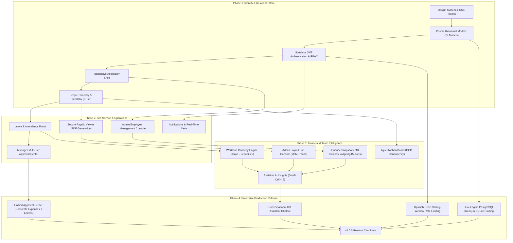

# Horizon Portal — Aura Workforce Management Platform

<div align="center">


**Centralized Workforce Management, Enterprise Operations, and Assistive AI Analytics Platform**

[Project Overview](#1-project-overview) • [Live Preview](#2-live-preview--deployment) • [Architecture](#3-monorepo--system-architecture) • [Demo Personas](#4-demo-personas--authentication) • [Quick Start](#5-local-quick-start) • [Test Suites](#6-automated-testing--quality-gates) • [Release Governance](#7-release-governance--evidence)

</div>

---

## 1. Project Overview

**Horizon Portal** is the unified enterprise workforce platform developed for **Aura Workforce by Growmar**. Architected on **Next.js 16 (App Router)**, **React 19**, **TypeScript (Strict)**, and **Prisma ORM 6**, Horizon Portal provides a single, high-performance interface spanning human resources administration, multi-tier self-service approvals, automated payroll reconciliation with integer-paise precision, agile team sprint capacity planning, and responsible, privacy-preserving AI workforce insights.

### Core Architectural Pillars
- **Zero-Loss Financial Precision:** Eliminates floating-point drift across payroll and corporate expenses through integer-paise calculations (`toPaise` / `fromPaise`) with automated 6-run tie-out reconciliation.
- **Dual-Dialect Database Abstraction:** Seamlessly bridges rapid local development on **SQLite** (`prisma/schema.prisma`) with cloud deployments on **Neon Serverless PostgreSQL** (`prisma/schema.postgresql.prisma`) using dynamic runtime Prisma client routing.
- **Optimistic Concurrency Control (OCC):** Protects high-concurrency Kanban task movements and unified approval decisions against mid-air collisions using version-stamped records and HTTP 409 conflict detection.
- **Defense-in-Depth Security:** Employs distributed sliding-window rate limiting via **Upstash Redis**, strict Content Security Policy (CSP), HTTP 422 standard Zod validation, HTTP-only signed session tokens, and IDOR access control guards.
- **Assistive, Privacy-Preserving AI:** Integrates conversational HR policies and predictive attrition risk models with strict **statistical small-cell suppression ($< 5$)** to prevent employee re-identification.

---

## 2. Live Preview & Deployment

- **GitHub Repository:** [`https://github.com/madugushivakumar/horizon-portal`](https://github.com/madugushivakumar/horizon-portal)
- **Active Release Candidate Branch:** `release/horizon-portal-phase4-v1.0.0`
- **Target Pull Request:** [`main ← release/horizon-portal-phase4-v1.0.0`](https://github.com/madugushivakumar/horizon-portal/pull/1)
- **Vercel Preview Deployment:** [`https://horizon-portal-sigma.vercel.app`](https://horizon-portal-sigma.vercel.app)

---

## 3. Monorepo & System Architecture

```text
horizon-portal/
├── README.md                               # Repository root documentation (this file)
│
├── phase-1/                                # Phase 1: Foundation (Days 1–5)
│   ├── src/                                # Design system, tokens, auth, directory & shell
│   ├── prisma/schema.prisma                # Initial 23 models schema
│   ├── scripts/                            # Phase 1 test suites (test:auth, test:db, test:nav)
│   └── FullStack_MaduguShivaKumar_Phase1_Report.pdf # Final Phase 1 audit report
│
├── phase-2/                                # Phase 2: Operations & Self-Service (Days 6–10)
│   ├── src/                                # Leave portal, payslips, notifications, admin & approvals
│   ├── reports/                            # Visual evidence screenshots
│   ├── scripts/                            # Phase 2 test suites (test:leave, test:payslips, etc.)
│   └── FullStack_MaduguShivaKumar_Phase2_Report.pdf # Final Phase 2 audit report
│
├── phase-3/                                # Phase 3: Teams & Insight (Days 11–15 + Mini Challenge)
│   ├── src/                                # Payroll console, finance snapshot, Kanban, capacity, AI
│   ├── reports/                            # Visual evidence screenshots
│   ├── scripts/                            # Phase 3 test suites (test:payroll, test:finance, etc.)
│   └── FullStack_MaduguShivaKumar_Phase3_Report.pdf # Final Phase 3 audit report
│
├── phase-4/                                # Phase 4: Production Release Candidate (Primary App)
│   ├── src/                                # Full enterprise application (App Router, UI, API v1)
│   │   ├── app/                            # Route handlers, login, approvals, assistant, payroll
│   │   ├── components/                     # Accessible UI components (Tailwind v4 tokens)
│   │   ├── config/                         # Navigation menus and RBAC permissions
│   │   └── lib/                            # Auth, security headers, rate limiting, OCC, validations
│   ├── prisma/                             # Dual schemas (27 models) & migration directories
│   │   ├── schema.prisma                   # SQLite schema (Local development)
│   │   ├── schema.postgresql.prisma        # PostgreSQL schema (Neon Cloud Serverless)
│   │   ├── seed.ts                         # SQLite master seeder
│   │   └── seed.postgresql.ts              # PostgreSQL production seeder
│   ├── scripts/                            # Automated verification suites & PDF report generators
│   ├── tests/                              # Playwright E2E browser automation test suites
│   ├── docs/                               # Phase 4 architecture runbooks, security, and handover
│   ├── reports/                            # Formal PDF audit reports & visual evidence
│   ├── package.json                        # Phase 4 dependencies and test scripts
│   └── README.md                           # Phase 4 technical architecture guide
│
├── 03_Data_Pack/                           # 23 canonical enterprise JSON datasets (441 employees)
├── 04_Evidence_Pack/                       # Audit submissions & chain of custody templates
└── reports/release-audit/                  # Comprehensive 6-stage release readiness reports
```

### End-to-End Module Integration Workflow



---

## 4. Demo Personas & Authentication

The application provides four pre-configured persona presets accessible directly on `/login`:

| Role | Email | Preset Password | Linked Employee | Access Scope |
| :--- | :--- | :--- | :--- | :--- |
| **Admin** | `admin@growmar.com` | `Admin@Horizon2026!` | `EMP-0099` (Sanjay Kumar) | Full platform administration, payroll runs, finance exports, employee deactivation, audit logs. |
| **HR** | `hr@growmar.com` | `HR@Horizon2026!` | `EMP-0011` (Hemant Mathew) | Employee directory, leave administration, HR insights analytics, announcements. |
| **Manager** | `manager@growmar.com` | `Manager@Horizon2026!` | `EMP-0547` (Imran Philip) | Unified approvals queue (leaves & expenses), team sprint board, capacity planning. |
| **Employee** | `employee@growmar.com` | `Employee@Horizon2026!` | `EMP-0188` (Sasi Shetty) | Self-service leave requests, payslip downloads, personal tasks, HR Assistant chatbot. |

> [!NOTE]
> All passwords are cryptographically hashed using **bcrypt** (10 salt rounds). Authentication sessions are managed via signed **HTTP-Only, SameSite=Lax** cookies with zero sensitive credentials exposed in client-side state.

---

## 5. Local Quick Start

### Prerequisites
- **Node.js:** `v20.x` or `v22.x LTS` (Node.js 20 or higher recommended)
- **npm:** `v10.x` or higher

### 1. Clone & Navigate
```bash
git clone https://github.com/madugushivakumar/horizon-portal.git
cd horizon-portal/phase-4
```

### 2. Install Dependencies
```bash
npm install
```

### 3. Environment Configuration
Create `.env` inside `phase-4/`:
```bash
cp .env.example .env
```

```env
# Local SQLite database URL
DATABASE_URL="file:./dev.db"

# JWT cryptographic signing key (minimum 32 characters)
AUTH_SECRET="your-32-byte-secure-cryptographic-secret-key-here"

# Application URL
NEXT_PUBLIC_APP_URL="http://localhost:3000"
```

### 4. Database Setup & Seeding
```bash
# Generate SQLite Prisma Client
npx prisma generate --schema=prisma/schema.prisma

# Apply SQLite migrations
npx prisma migrate dev

# Seed baseline operations and 4 canonical demo users
npm run db:seed
```

### 5. Launch Development Server
```bash
npm run dev
```
Open [http://localhost:3000](http://localhost:3000) to access the application. Use the quick-preset buttons on `/login` to sign in instantly.

---

## 6. Automated Testing & Quality Gates

Horizon Portal maintains a test suite spanning unit, API route integration, security, and Playwright end-to-end browser automation:

```bash
# Execute within phase-4/

# --- Core Verification ---
npm run test:auth             # 39 tests: JWT signing, password hashing, sessions & RBAC
npm run test:rate-limit       # 61 tests: Redis sliding-window, IP & account throttling
npm run test:validation       # 54 tests: Zod HTTP 422 boundary and route validation
npm run test:headers          # 12 tests: Content-Security-Policy & security headers

# --- Functional Domains ---
npm run test:leave            # Leave request calculations, allowances & deductions
npm run test:payslips         # Payslip detail queries & integer-paise calculations
npm run test:employees        # Admin employee sorting, filtering & audit history
npm run test:approvals        # Multi-tier approvals & rejection rationale requirements
npm run test:payroll          # Payroll run ledger, MoM comparisons & lock state
npm run test:reconciliation   # Fail-closed integer-paise financial reconciliation
npm run test:finance          # Invoice & expense ageing buckets (0-30, 31-60, 61-90, 90+)
npm run test:tasks-api        # Agile board task filtering, OCC concurrency & RBAC
npm run test:capacity-engine  # Sprint capacity formula ((Days - Leave) x 5)
npm run test:hr-insights-api  # Attrition risk models & small-cell (< 5) suppression
npm run test:assistant        # HR Assistant intent resolution & privacy checks

# --- Accessibility & Responsive ---
npm run test:accessibility    # WCAG 2.1 AA keyboard navigation, contrast & touch targets
npm run test:responsive       # Mobile viewports verification (320px to 1920px)

# --- End-to-End Browser Automation ---
npm run test:playwright       # Playwright E2E browser automation suite
```

### Production Build Verification
```bash
# Compiles both SQLite and PostgreSQL Prisma clients and executes Next.js production build
npm run build:prod
```

---

## 7. Release Governance & Evidence

All four phases and the consolidated release candidate are supported by formal documentation:

| Document / Asset | Location | Purpose & Contents |
| :--- | :--- | :--- |
| **Phase 1 Final Report** | [`phase-1/FullStack_MaduguShivaKumar_Phase1_Report.pdf`](./phase-1/FullStack_MaduguShivaKumar_Phase1_Report.pdf) | Foundation architecture, design tokens & initial 23-model schema audit. |
| **Phase 2 Final Report** | [`phase-2/FullStack_MaduguShivaKumar_Phase2_Report.pdf`](./phase-2/FullStack_MaduguShivaKumar_Phase2_Report.pdf) | Employee self-service, leave management, payslip downloads & audit logs. |
| **Phase 3 Final Report** | [`phase-3/FullStack_MaduguShivaKumar_Phase3_Report.pdf`](./phase-3/FullStack_MaduguShivaKumar_Phase3_Report.pdf) | Payroll console, financial reconciliation, Kanban OCC & AI insights. |
| **Phase 4 Final Report** | [`phase-4/FullStack_MaduguShivaKumar_Phase4_Report.pdf`](./phase-4/FullStack_MaduguShivaKumar_Phase4_Report.pdf) | HR Assistant, dual PostgreSQL/SQLite, rate limiting, WCAG AA & Playwright E2E. |
| **Master Consolidated Report** | [`phase-4/reports/consolidated/Horizon_Portal_Consolidated_Project_Report.pdf`](./phase-4/reports/consolidated/Horizon_Portal_Consolidated_Project_Report.pdf) | 10-page master engineering dossier compiling all 20 days and 2 challenges. |
| **Release Notes v1.0.0** | [`phase-4/RELEASE_NOTES.md`](./phase-4/RELEASE_NOTES.md) | Release candidate features, security remediations, and migration guides. |
| **Design Architecture Note** | [`phase-4/DESIGN_NOTE.md`](./phase-4/DESIGN_NOTE.md) | Corporate Expense Authorization schema design and concurrency controls. |
| **GitHub Handover Report** | [`reports/release-audit/FINAL-GITHUB-PUBLICATION-REPORT.md`](./reports/release-audit/FINAL-GITHUB-PUBLICATION-REPORT.md) | Commit topology, clean release branch verification, and pull request guide. |

---

## 8. Technology Stack Summary

| Domain | Selected Technologies | Key Specifications |
| :--- | :--- | :--- |
| **Framework & Engine** | Next.js 16.4.6, React 19, TypeScript 5 (Strict) | Turbopack, App Router, React Server Components (RSC) |
| **Styling & Tokens** | Tailwind CSS v4, Semantic CSS Variables | Responsive (320px–1920px), Dark/Light mode theme engine |
| **Databases** | Neon Serverless PostgreSQL & SQLite | Dual-client abstraction via Prisma ORM 6.19.3 |
| **Security & Auth** | `jose` (JWT), `bcryptjs`, Upstash Redis | Stateless HS256 tokens, sliding-window rate limit, CSP Level 3 |
| **UI Components** | Radix Primitives, `@dnd-kit/core`, `@dnd-kit/sortable` | Accessible modal dialogs, accessible drag-and-drop |
| **Testing & Quality** | Playwright, Node Test Runner, TSX | 343 automated assertions, 0 failed tests across all suites |

---

## 9. Security & Compliance Declarations

- **Production Isolation:** Local and preview execution environments feature fail-closed runtime connection guards that actively reject the Production Neon PostgreSQL compute endpoint (`ep-broad-hall-b3dtqwdp`), preventing accidental state mutation.
- **Privacy Assurance:** AI analytics modules enforce differential privacy through statistical small-cell suppression: groups with fewer than 5 members display aggregated alerts without individual details.
- **Zero Live Secrets:** Repository configuration files, commits, and public fixtures contain strictly synthetic demonstration data and placeholders.

---

## 10. License & Copyright

Copyright &copy; 2026 Growmar — Aura Workforce. All rights reserved.  
Architected and developed by **Madugu Shiva Kumar** for the Full Stack Development Capstone.
