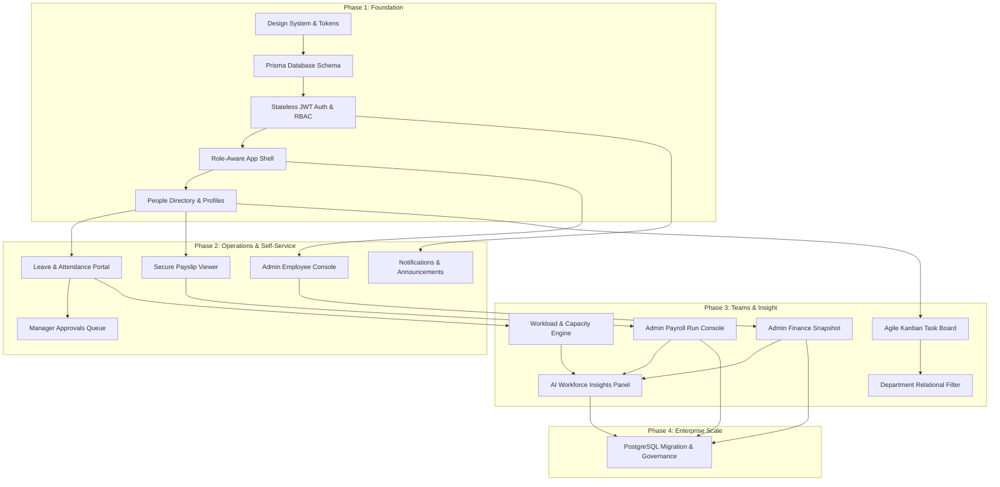

# Aura Workforce — Horizon Portal

> **Aura Workforce by Growmar** — Consolidated Master Repository (Phases 1–3 Complete)  
> **Repository:** [`https://github.com/madugushivakumar/horizon-portal`](https://github.com/madugushivakumar/horizon-portal)  
> **Student / Lead Full-Stack Architect:** Madugu Shiva Kumar  
> **Engineering Track:** Full Stack Development  
> **Release Tags:** `phase-1` (Commit: `c666991`) | `phase-2` (Commit: `ac72469`) | `phase-3` (Commit: `57ebcba`)  
> **Governing HEAD:** `725e47b0b036420bf544d108d886cc7bbcfae587`  
> **Release Classification:** **`NOT APPROVED FOR PRODUCTION`** *(Educational Internship Build)*

---

## 1. Project Overview

**Horizon Portal** is the centralized workforce management and operational intelligence platform for **Aura Workforce by Growmar**. Architected as an enterprise-grade full-stack web application on Next.js 16 (App Router), React 19, TypeScript, Tailwind CSS v4, and Prisma ORM 6, Horizon Portal provides a unified experience across human resources, payroll operations, financial oversight, sprint capacity management, and assistive AI workforce analytics.

---

## 2. Project Objectives

- **Unified Workforce Administration:** Provide a singular, cohesive portal connecting employee identity, organizational hierarchies, self-service portals, administrative management, and executive reporting.
- **Defensive Financial Integrity:** Eliminate floating-point calculation drift through zero-loss integer-paise conversions (`toPaise` / `fromPaise`) and enforce fail-closed reconciliation guards protecting against data inconsistencies.
- **High-Concurrency Interactive Workflows:** Deliver fluid, optimistic Kanban board task management backed by server-side Optimistic Concurrency Control (OCC) with automatic HTTP 409 conflict rollback.
- **Ethical & Privacy-Preserving AI:** Architect responsible AI dashboard patterns that serve strictly as assistive advisory signals, enforcing statistical small-cell suppression ($< 5$) to prevent employee re-identification.
- **Architectural Scalability:** Maintain strict separation of concerns across presentation components, route handlers, schema validation layers (Zod), and database abstraction models (Prisma).

---

## 3. Technology Stack

| Layer | Technology | Version | Purpose |
| :--- | :--- | :---: | :--- |
| **Framework** | Next.js (App Router) | 16.4.2 | Server Components, Route Handlers, Route Proxying |
| **UI Library** | React | 19.3.0 | Modern concurrent UI architecture |
| **Language** | TypeScript | 5.x (strict) | End-to-end type safety across contracts and models |
| **Styling** | Tailwind CSS & Tokens | 4.x | Semantic CSS design token mapping |
| **Database ORM** | Prisma ORM | 6.19.3 | Type-safe migrations, models, and query client |
| **Database Engine** | SQLite (`dev.db`) | 3 | Embedded relational database |
| **Drag & Drop** | `@dnd-kit/core` & `sortable` | 6.x / 10.x | Accessible Kanban drag-and-drop interactions |
| **Security & JWT** | `jose` & `bcryptjs` | 6.x / 3.x | Stateless HS256 JWT tokens & salted password hashing |
| **Validation** | Zod | 3.25.x | Runtime request body and query parameter validation |
| **Reporting Engine** | ReportLab & Python | 5.1 / 3.11+ | Automated audit report compilation & PDF generation |

---

## 4. Repository Folder Structure

The repository is structured to maintain all phases of the Aura Workforce lifecycle within a single consolidated GitHub repository:

```text
horizon-portal/
│
├── README.md                               # Master repository documentation (this file)
│
├── phase-1/                                # Phase 1: Foundation (Days 1–5)
│   ├── src/                                # Core design system, auth, directory & navigation
│   ├── prisma/schema.prisma                # Initial 23 models schema
│   ├── scripts/                            # Phase 1 test suites (test:auth, test:db, test:nav)
│   ├── FullStack_MaduguShivaKumar_Phase1_Report.pdf # Final Phase 1 audit report
│   └── README.md                           # Phase 1 architecture & verification guide
│
├── phase-2/                                # Phase 2: Operations & Self-Service (Days 6–10)
│   ├── src/                                # Leave portal, payslips, notifications, admin & approvals
│   ├── reports/                            # Visual evidence screenshots (Days 6–10)
│   ├── scripts/                            # Phase 2 test suites (test:leave, test:payslips, etc.)
│   ├── FullStack_MaduguShivaKumar_Phase2_Report.pdf # Final Phase 2 audit report
│   └── README.md                           # Phase 2 architecture & verification guide
│
├── phase-3/                                # Phase 3: Teams & Insight (Days 11–15 + Mini Challenge)
│   ├── src/                                # Payroll console, finance snapshot, Kanban board, capacity, AI
│   ├── reports/                            # Visual evidence screenshots (Days 11–15)
│   ├── scripts/                            # Phase 3 test suites (test:payroll, test:finance, etc.)
│   ├── FullStack_MaduguShivaKumar_Phase3_Report.pdf # Final Phase 3 audit report
│   └── README.md                           # Phase 3 architecture & verification guide
│
├── phase-4/                                # Phase 4: Enterprise Production Readiness (Placeholder)
│   └── README.md                           # Placeholder & planned enterprise scope
│
├── src/                                    # Active unified application source code
│   ├── app/                                # Next.js App Router (all pages & API routes)
│   ├── components/                         # Design system & feature UI components
│   ├── lib/                                # Utilities, auth, reconciliation engine, security
│   └── types/                              # Shared TypeScript interfaces & types
├── prisma/                                 # Active Prisma database models & migrations
├── reports/                                # Master visual evidence screenshot directory
├── scripts/                                # Master test runner & verification scripts
└── backups/                                # Cryptographic pre-consolidation backups
```

---

## 5. Phase 1 Overview: Foundation Architecture (Days 1–5)

Phase 1 established the design system, relational foundation, security model, and application layout:
- **Day 1:** Design system and CSS token engine mapping semantic variables from `design_tokens.json`.
- **Day 2:** Relational schema definition with 23 Prisma models and data seeding.
- **Day 3:** Stateless JWT authentication (`jose`), salted bcrypt password hashing, and role-based permissions for 4 personas (Admin, HR, Manager, Employee).
- **Day 4:** Role-aware responsive application shell with breadcrumb navigation and route protection.
- **Day 5:** Employee Profile (`/profile`) and People Directory (`/directory`) with search, department filtering, and 3-tier reporting hierarchy visualization.
- **Deliverable:** Verified by 7 automated test suites and documented in `FullStack_MaduguShivaKumar_Phase1_Report.pdf`.

---

## 6. Phase 2 Overview: Operations & Self-Service (Days 6–10)

Phase 2 expanded the portal into employee self-service and managerial oversight:
- **Day 6:** Employee Leave & Attendance Portal (`/leave`) with dynamic balance calculation and calendar view.
- **Day 7:** Secure Payslip Viewer (`/payslips`) with earnings/deductions breakdown and PDF download generator.
- **Day 8:** Real-time Notifications & Announcements (`/notifications`) with topbar bell unread counter.
- **Day 9:** Admin Employee Management Console (`/admin/employees`) with sorting, filtering, deactivation, and diff audit logging.
- **Day 10:** Multi-Tier Approvals Workflow (`/approvals`) for managers with rejection rationale requirements.
- **Deliverable:** Verified by 5 automated test suites and documented in `FullStack_MaduguShivaKumar_Phase2_Report.pdf`.

---

## 7. Phase 3 Overview: Teams & Insight (Days 11–15 + Mini Challenge)

Phase 3 delivered executive analytics, financial controls, and collaborative team tools:
- **Day 11:** Admin Payroll Run Console (`/payroll`) with 18 historical runs, payslip breakdown, MoM trend comparison, and fail-closed reconciliation engine.
- **Day 12:** Admin Finance Snapshot (`/finance`) with 743 invoices, 501 expenses, 4 ageing buckets (0–30, 31–60, 61–90, 90+ days), and CSV export.
- **Day 13:** Agile Team Task Board (`/task-board`) with `@dnd-kit` drag-and-drop, optimistic UI, and Optimistic Concurrency Control (OCC).
- **Day 14:** Workload & Capacity Management (`/capacity`) calculating available story points via $(Working\ Days - Leave\ Days) \times 5$, with $>100\%$ overload alerts.
- **Day 15:** AI Insights Panel for HR (`/hr-insights`) with 430 attrition evaluations, 405 anomaly cards ranked by money at risk, and statistical small-cell suppression ($< 5$).
- **Mini Challenge:** Cross-table relational Department Filter extension on the Agile Task Board.
- **Deliverable:** Verified by 7 automated test suites (479 passed assertions) and documented in `FullStack_MaduguShivaKumar_Phase3_Report.pdf`.

---

## 8. How All Phases Connect to Form One Unified Product



The modules operate symbiotically:
1. **Identity & Authorization (Phase 1)** provides the security backbone across all routes.
2. **Attendance & Leave Records (Phase 2)** feed directly into the **Capacity Engine (Phase 3)** to deduct non-working days from sprint availability.
3. **Employee Payslips (Phase 2)** aggregate into the **Payroll Run Console (Phase 3)** and trigger the **Reconciliation Engine**.
4. **Task Allocations (Phase 3)** map back to **Teams & Departments (Phase 1)** to populate the **Department Filter (Mini Challenge)**.
5. **Historical Ledger Data (Phase 2 & 3)** feeds the **AI Insights Engine (Phase 3)** to flag attrition risks and payroll anomalies with small-cell suppression.

---

## 9. Installation Instructions

### Prerequisites
- **Node.js:** Version 20.x or 22.x LTS (tested on Node.js 20 & 24)
- **npm:** Version 10.x or higher
- **Python:** Version 3.10+ (for report generation and test audit scripts)

### Setup Steps
```bash
# 1. Clone the repository
git clone https://github.com/madugushivakumar/horizon-portal.git
cd horizon-portal

# 2. Install dependencies
npm install

# 3. Setup environment configuration
cp .env.example .env
```

---

## 10. Environment Variable Setup

The application uses standard environment variables. Copy `.env.example` to `.env`:

```env
# Database connection string (local SQLite)
DATABASE_URL="file:./dev.db"

# JWT token signing secret (32+ bytes cryptographic string)
AUTH_SECRET="your-32-byte-cryptographic-secret-key-here"

# Application base URL
NEXT_PUBLIC_APP_URL="http://localhost:3000"
```

> [!CAUTION]
> Never commit `.env` files or expose `AUTH_SECRET` in public repositories. `.gitignore` is pre-configured to strictly ignore all `.env` variants except `.env.example`.

---

## 11. Database Setup Instructions

The application uses Prisma ORM with SQLite for development:

```bash
# 1. Generate Prisma Client
npx prisma generate

# 2. Apply migrations (if initializing fresh database)
npx prisma migrate dev

# 3. Seed demo users and baseline operational data
npm run db:seed
```

---

## 12. Development Commands

```bash
# Start Next.js development server (hot-reload enabled)
npm run dev

# Run TypeScript type-checking
npm run type-check

# Run ESLint validation
npm run lint
```
Open [http://localhost:3000](http://localhost:3000) to access Horizon Portal.

---

## 13. Testing Instructions

Run any of the comprehensive automated test suites:

```bash
# Phase 1 Test Suites
npm run test:auth          # Verify JWT auth, sessions & roles
npm run test:db            # Verify database schema & relationships
npm run test:nav           # Verify role-aware navigation guards

# Phase 2 Test Suites
npm run test:leave         # Verify leave balance & deductions
npm run test:payslips      # Verify payslip access & calculations
npm run test:employees     # Verify admin employee management & audit logs
npm run test:approvals     # Verify multi-tier manager approvals

# Phase 3 Test Suites
npm run test:payroll       # Verify payroll console, MoM trends & audit logs
npm run test:reconciliation # Verify paise precision & 6-run tie-out
npm run test:finance       # Verify invoices, expenses & 4 ageing buckets
npm run test:tasks-api     # Verify task board RBAC & OCC concurrency
npm run test:capacity-engine # Verify capacity formula & leave deduction
npm run test:hr-insights-api # Verify AI insights & small-cell suppression
npm run test:mini-challenge # Verify task board department filter extension
```

---

## 14. Build & Production Run Instructions

```bash
# Create optimized production build
npm run build

# Start production server
npm run start
```

---

## 15. Screenshots & Evidence References

High-resolution visual evidence is systematically archived across the repository:
- **Phase 2 Evidence:** `phase-2/reports/` (`day-6-evidence/` through `day-10-evidence/`)
- **Phase 3 Evidence:** `phase-3/reports/` (`day-11-evidence/` through `day-15-evidence/`)
- **Master Root Evidence:** `reports/`

### Formal PDF Audit Reports
- **Phase 1 Final Report:** [`FullStack_MaduguShivaKumar_Phase1_Report.pdf`](./FullStack_MaduguShivaKumar_Phase1_Report.pdf)
- **Phase 2 Final Report:** [`FullStack_MaduguShivaKumar_Phase2_Report.pdf`](./FullStack_MaduguShivaKumar_Phase2_Report.pdf)
- **Phase 3 Final Report:** [`FullStack_MaduguShivaKumar_Phase3_Report.pdf`](./FullStack_MaduguShivaKumar_Phase3_Report.pdf)

---

## 16. Phase 4 Placeholder: Enterprise Scale & Production Readiness

> **Status:** Pending Corporate Release & Gate 1 Authorization  
> **Target Timeline:** Post-Phase 3 Review  

### Planned Phase 4 Enterprise Scope
1. **Gate 1 Corporate Governance Ratification:** Formal sign-off on Board Delegation Charter and Executive Financial Policies A–E.
2. **Production Database Migration:** Rehearsal and execution of migration from local SQLite (`dev.db`) to AWS Aurora Serverless v2 PostgreSQL.
3. **Stage 4B Technical Remediation:** Maker-Checker null-preparer bypass hardening and dual-engine BigInt consolidation.
4. **Stage 5 Operational Readiness:** Blue-Green zero-downtime deployment, automated DR failover drill (< 4h RTO), real-time monitoring, and external penetration audit.

---

## 17. License & Compliance Notice

Copyright &copy; 2026 Growmar — Aura Workforce. All rights reserved.  
This software is developed for technical review and educational evaluation. It remains classified as **`NOT APPROVED FOR PRODUCTION`**.
