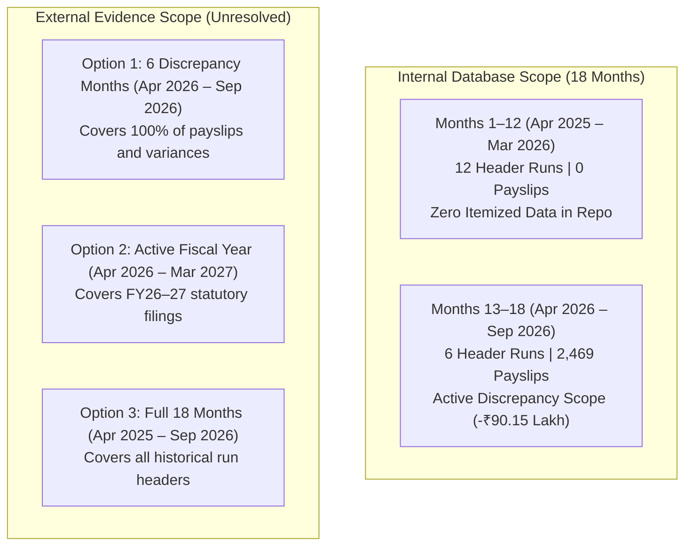

# DAY 11 — EVIDENCE REPORTING PERIOD CLARIFICATION
## Aura Workforce by Growmar — Horizon Portal
### Phase 3 — Teams and Insight | Day 11: Admin Payroll Run Console
### Forensic Investigation C | Analysis of 18-Month Payroll History vs. External Evidence Scope

---

## Document Metadata

| Attribute | Specification |
|---|---|
| **Document ID** | `DAY11-EVIDENCE-REPORTING-PERIOD-CLARIFICATION` |
| **Document Title** | Technical Clarification: Payroll History Coverage vs. Approved External Evidence Reporting Periods |
| **Project & Phase** | Aura Workforce by Growmar — Horizon Portal / Phase 3 — Day 11 |
| **Investigation Mode** | Read-Only Source Data Inspection & Evidence Governance Audit |
| **Analyzed Metrics** | 18 Payroll Runs, 2,469 Payslips, 18 Calendar Months, External Audit Scope |
| **Mandatory Finding** | **`18-MONTH EVIDENCE COVERAGE — NOT ESTABLISHED AS AN APPROVED REQUIREMENT. REPORTING PERIOD REQUIRES AUTHORIZED STAKEHOLDER CONFIRMATION.`** |
| **Gate 1 Status** | **`GATE 1: LOCKED — FINANCIAL EXECUTION NOT AUTHORIZED`** |
| **Stage 4B Status** | **`STAGE 4B: NOT AUTHORIZED`** |
| **Date of Execution** | November 8, 2026 |

---

## 1. Executive Summary

This investigation clarifies the critical distinction between the **internal payroll run history** stored in the Horizon Portal database and the **external evidence reporting period** required from corporate stakeholders to unlock Gate 1.

Previous intake documentation loosely conflated the fact that the repository contains 18 historical payroll runs with an assumed requirement that all external financial, banking, and tax evidence must span an 18-month window (April 2025 – September 2026).

Through an exhaustive audit of `prisma/dev.db`, `03_Data_Pack/`, and all Stage 3 governance policies, this investigation establishes:
1. **Internal Database Reality:** The database stores 18 payroll run headers covering 18 consecutive calendar months (April 2025 through September 2026). However, the first 12 runs (`PR-2025-04` through `PR-2026-03`) contain **zero itemized payslips**. Only the 6 runs from April 2026 to September 2026 (`PR-2026-04` through `PR-2026-09`) contain itemized payslips (2,469 payslips) and exhibit the documented discrepancies.
2. **External Evidence Mandate Status:** The repository contains **zero approved corporate policy** mandating that external GL trial balances, bank statements, or statutory challans must be collected for the 12 older runs where no itemized payslips exist.
3. **Mandatory Governance Determination:**
   > **`18-MONTH EVIDENCE COVERAGE — NOT ESTABLISHED AS AN APPROVED REQUIREMENT. REPORTING PERIOD REQUIRES AUTHORIZED STAKEHOLDER CONFIRMATION.`**

---

## 2. Core Quantitative Measurements Table

In compliance with Section 5 of the Master Prompt:

| Measurement Dimension | Actual Verified Result | Evidence Source & Verification Method |
|---|---|---|
| **Number of Payroll Runs** | **18 Runs** | `SELECT COUNT(*) FROM payroll_runs` in `prisma/dev.db` |
| **Number of Payslips** | **2,469 Payslips** | `SELECT COUNT(*) FROM payslips` in `prisma/dev.db` (encompasses only runs `PR-2026-04` to `PR-2026-09`) |
| **First Payroll Period** | **2025-04-01 to 2025-04-30** | Run `PR-2025-04` (`period_start: 1743465600`, `period_end: 1745971200`) |
| **Last Payroll Period** | **2026-09-01 to 2026-09-30** | Run `PR-2026-09` (`period_start: 1788220800`, `period_end: 1790726400`) |
| **Distinct Calendar Months** | **18 Distinct Calendar Months** | 18 consecutive months: Apr 2025, May 2025, Jun 2025, Jul 2025, Aug 2025, Sep 2025, Oct 2025, Nov 2025, Dec 2025, Jan 2026, Feb 2026, Mar 2026, Apr 2026, May 2026, Jun 2026, Jul 2026, Aug 2026, Sep 2026 |
| **Required External Evidence Period** | **`PROPOSED / UNRESOLVED`** | Requires authorized stakeholder confirmation; no corporate policy approves an 18-month evidence mandate. |

---

## 3. Segregation: Payroll-History Coverage vs. External Evidence Coverage

A rigorous technical boundary exists between internal system history and external audit requirements:

### Analysis of the Two Internal Epochs:
1. **Epoch 1: Historical Header-Only Archive (April 2025 – March 2026 / FY2025–26):**
   - 12 payroll runs (`PR-2025-04` through `PR-2026-03`).
   - Stored Gross Header Total: ₹53,54,01,181.06; Stored Net Header Total: ₹47,49,34,025.45.
   - **Zero payslips exist in the database or `03_Data_Pack/payslips.json`.**
   - Because no itemized payslips exist, there is no mathematical payslip discrepancy to reconcile.
2. **Epoch 2: Itemized Operational Runs (April 2026 – September 2026 / H1 FY2026–27):**
   - 6 payroll runs (`PR-2026-04` through `PR-2026-09`).
   - Stored Gross Header: ₹31,42,25,779.21; Itemized Gross: ₹30,38,31,344.39 (Gross Var: -₹1,03,94,434.82).
   - Stored Net Header: ₹27,60,84,281.24; Itemized Net: ₹26,70,69,563.37 (Net Var: -₹90,14,717.87).
   - Stored Employees: 2,547; Itemized Payslips: 2,469 (Headcount Var: -78).
   - **100% of all itemized payslips (2,469) and 100% of all documented discrepancies belong to this 6-month period.**

---

## 4. Required Reporting Periods by Evidence Pillar

| Evidence Pillar | Evidence IDs | Minimum Technical Scope | Proposed Maximum Scope | Governance Status | Responsible Stakeholder |
|---|---|---|---|---|---|
| **Pillar 1: General Ledger** | `EVID-GL-01..03` | 6 Discrepancy Months (Apr 2026 – Sep 2026) | Full 18 Months (Apr 2025 – Sep 2026) | `PROPOSED — APPROVAL PENDING` | Corporate Controller |
| **Pillar 2: Treasury & Banking** | `EVID-BNK-01..04` | 6 Discrepancy Months (Apr 2026 – Sep 2026) | Full 18 Months (Apr 2025 – Sep 2026) | `PROPOSED — APPROVAL PENDING` | Corporate Treasurer |
| **Pillar 3: Statutory & Tax** | `EVID-TAX-01..03` | FY2026–27 H1 (Apr 2026 – Sep 2026) | FY2025–26 & FY2026–27 H1 (6 Quarters) | `PROPOSED — APPROVAL PENDING` | Head of Tax Operations |
| **Pillar 4: HR & Headcount** | `EVID-HR-02` | Point-in-time status for Aug & Sep 2026 | Historical roster effective dates | `PROPOSED — APPROVAL PENDING` | VP of Human Resources |
| **Pillar 5: Corporate Governance** | `EVID-GOV-01, 02, 05` | Active Gate 1 Governance Package | Historical board resolutions | `PROPOSED — APPROVAL PENDING` | Governance Committee & CFO |

---

## 5. Stakeholder Determination Mandate

Corporate leadership must formally define the binding external evidence reporting period:
1. **Controller & Treasurer Action:** Determine whether external banking and GL proof is strictly required for the 6 discrepancy runs (`PR-2026-04` to `PR-2026-09`) where itemized payslips exist, or for all 18 historical run headers.
2. **Tax Head Action:** Determine whether statutory tax challans (Form 24Q, EPFO TRRN, ESIC CPIN) must be audited for FY25–26 or restricted to the active FY26–27 period.
3. Until these decisions are ratified, the technical team must not enforce an unapproved 18-month evidence mandate as a rigid blocker for runs that have no payslip records.

---

## 6. Security & Gate 1 Invariant

- **Gate 1 Status:** **`GATE 1: LOCKED — FINANCIAL EXECUTION NOT AUTHORIZED`**.
- **Stage 4B Status:** **`STAGE 4B: NOT AUTHORIZED`**.
- **Database Status:** `prisma/dev.db` hash verified identical.

