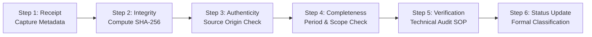

# DAY 11 — EXTERNAL EVIDENCE INTAKE REGISTER
## Aura Workforce by Growmar — Horizon Portal
### Phase 3 — Teams and Insight | Day 11: Admin Payroll Run Console
### Post Gate 1 Quality Control | Fourteen-Artifact Formal Intake & Custody Register

---

## Document Metadata

| Attribute | Specification |
|---|---|
| **Document ID** | `DAY11-EXTERNAL-EVIDENCE-INTAKE-REGISTER` |
| **Document Title** | Controlled External Evidence Intake, Chain of Custody & Cryptographic Register |
| **Project & Phase** | Aura Workforce by Growmar — Horizon Portal / Phase 3 — Day 11 |
| **Governing Baseline** | Policy E (`DAY11-STAGE3-POLICY-E-*`), Verification Procedures (`DAY11-EXTERNAL-EVIDENCE-VERIFICATION-PROCEDURES.md`) |
| **Execution Mode** | Controlled Evidence Ingestion & Custody Tracking (Strictly Read-Only Documentation) |
| **Target Artifacts** | **14 External Evidence Artifacts** (`EVID-GL-01` through `EVID-GOV-05`) |
| **Intake Rule** | Record genuine supplied files only; calculate SHA-256 upon receipt; preserve original immutability. |
| **Current Intake State** | **NO NEW STAKEHOLDER RESPONSES OR EXTERNAL EVIDENCE WERE PROVIDED FOR VERIFICATION DURING THIS EXECUTION.** |
| **Active Status** | **14 of 14 Artifacts: `NOT_PROVIDED`** |
| **Gate 1 Status** | **`GATE 1: LOCKED — FINANCIAL EXECUTION NOT AUTHORIZED`** |
| **Stage 4B Status** | **`STAGE 4B: NOT AUTHORIZED`** |
| **Date of Execution** | November 8, 2026 |

---

## 1. Six-Step Evidence Intake Standard Operating Procedure

All incoming external financial, banking, statutory, HR, and governance documents must undergo the following six-step chain of custody and intake protocol before any status promotion:



### Step 1 — Receipt & Metadata Registration
Capture the exact metadata upon physical or digital deposit:
- Unique Evidence ID (`EVID-GL-01` to `EVID-GOV-05`).
- Original filename (as transmitted by the issuing source).
- Actual repository storage path (under designated `04_Evidence_Intake/<Category>/`).
- File format and MIME type.
- Exact file size in bytes.
- Precise date and timestamp of receipt.
- Submitting stakeholder role and verified individual.
- Source organization / issuing system.
- Relevant accounting / statutory period.
- Related decision ID and Gate 1 prerequisite ID.
*If no actual file is supplied, its status remains strictly unchanged (`NOT_PROVIDED`).*

### Step 2 — Integrity & Cryptographic Preservation
Preserve the immutable chain of custody:
- Compute SHA-256 checksum immediately upon deposit.
- Mark the original file as read-only on disk.
- Never modify, overwrite, sanitize, or re-encode the original raw evidence file.
- Generate an isolated working copy for technical inspection where required.

### Step 3 — Authenticity Verification
Independently verify document origin:
- Verify official ERP export metadata and system run headers.
- Verify bank-issued digital statements, institutional headers, and branch routing codes.
- Verify government portal transaction IDs, challan identification numbers, or digital signatures.
- Validate authorized corporate executive signatures against board-approved specimen signatures.
- If authenticity cannot be independently substantiated, classify as `AUTHENTICITY NOT INDEPENDENTLY VERIFIED`. Never assume authenticity based on visual formatting alone.

### Step 4 — Completeness & Boundary Audit
Audit structural and mathematical completeness:
- Verify that the document encompasses the exact required period (e.g., April 2025 – September 2026).
- Verify coverage of all 2,469 payslips and all 18 payroll runs.
- Check for missing pages, truncated ledger runs, omitted annexures, or missing schedules.
- Audit for duplicate entries, missing journal vouchers, or unexplained omissions.

### Step 5 — Technical Verification
Execute the specific audit procedure defined in [`DAY11-EXTERNAL-EVIDENCE-VERIFICATION-PROCEDURES.md`](file:///c:/Users/Madugu%20Shiva%20Kumar/OneDrive/图片/Desktop/horizon-portal/docs/DAY11-EXTERNAL-EVIDENCE-VERIFICATION-PROCEDURES.md):
- Perform double-entry arithmetic tie-outs ($\sum \text{Debits} == \sum \text{Credits}$).
- Cross-reconcile itemized payroll totals against bank debits and statutory challans.
- Record expected vs. actual values, variances, reviewer identity, timestamp, and formal findings.

### Step 6 — Controlled Status Classification
Update the evidence lifecycle state using only the permitted classifications:
- `NOT_PROVIDED`: Baseline state. Artifact has not been supplied to the repository.
- `RECEIVED — VERIFICATION PENDING`: Physical artifact deposited into `04_Evidence_Intake/`; technical audit pending.
- `AUTHENTICITY NOT INDEPENDENTLY VERIFIED`: Artifact received, but issuing origin cannot be independently verified.
- `VERIFICATION IN PROGRESS`: Technical reconciliation and mathematical tie-out actively underway.
- `VERIFIED`: Artifact meets all acceptance criteria, reconciles completely, and holds verified corporate authority.
- `REJECTED`: Artifact fails mathematical tie-out, date boundaries, or authenticity checks.
- `INCOMPLETE — CLARIFICATION REQUIRED`: Substantive data missing, truncated, or inconsistent.

---

## 2. Master External Evidence Intake Register (14 Artifacts)

```
========================================================================================================================
                                 FOURTEEN-ARTIFACT EXTERNAL EVIDENCE INTAKE REGISTER
========================================================================================================================
```

| Evidence ID | Required Artifact Description | Target Storage Path | Submitting Stakeholder | Issuing Source Organization | Date Received | File Size & Format | SHA-256 Checksum | Authenticity Assessment | Completeness Audit | Verification Status | Current Lifecycle Status | Active Blockers / Outstanding Actions |
|---|---|---|---|---|---|---|---|---|---|---|---|---|
| **EVID-GL-01** | Official Corporate ERP Chart of Accounts | `04_Evidence_Intake/GL/erp_chart_of_accounts.json` | Corporate Controller (`FIN-CTRL`) | Enterprise Financial System (SAP/Oracle) | *Not Received* | *None* | *None (Pending Receipt)* | *Not Assessed* | *Not Assessed* | *Not Executed* | `NOT_PROVIDED` | Awaiting Controller export of formal active account code hierarchy. |
| **EVID-GL-02** | Historical ERP GL Trial Balances & Journal Vouchers | `04_Evidence_Intake/GL/historical_trial_balances_FY25_26.pdf` | Corporate Controller (`FIN-CTRL`) | Corporate General Accounting | *Not Received* | *None* | *None (Pending Receipt)* | *Not Assessed* | *Not Assessed* | *Not Executed* | `NOT_PROVIDED` | Awaiting certified monthly trial balances and journal vouchers for Apr 2025 – Sep 2026. |
| **EVID-GL-03** | Wage Expense Postings (`GL-6100` Payroll Expense Journals) | `04_Evidence_Intake/GL/gl_6100_wage_expense_postings.xlsx` | Corporate Controller (`FIN-CTRL`) | Corporate General Accounting | *Not Received* | *None* | *None (Pending Receipt)* | *Not Assessed* | *Not Assessed* | *Not Executed* | `NOT_PROVIDED` | Awaiting line-item journal vouchers for 6 historical discrepancy runs. |
| **EVID-BNK-01** | Commercial Bank Account Statements (Consolidated Debits) | `04_Evidence_Intake/Banking/commercial_bank_statements_FY25_26.pdf` | Corporate Treasurer (`TREAS-CORP`) | Primary Commercial Bank | *Not Received* | *None* | *None (Pending Receipt)* | *Not Assessed* | *Not Assessed* | *Not Executed* | `NOT_PROVIDED` | Awaiting bank-issued statements showing debit entries matching net payroll disbursements. |
| **EVID-BNK-02** | Beneficiary Credit UTR Clearing Numbers | `04_Evidence_Intake/Banking/beneficiary_utr_clearing_manifests.csv` | Corporate Treasurer (`TREAS-CORP`) | Commercial Banking Clearing Operations | *Not Received* | *None* | *None (Pending Receipt)* | *Not Assessed* | *Not Assessed* | *Not Executed* | `NOT_PROVIDED` | Awaiting NEFT/RTGS/IMPS transaction clearing logs for all 2,469 payslips. |
| **EVID-BNK-03** | Treasury Returned / Bounced Payment Exception Logs | `04_Evidence_Intake/Banking/treasury_returned_payment_logs.csv` | Corporate Treasurer (`TREAS-CORP`) | Corporate Cash Management / Treasury | *Not Received* | *None* | *None (Pending Receipt)* | *Not Assessed* | *Not Assessed* | *Not Executed* | `NOT_PROVIDED` | Awaiting register of payment failures, invalid account numbers, and reversal credits. |
| **EVID-BNK-04** | Corporate Treasurer Banking Model Formal Sign-Off | `04_Evidence_Intake/Banking/treasurer_banking_model_signoff.pdf` | Corporate Treasurer (`TREAS-CORP`) | Office of Corporate Treasurer | *Not Received* | *None* | *None (Pending Receipt)* | *Not Assessed* | *Not Assessed* | *Not Executed* | `NOT_PROVIDED` | Awaiting Treasurer formal determination adopting the hybrid banking evidence model. |
| **EVID-TAX-01** | EPFO Electronic Challan cum Return (ECR) & TRRN Receipts | `04_Evidence_Intake/Tax/epfo_ecr_trrn_receipts.pdf` | Head of Tax Operations (`TAX-HEAD`) | Employees' Provident Fund Organisation | *Not Received* | *None* | *None (Pending Receipt)* | *Not Assessed* | *Not Assessed* | *Not Executed* | `NOT_PROVIDED` | Awaiting official TRRN challans confirming remittance of PF deductions. |
| **EVID-TAX-02** | ESIC Monthly Contribution Challans & CPIN | `04_Evidence_Intake/Tax/esic_monthly_challans_cpin.pdf` | Head of Tax Operations (`TAX-HEAD`) | Employees' State Insurance Corporation | *Not Received* | *None* | *None (Pending Receipt)* | *Not Assessed* | *Not Assessed* | *Not Executed* | `NOT_PROVIDED` | Awaiting official CPIN receipts confirming remittance of ESIC contributions. |
| **EVID-TAX-03** | Income Tax TDS Form 24Q Quarterly Returns & ITNS 281 Challans | `04_Evidence_Intake/Tax/tds_form24q_itns281_challans.pdf` | Head of Tax Operations (`TAX-HEAD`) | Income Tax Dept / Protean TRACES | *Not Received* | *None* | *None (Pending Receipt)* | *Not Assessed* | *Not Assessed* | *Not Executed* | `NOT_PROVIDED` | Awaiting quarterly Form 24Q provisional receipts and ITNS 281 challans with BSR/CIN codes. |
| **EVID-HR-02** | Formal VP HR Designation of Authoritative Status Source | `04_Evidence_Intake/HR/hr_authoritative_status_source_directive.pdf` | VP of Human Resources (`HR-VPHR`) | Corporate HR Leadership Office | *Not Received* | *None* | *None (Pending Receipt)* | *Not Assessed* | *Not Assessed* | *Not Executed* | `NOT_PROVIDED` | Awaiting written directive designating authoritative HRMS master and termination cutoffs. |
| **EVID-GOV-01** | Corporate Policy Voting Artifacts (Policies A through E) | `04_Evidence_Intake/Governance/corporate_policy_ratification_records.pdf` | Corporate Governance Committee / CFO | Corporate Governance Committee | *Not Received* | *None* | *None (Pending Receipt)* | *Not Assessed* | *Not Assessed* | *Not Executed* | `NOT_PROVIDED` | Awaiting signed voting determination records (Template 1) for Policies A through E. |
| **EVID-GOV-02** | Signed Joint Monetary Threshold Determination Paper (`DEC-C-02`) | `04_Evidence_Intake/Governance/dec_c02_monetary_threshold_determination.pdf` | Controller & CFO (`FIN-CTRL` / `EXEC-CFO`) | Joint Financial Leadership | *Not Received* | *None* | *None (Pending Receipt)* | *Not Assessed* | *Not Assessed* | *Not Executed* | `NOT_PROVIDED` | Awaiting joint written decision resolving threshold basis and amount (₹5,00,000 illustrative). |
| **EVID-GOV-05** | Independent Audit Committee Concurrence Letter (`COND-16`) | `04_Evidence_Intake/Governance/audit_committee_concurrence_letter.pdf` | Audit Committee Chair (`AUD-COMM-CHAIR`) | Board Audit Committee | *Not Received* | *None* | *None (Pending Receipt)* | *Not Assessed* | *Not Assessed* | *Not Executed* | `NOT_PROVIDED` | Awaiting Audit Committee convening and execution of formal concurrence letter. |

---

## 3. Physical Directory & Intake Status Finding

```
===========================================================================================
NO NEW STAKEHOLDER RESPONSES OR EXTERNAL EVIDENCE WERE PROVIDED FOR VERIFICATION
DURING THIS EXECUTION.
===========================================================================================
```

An inspection of the workspace confirms that the target intake directory structure (`04_Evidence_Intake/`) has not been populated with any external artifacts. All 14 artifacts remain strictly `NOT_PROVIDED`. Zero evidence files have been received, verified, or promoted.

---

## 4. Governance Gate 1 & Stage 4B Invariant

- Gate 1 Status: **`GATE 1: LOCKED — FINANCIAL EXECUTION NOT AUTHORIZED`**.
- Stage 4B Status: **`STAGE 4B: NOT AUTHORIZED`**.
- Database State: SHA-256 `B88E178B1B341FB44D7B676DC9F320FFF4079120AE63770D33ABD32E3F9EB4EA` (100% Intact).
- Financial Tables: Zero rows modified, zero adjustments created.

