# DAY 11 — GATE 1: FORMAL UNLOCKING PROTOCOL
## Aura Workforce by Growmar — Horizon Portal
### Phase 3 — Teams and Insight | Day 11: Admin Payroll Run Console
### Gate 1 Governance Approval and Readiness Phase

---

## Document Metadata

| Attribute | Specification |
|---|---|
| **Document ID** | `DAY11-GATE1-FORMAL-UNLOCKING-PROTOCOL` |
| **Document Title** | Strict Evidence-Based Unlocking Protocol, Governance State Machine & Transition Rules |
| **Project & Phase** | Aura Workforce by Growmar — Horizon Portal / Phase 3 — Day 11 |
| **Governing Baseline** | Stage 3 Gate 1 Lock Register (`docs/DAY11-STAGE3-GATE-1-READINESS-AND-LOCK-REGISTER.md`) |
| **Execution Mode** | Protocol Specification & Transition Governance (Strictly Read-Only) |
| **Current Gate 1 State** | **`LOCKED`** |
| **Authorized Unlocking Authority** | Joint Sign-Off: CFO, Controller, VP HR, Head of Audit (PROPOSED QUORUM REQUIREMENT — FORMAL CORPORATE AUTHORITY NOT YET VERIFIED) |
| **Financial Execution Status** | **`NOT AUTHORIZED`** |
| **Stage 4B Status** | **`STAGE 4B: NOT AUTHORIZED`** |
| **Date of Execution** | November 7, 2026 |

---

## 1. Executive Summary & Unlocking Invariants

Governance Gate 1 represents the legal, regulatory, and corporate control boundary separating **Read-Only Technical Assessment and Software Design (Stages 1–4A)** from **Authorized Implementation and Financial Execution (Stage 4B+)**.

### Inviolable Governance Principles:
1. **Zero Automated Unlocking:** Under no circumstances can an automated CI/CD pipeline, AI assistant, or engineering lead unlock Gate 1.
2. **Recommendation $\ne$ Authorization:** A technical determination that "all documents are complete" is merely a recommendation; it does **NOT** unlock Gate 1.
3. **Evidence Precedes Code:** Software implementation (Stage 4B) cannot begin until all mandatory corporate decisions are formally signed and verified.
4. **Current Status Retained:**
   $$\mathbf{GATE\ 1\ LOCKED\ —\ FINANCIAL\ EXECUTION\ NOT\ AUTHORIZED.}$$

---

## 2. Gate 1 Governance State Machine

To monitor the transition from locked assessment to authorized software build, the governance framework defines a seven-state tracking model:

```mermaid
stateDiagram-v2
    [*] --> LOCKED: Initial State
    LOCKED --> READINESS_REVIEW_IN_PROGRESS: Stage 4A Documentation Concluded
    READINESS_REVIEW_IN_PROGRESS --> EVIDENCE_PENDING: External Evidence Gaps Identified
    EVIDENCE_PENDING --> STAKEHOLDER_APPROVAL_PENDING: Evidence Received; Convening Stakeholders
    STAKEHOLDER_APPROVAL_PENDING --> READY_FOR_FORMAL_GATE_REVIEW: 18 Decisions Signed; 14 Blockers Cleared
    READY_FOR_FORMAL_GATE_REVIEW --> APPROVED_FOR_UNLOCKING: Executive Signatures Delivered
    APPROVED_FOR_UNLOCKING --> UNLOCKED: Formal Gate 1 Unlocking Token Verified
    UNLOCKED --> LOCKED: Emergency Revocation / Integrity Violation
    UNLOCKED --> [*]: Authorizes Stage 4B Build
```



### Detailed State Definitions:

| Governance State | Description & Operational Meaning | Permitted Technical Actions |
|---|---|---|
| **`LOCKED`** | Default state. Gate 1 is locked. Zero code changes, zero migrations, zero financial execution permitted. | Strictly read-only queries, code audits, documentation drafting. |
| **`READINESS_REVIEW_IN_PROGRESS`** | Stage 4A technical assessments are complete; internal audit is evaluating documentation consistency. | Cross-document consistency verification, baseline hashing. |
| **`EVIDENCE_PENDING`** | Technical designs are ready, but external financial documents (GL COA, bank statements, tax challans) are missing. | Cataloging evidence gaps, issuing formal evidence requests. |
| **`STAKEHOLDER_APPROVAL_PENDING`**| Evidence received; executive voting sessions are actively convening for Policies A through E. | Tracking voting ballots, verifying quorum compliance. |
| **`READY_FOR_FORMAL_GATE_REVIEW`**| All 18 decisions voted; all 14 blocking prerequisites verified closed; final executive pack submitted. | Independent Audit Committee final compliance audit. |
| **`APPROVED_FOR_UNLOCKING`** | Joint sign-off executed by designated officers (PROPOSED QUORUM REQUIREMENT — FORMAL CORPORATE AUTHORITY NOT YET VERIFIED); tokens delivered. | Verification of cryptographic token signatures. |
| **`UNLOCKED`** | Gate 1 is officially open. Stage 4B implementation authorized. | Additive schema migrations, adjustment services, API builds. |

---

## 3. Twelve Mandatory Gate 1 Unlocking Conditions

Gate 1 can transition from `APPROVED_FOR_UNLOCKING` to `UNLOCKED` **ONLY** when all twelve conditions below are simultaneously and verifiably satisfied:

1. **Condition 1 (Master Decisions Ratified):** All eighteen Master Decisions (`DEC-A-01` through `DEC-E-05`) have genuine, signed corporate determination records.
2. **Condition 2 (Policies Adopted):** Corporate leadership has executed unanimous policy ratification records for Policies A, B, C, D, and E.
3. **Condition 3 (Maker-Checker Remediation Authorized):** The `CRITICAL CONTROL GAP` regarding null `preparerId` bypass has an approved fail-closed remediation plan with designated security test suites.
4. **Condition 4 (Monetary Threshold Formally Decided):** Decision `DEC-C-02` is formally decided by the Controller and CFO, with a selected measurement basis and ratified monetary threshold amount.
5. **Condition 5 (Official Chart of Accounts Verified):** The Corporate Controller has supplied an official, certified corporate ERP Chart of Accounts extract (`DEC-E-04`).
6. **Condition 6 (Treasury Methodology Ratified):** The Corporate Treasurer has formally reviewed and signed off on the hybrid banking settlement model (`DEC-E-05`).
7. **Condition 7 (Statutory Evidence Standards Validated):** The Head of Tax Operations has formally validated statutory compliance receipt requirements (EPFO, ESIC, Form 24Q).
8. **Condition 8 (20 Prerequisites Cleared):** All twenty conditions in the Gate 1 Prerequisite Register have met their documented closure criteria.
9. **Condition 9 (Zero Baseline Drift):** Post-assessment verification proves that `prisma/dev.db` hash matches the pre-investigation baseline (`B88E178B1B...`) and zero financial adjustments exist.
10. **Condition 10 (Independent Audit Review Letter):** The Independent Audit Committee has formally delivered a signed concurrence letter (`COND-16`).
11. **Condition 11 (Stakeholder Confirmation):** Executive leadership has formally appointed named corporate individuals to all nine governance role codes (`COND-09`).
12. **Condition 12 (Formal Unlocking Authorization Delivered):** A signed copy of the Executive Governance Gate 1 Unlocking Authorization (Template 16 from the Stakeholder Pack / Template Register) is physically delivered to the Lead Systems Architect. *(A completed template is NOT equivalent to authorization; only genuine execution by authorized corporate officers under an established corporate quorum [PROPOSED QUORUM REQUIREMENT — FORMAL CORPORATE AUTHORITY NOT YET VERIFIED], substantiated by verified evidence and satisfied conditions, authorizes progression).*

---

## 4. Step-by-Step Gate 1 Unlocking Sequence

```
+---------------------------------------------------------------------------------------------------+
|                                 GATE 1 UNLOCKING EXECUTION SEQUENCE                               |
+---------------------------------------------------------------------------------------------------+
|  Step 1: Stakeholder Review Sessions    CFO, Controller, VP HR, Audit convene on Policies A–E.    |
|  Step 2: Formal Voting Execution        Ballots recorded for Decisions DEC-A-01 through DEC-E-05. |
|  Step 3: External Evidence Ingestion    Controller supplies COA; Treasury supplies statements.   |
|  Step 4: Prerequisite Register Audit   Prerequisite Register updated; 14 blockers verified closed.|
|  Step 5: Audit Committee Sign-Off       Independent Audit Committee issues formal sign-off letter.|
|  Step 6: Executive Token Execution      CFO, Controller, VP HR, and Audit sign Unlocking Warrant. |
|  Step 7: Token Cryptographic Sealing    Lead Architect verifies digital signatures and hashes.    |
|  Step 8: State Transition to UNLOCKED   Gate 1 officially transitioned to UNLOCKED in git history.|
|  Step 9: Phase 4B-1 Kickoff             Engineering authorized to begin core calculation engine.  |
+---------------------------------------------------------------------------------------------------+
```

---

## 5. Emergency Re-Locking & Revocation Protocols

If, subsequent to Gate 1 unlocking, any of the following integrity violations occur during Stage 4B development, Gate 1 shall be **IMMEDIATELY RE-LOCKED**:
1. Execution of destructive database commands (`prisma migrate reset` or `db push --force-reset`).
2. Detection of SQL mutations on historical payroll headers or payslips.
3. Failure of the continuous baseline integrity hash check on raw data pack files.
4. Attempted deployment of an approval endpoint without maker-checker enforcement.
5. Discovery of unauthorized modifications to audit log records.

Upon triggering an emergency re-lock, all development halts, the database is restored from pre-migration backup snapshots, and a full incident report is submitted to the Audit Committee.

---

## 6. Current State Declaration & Gate 1 Guard

- **Current Protocol State:** `LOCKED` (State 1 of 7).
- **Readiness State:** `EVIDENCE_PENDING` and `STAKEHOLDER_APPROVAL_PENDING`.
- **Determination:** Gate 1 cannot unlock until all twelve mandatory unlocking conditions are satisfied by genuine corporate evidence.
- **Gate 1 Status:** `GATE 1 LOCKED — FINANCIAL EXECUTION NOT AUTHORIZED.`

---

*End of Day 11 Gate 1 Formal Unlocking Protocol.*

