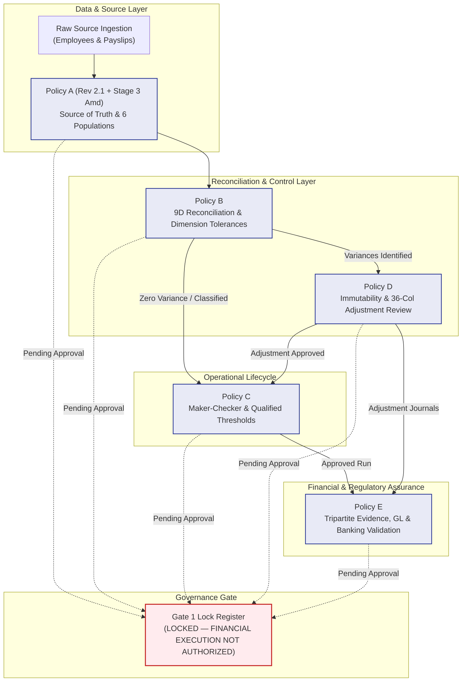

# DAY 11 — STAGE 3: GOVERNANCE CONTROL MATRIX (AMENDED)
## Aura Workforce by Growmar — Horizon Portal
### Phase 3 — Teams and Insight | Day 11: Admin Payroll Run Console
### Stage 3 of 6: Formal Payroll Governance Package

---

## Document Metadata

| Attribute | Specification |
|---|---|
| **Document ID** | `DAY11-STAGE3-GOVERNANCE-CONTROL-MATRIX` |
| **Document Title** | Enterprise Payroll Governance Control Matrix & Cross-Policy Coherence Architecture |
| **Governing Baseline** | Stage 1 Revision 2.1 (`DAY11-POLICY-A-SOURCE-OF-TRUTH-DECISION.md`) & Stage 2 Forensic Report (`DAY11-STAGE2-ROOT-CAUSE-FORENSIC-REPORT.md`) |
| **Supporting Artifacts** | [`docs/DAY11-STAGE3-CROSS-POLICY-CONTRADICTION-AND-CONSISTENCY-AUDIT.md`](file:///c:/Users/Madugu%20Shiva%20Kumar/OneDrive/图片/Desktop/horizon-portal/docs/DAY11-STAGE3-CROSS-POLICY-CONTRADICTION-AND-CONSISTENCY-AUDIT.md)<br>[`docs/DAY11-STAGE3-POLICY-D-ADJUSTMENT-SCHEMA-REVIEW.md`](file:///c:/Users/Madugu%20Shiva%20Kumar/OneDrive/图片/Desktop/horizon-portal/docs/DAY11-STAGE3-POLICY-D-ADJUSTMENT-SCHEMA-REVIEW.md)<br>[`docs/DAY11-STAGE3-POLICY-E-EXTERNAL-MAPPING-VALIDATION.md`](file:///c:/Users/Madugu%20Shiva%20Kumar/OneDrive/图片/Desktop/horizon-portal/docs/DAY11-STAGE3-POLICY-E-EXTERNAL-MAPPING-VALIDATION.md) |
| **Policies Evaluated** | Policy A (Rev 2.1/Stage 3 Amd), Policy B, Policy C, Policy D, Policy E |
| **Status** | `PROPOSED — APPROVAL PENDING` |
| **Governance Gate** | Gate 1 Locked (`GATE 1: LOCKED — FINANCIAL EXECUTION NOT AUTHORIZED`) |
| **Target Audience** | Enterprise Governance Committee, CFO, Internal Audit, Compliance, Engineering Leads |

---

## 1. Executive Control Framework

The Aura Workforce Payroll Governance Architecture comprises five interlocking, mutually supportive enterprise policies:
- **Policy A (Rev 2.1 + Stage 3 Amd):** Source-of-Truth Hierarchy, 6 Population Definitions & Baseline Authority.
- **Policy B:** 9-Dimensional Reconciliation, Dimension-Specific Tolerances & 9 Variance Classifications.
- **Policy C:** Dual-Tier Maker-Checker Approval, Segregation of Duties & Qualified Threshold Framework.
- **Policy D:** Historical Data Preservation, Append-Only Adjustment Accounting & 36-Column Schema Design.
- **Policy E:** Tripartite Audit Evidence, Classified GL Accounts & Hybrid Banking Settlement Standards.

This Control Matrix maps the interactions, dependencies, enforcement tiers, and cross-policy coherence across eleven operational control dimensions.

---

## 2. Comprehensive 11 x 5 Governance Control Matrix

The matrix below defines the explicit governing mandate of each policy across the eleven core payroll control dimensions:

| # | Operational Control Area | Policy A (Source Authority) | Policy B (Reconciliation & Variance) | Policy C (Approval & Maker-Checker) | Policy D (Preservation & Adjustments) | Policy E (Audit & Settlement Evidence) |
|---|---|---|---|---|---|---|
| **1** | **Source Authority & Data Hierarchy** | **Primary Owner.** Defines itemized payslips as authoritative for gross/deductions/net; establishes 6 population definitions; mandates approved employee-status source with effective dates for headcount; notes data gaps. | Consumes Policy A hierarchy as mathematical baseline; compares observed payslips against approved roster headcount. | Governs authorization required when source inputs are ingested or modified. | Mandates raw source data preservation; prohibits in-place overwriting of initial data packs. | Verifies cryptographic provenance and input integrity snapshots of raw source data. |
| **2** | **Reconciliation & Balancing** | Establishes the rule that run headers must mathematically equal the sum of itemized payslips. | **Primary Owner.** Mandates 9-dimensional balancing (Dims A..I) with BigInt arbitrary-precision integer paise arithmetic; 0-paise tolerance for internal math (A/B/C). | Restricts progression from `RECONCILING` to `PENDING_APPROVAL` until automated reconciliation passes. | Balances adjustment records back to the original baseline through double-entry accounting. | Reconciles application ledger balances against external General Ledger (GL) trial balances when supplied. |
| **3** | **Variance Detection & Classification** | Identifies that variances exist between stored headers and itemized payslips in 6 historical runs. | **Primary Owner.** Standardizes 9 variance classifications (`MATCH`, `MISMATCH`, `ROUNDING_VARIANCE`, `TIMING_VARIANCE`, etc.) and signed formula. | Hard blocks maker-checker approval if unclassified or unadjusted `MISMATCH` variances exist. | Tracks `variance_gross_paise`, `variance_deductions_paise`, etc., within `payroll_adjustments`. | Mandates forensic variance reporting and root-cause evidence before variance write-offs. |
| **4** | **Payroll Preparation & Calculation** | Defines calculation inputs (contracts, leave, formula versions) and employee roster eligibility. | Validates calculation outputs against statutory deduction formulas (EPF 12%, ESI 0.75%, etc.). | **Primary Owner.** Defines the Maker role (`PAYROLL_PREPARER`); enforces preparation step validation. | Captures calculation adjustments as revision records rather than modifying draft calculations. | Archives calculation engine configuration, tax tables, and batch run execution logs. |
| **5** | **Maker-Checker Approval** | Enforces that source-of-truth determination cannot be unilaterally made by the preparer. | Provides reconciliation verification artifacts required before the Checker may approve. | **Primary Owner.** Strictly enforces $\text{preparer\_id} \ne \text{approved\_by\_id}$; qualifies ₹5,00,000 threshold as illustrative with basis undecided. | Mandates independent Checker approval for every adjustment before financial ledger posting. | Requires cryptographic signature, MFA token, timestamp, and audit logging of approval events. |
| **6** | **Historical Data Preservation** | Classifies historical data pack files as immutable evidentiary baselines. | Forbids clearing historical variances by retroactively updating historical header records. | Prohibits retrospective re-approval or de-authorization of closed historical periods. | **Primary Owner.** Mandates zero in-place SQL `UPDATE`/`DELETE`; enforces append-only delta ledger. | Archives historical database snapshots and generates periodic tamper-evident hash digests. |
| **7** | **Financial Adjustments & True-Ups** | Distinguishes between historical baseline errors and current-period operational adjustments. | Defines adjustment variance calculation rules: $\Delta = \text{Adjusted} - \text{Original}$. | Requires maker-checker dual authorization for all financial adjustments. | **Primary Owner.** Manages proposed 36-column `payroll_adjustments` schema; establishes BigInt paise as calculation authority; float as read-only. | Links adjustment records to GL journal entries and verifies double-entry balance equality. |
| **8** | **Audit Trail & Event Logging** | Mandates field-level attribution for source data overrides. | Mandates logging of every automated reconciliation execution and variance detection event. | Enforces audit logging for every lifecycle transition (`INITIATED`, `RECONCILED`, `APPROVED`). | Binds every adjustment to `audit_logs(id)` and `audit_event_id`. | **Primary Owner.** Evaluates and remediates `audit_logs` schema, requiring tamper-evident chaining. |
| **9** | **General Ledger Accounting Evidence** | Distinguishes internal itemized totals from external general ledger account postings. | Verifies that payslip net equals Net Salaries Payable credit in the GL. | Mandates Controller approval before posting journal entries to the corporate ERP. | Ensures adjustment records map directly to debit/credit prior-period adjustment accounts. | **Primary Owner.** Classifies proposed GL codes (`GL-6100` etc.) as `PROPOSED_EXAMPLE_ONLY`; requires Controller chart of accounts. |
| **10** | **Banking & Settlement Evidence** | Distinguishes internal `'PAID'` operational status flags from external bank debit confirmation. | Verifies total bank debits equal total approved net pay; flags returned/held salaries. | Restricts disbursement authorization to Corporate Treasury roles. | Mandates adjustments for bank fees, payment failures, or currency conversion variances. | **Primary Owner.** Establishes hybrid settlement model (Batch Debit statement tie-out + UTR credit matching); designates missing bank data as `BANK_SETTLEMENT_EVIDENCE_NOT_PROVIDED`. |
| **11** | **Human Stakeholder Authorization** | Governs stakeholder roles required to ratify the source-of-truth policy hierarchy. | Defines variance escalation paths and threshold limits requiring Executive review. | Defines explicit approval matrix: Preparer $\rightarrow$ Manager $\rightarrow$ Controller $\rightarrow$ CFO. | Governs CFO and Controller authorization thresholds for financial adjustments. | **Primary Owner.** Governs formal Gate 1 lock register, sign-off workflows, and external auditor packets. All decisions remain PROPOSED. |

---

## 3. Cross-Policy Consistency & Contradiction Resolution Summary

The detailed pairwise analysis and contradiction register are formally published in [`docs/DAY11-STAGE3-CROSS-POLICY-CONTRADICTION-AND-CONSISTENCY-AUDIT.md`](file:///c:/Users/Madugu%20Shiva%20Kumar/OneDrive/图片/Desktop/horizon-portal/docs/DAY11-STAGE3-CROSS-POLICY-CONTRADICTION-AND-CONSISTENCY-AUDIT.md).

```
+-----------------------------------------------------------------------------------------+
|                               CROSS-POLICY COHERENCE STATUS                             |
+-----------------------------------------------------------------------------------------+
|  [x] Total Contradictions Identified & Analyzed:    8 Items (CON-01 through CON-08)     |
|  [x] Total Contradictions Resolved & Corrected:     8 Items (100.0% Resolved)           |
|  [x] Active Contradictions Remaining:               0 Items                             |
|  [x] Mathematical Harmony: Arbitrary-precision BigInt integer paise across all policies |
|  [x] Segregation Harmony: Maker-checker segregation enforced across runs & adjustments  |
|  [x] Evidence Harmony: Tripartite separation (Calculation vs GL vs Settlement) preserved|
+-----------------------------------------------------------------------------------------+
```

---

## 4. Policy Dependency and Execution Flow Graph



---

*End of Day 11 Stage 3 Governance Control Matrix (Amended).*
