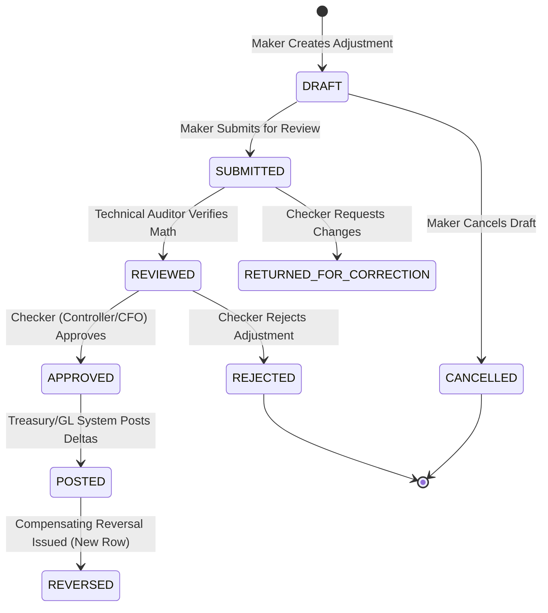

# DAY 11 — STAGE 3: POLICY D ADJUSTMENT SCHEMA AND LOGICAL DESIGN REVIEW
## Aura Workforce by Growmar — Horizon Portal
### Phase 3 — Teams and Insight | Day 11: Admin Payroll Run Console
### Stage 3 of 6: Governance Package Correction & Amendment

---

## Document Metadata

| Attribute | Specification |
|---|---|
| **Document ID** | `DAY11-STAGE3-POLICY-D-ADJUSTMENT-SCHEMA-REVIEW` |
| **Document Title** | Detailed Field-by-Field Analysis, Correction Mechanism Assessment & Logical Adjustment Design |
| **Governing Baseline** | Stage 1 Revision 2.1 (`DAY11-POLICY-A-SOURCE-OF-TRUTH-DECISION.md`) & Stage 2 Forensic Report (`DAY11-STAGE2-ROOT-CAUSE-FORENSIC-REPORT.md`) |
| **Evaluated Entity** | Proposed `payroll_adjustments` 36-Column Schema (Migration `20261106154652_add_payroll_correction_ledger`) |
| **Current Status** | `PROPOSED DESIGN — UNIMPLEMENTED IN APPLICATION RUNTIME` |
| **Governance Gate 1** | `LOCKED — FINANCIAL EXECUTION NOT AUTHORIZED` |
| **Date of Execution** | November 7, 2026 |

---

## 1. Executive Summary & Design Scope

Policy D introduces the architectural requirement for an immutable, append-only adjustment ledger to record financial and headcount corrections without modifying historical payroll runs or payslips. In the workspace, migration `20261106154652_add_payroll_correction_ledger` defines an unpopulated 36-column table (`payroll_adjustments` with 0 rows in `dev.db`).

This document provides:
1. An exhaustive, field-by-field evaluation of all 36 proposed fields across ten architectural dimensions.
2. A comparative evaluation of five historical correction mechanisms.
3. A streamlined minimum viable adjustment logical model grouped into seven functional categories.
4. A complete multi-actor lifecycle state machine with segregation-of-duties controls.
5. Explicit separation of governance approval, technical schema ratification, implementation authorization, and financial execution.

> [!IMPORTANT]
> **GATE 1 SAFETY NOTICE:** This review evaluates a proposed future design. No database schema changes, migrations, or data inserts are performed. Financial execution remains strictly unauthorized.

---

## 2. Field-by-Field Review of the 36 Proposed Adjustment Fields

The table below examines every proposed column in `payroll_adjustments`:

| # | Field Name | Proposed Type | Business Purpose | Requiredness | Data Source | Sensitivity | Access Control | Audit Requirement | Redundancy Assessment | Architectural Decision |
|---|---|---|---|---|---|---|---|---|---|---|
| **1** | `id` | `TEXT` (cuid) | Unique primary key for adjustment entity | Mandatory | System generated | Low | Read: Public Admin<br/>Write: System | Immutable PK index | None | **RETAIN** (Primary Key) |
| **2** | `payroll_run_id` | `TEXT` | FK linking adjustment to target run | Mandatory | Target run ID | Low | Read: Admin<br/>Write: Maker | FK index on `payroll_runs` | None | **RETAIN** (Relational Anchor) |
| **3** | `adjustment_type` | `TEXT` | Classification of adjustment rationale | Mandatory | User selection | Medium | Read: Admin<br/>Write: Maker | Enum constraint validation | None | **RETAIN** (Enum Type) |
| **4** | `status` | `TEXT` | Current lifecycle state | Mandatory | State machine | High | Read: Admin<br/>Write: Maker/Checker | State transition audit log | None | **RETAIN** (State Machine) |
| **5** | `revision` | `INTEGER` | Sequential revision counter per run | Mandatory | Computed (`max(rev)+1`) | Low | Read: Admin<br/>Write: System | Revision sequence tracking | None | **RETAIN** (Concurrency Control) |
| **6** | `idempotency_key` | `TEXT` | Cryptographic deduplication hash | Mandatory | SHA-256 hash | High | Read: Security/Admin<br/>Write: System | Unique index enforcement | None | **RETAIN** (Replay Protection) |
| **7** | `original_employees_paid` | `INTEGER` | Snapshot of original run employee count | Mandatory | Original run header | Medium | Read: Admin<br/>Write: System | Baseline integrity snapshot | None | **RETAIN** (Baseline Snapshot) |
| **8** | `original_gross_paise` | `BIGINT` | Original gross pay in integer paise | Mandatory | Original run header | High (Financial) | Read: Finance<br/>Write: System | Baseline integrity snapshot | Stores same value as #11 in paise | **RETAIN** (Authoritative Base) |
| **9** | `original_deductions_paise` | `BIGINT` | Original deductions in integer paise | Mandatory | Original run header | High (Financial) | Read: Finance<br/>Write: System | Baseline integrity snapshot | Stores same value as #12 in paise | **RETAIN** (Authoritative Base) |
| **10** | `original_net_paise` | `BIGINT` | Original net pay in integer paise | Mandatory | Original run header | High (Financial) | Read: Finance<br/>Write: System | Baseline integrity snapshot | Stores same value as #13 in paise | **RETAIN** (Authoritative Base) |
| **11** | `original_total_gross` | `REAL` | Display float of original gross | Mandatory | Derived (`paise / 100.0`) | High (Financial) | Read: Finance<br/>Write: System | Read convenience | Denormalized float of #8 | **RETAIN** (Read View Helper) |
| **12** | `original_total_deductions` | `REAL` | Display float of original deductions | Mandatory | Derived (`paise / 100.0`) | High (Financial) | Read: Finance<br/>Write: System | Read convenience | Denormalized float of #9 | **RETAIN** (Read View Helper) |
| **13** | `original_total_net` | `REAL` | Display float of original net | Mandatory | Derived (`paise / 100.0`) | High (Financial) | Read: Finance<br/>Write: System | Read convenience | Denormalized float of #10 | **RETAIN** (Read View Helper) |
| **14** | `adjusted_employees_paid` | `INTEGER` | Target employee headcount | Mandatory | Maker calculation | Medium | Read: Admin<br/>Write: Maker | Target state record | None | **RETAIN** (Target State) |
| **15** | `adjusted_gross_paise` | `BIGINT` | Target gross pay in integer paise | Mandatory | Maker calculation | High (Financial) | Read: Finance<br/>Write: Maker | Target state record | Stores same value as #18 in paise | **RETAIN** (Authoritative Target) |
| **16** | `adjusted_deductions_paise`| `BIGINT` | Target deductions in integer paise | Mandatory | Maker calculation | High (Financial) | Read: Finance<br/>Write: Maker | Target state record | Stores same value as #19 in paise | **RETAIN** (Authoritative Target) |
| **17** | `adjusted_net_paise` | `BIGINT` | Target net pay in integer paise | Mandatory | Derived (`gross - ded`) | High (Financial) | Read: Finance<br/>Write: System | Invariant validation check | Stores same value as #20 in paise | **RETAIN** (Authoritative Target) |
| **18** | `adjusted_total_gross` | `REAL` | Display float of adjusted gross | Mandatory | Derived (`paise / 100.0`) | High (Financial) | Read: Finance<br/>Write: System | Read convenience | Denormalized float of #15 | **RETAIN** (Read View Helper) |
| **19** | `adjusted_total_deductions` | `REAL` | Display float of adjusted deductions | Mandatory | Derived (`paise / 100.0`) | High (Financial) | Read: Finance<br/>Write: System | Read convenience | Denormalized float of #16 | **RETAIN** (Read View Helper) |
| **20** | `adjusted_total_net` | `REAL` | Display float of adjusted net | Mandatory | Derived (`paise / 100.0`) | High (Financial) | Read: Finance<br/>Write: System | Read convenience | Denormalized float of #17 | **RETAIN** (Read View Helper) |
| **21** | `variance_gross_paise` | `BIGINT` | Gross delta: `adjusted - original` | Mandatory | System computed | High (Financial) | Read: Finance<br/>Write: System | Double-entry journal basis | Redundant with #15 - #8 | **RETAIN** (Explicit Delta) |
| **22** | `variance_deductions_paise`| `BIGINT` | Deduction delta: `adjusted - original` | Mandatory | System computed | High (Financial) | Read: Finance<br/>Write: System | Double-entry journal basis | Redundant with #16 - #9 | **RETAIN** (Explicit Delta) |
| **23** | `variance_net_paise` | `BIGINT` | Net delta: `adjusted - original` | Mandatory | System computed | High (Financial) | Read: Finance<br/>Write: System | Double-entry journal basis | Redundant with #17 - #10 | **RETAIN** (Explicit Delta) |
| **24** | `variance_employees` | `INTEGER` | Headcount delta: `adj - orig` | Mandatory | System computed | Medium | Read: Admin<br/>Write: System | Headcount audit trail | Redundant with #14 - #7 | **RETAIN** (Explicit Delta) |
| **25** | `reason` | `TEXT` | Narrative justification for adjustment | Mandatory | Maker input | Medium | Read: Admin<br/>Write: Maker | Mandatory justification min 20ch | None | **RETAIN** (Governance Mandate) |
| **26** | `reconciliation_source` | `TEXT` | Policy A Source of Truth reference | Mandatory | System/Maker selection | Low | Read: Admin<br/>Write: Maker | Methodological attribution | None | **RETAIN** (Attribution) |
| **27** | `source_dataset_reference` | `TEXT` | Traceability URI or document hash | Optional | File path / hash | Low | Read: Admin<br/>Write: Maker | Forensic link to data pack | None | **RETAIN** (Forensic Evidence) |
| **28** | `reconciled_by_id` | `TEXT` | User ID of the adjustment preparer (Maker) | Mandatory | Authenticated session | High (Attribution)| Read: Audit<br/>Write: System | Maker-checker attribution | None | **RETAIN** (Maker Control) |
| **29** | `reconciled_at` | `DATETIME` | Timestamp of adjustment preparation | Mandatory | System clock (`now()`) | Medium | Read: Audit<br/>Write: System | Temporal audit sequencing | None | **RETAIN** (Temporal Audit) |
| **30** | `approved_by_id` | `TEXT` | User ID of the independent checker | Optional | Authenticated session | High (Attribution)| Read: Audit<br/>Write: System | Checker sign-off ($\ne$ maker) | None | **RETAIN** (Checker Control) |
| **31** | `approved_at` | `DATETIME` | Timestamp of formal approval | Optional | System clock (`now()`) | Medium | Read: Audit<br/>Write: System | Segregation temporal check | None | **RETAIN** (Temporal Audit) |
| **32** | `effective_date` | `DATETIME` | Accounting period effective date | Mandatory | Period end date | High (Accounting) | Read: Finance<br/>Write: Maker | Fiscal period tie-out | None | **RETAIN** (Accounting Period) |
| **33** | `audit_log_id` | `TEXT` | Reference to `audit_logs` record | Optional | Generated audit row | Medium | Read: Audit<br/>Write: System | Cross-table audit linking | None | **RETAIN** (Audit Traceability) |
| **34** | `audit_event_id` | `TEXT` | Event UUID for telemetry tracking | Optional | Telemetry context | Low | Read: Ops<br/>Write: System | System event correlation | Partial overlap with #33 | **CLARIFY** (Retain as optional) |
| **35** | `created_at` | `DATETIME` | Record insertion timestamp | Mandatory | Database default | Low | Read: System<br/>Write: System | Row-level creation timestamp | None | **RETAIN** (DB Invariant) |
| **36** | `updated_at` | `DATETIME` | Record modification timestamp | Mandatory | Database trigger | Low | Read: System<br/>Write: System | Row-level mutation tracker | None | **RETAIN** (DB Invariant) |

### 2.1 Technical Analysis of Duplication (Paise vs. Float)
Fields #11–13, #18–20, and #21–24 store denormalized values.  
- **Justification:** In SQLite, queries generating executive dashboards require float values for JSON serialisation. Calculating `paise / 100.0` inside SQLite views can trigger IEEE 754 floating-point inaccuracies. Storing explicit BigInt paise ensures mathematical integrity during calculation, while pre-calculated float columns support performant, read-only UI rendering.
- **Governing Invariant:** All calculations, validations, and API assertions must execute exclusively on the `*_paise` fields. Float fields are strictly read-only mirrors.

---

## 3. Comparative Evaluation of Five Correction Mechanisms

| Evaluation Criterion | Mechanism 1: Append-Only Adjustments (`payroll_adjustments`) | Mechanism 2: Reversal & Replacement Runs | Mechanism 3: Versioned Records (SCD Type 2) | Mechanism 4: External Linked Documents | Mechanism 5: Reconciliation Annotations |
|---|---|---|---|---|---|
| **Historical Preservation** | **Optimal.** Original runs and payslips remain untouched. | **Acceptable.** Preserves original, but adds full duplicate inverted run. | **Complex.** Clutters core tables with valid-to/from dates. | **Poor.** High risk of orphaned or unlinked files. | **Optimal.** Zero data modification; pure UI presentation. |
| **Auditability** | **Optimal.** Explicit maker, checker, timestamp, and delta fields. | **Good.** Reversal visible in GL, but obscures root cause. | **Medium.** Difficult to reconstruct point-in-time state without complex SQL. | **Poor.** Unstructured audit logs; hard to query. | **Good for review.** Shows discrepancies without ledger true-up. |
| **Financial Traceability** | **Optimal.** Exact delta in paise ready for GL journal entry. | **High Overhead.** Multiplies gross/net by 2; confuses employee tax forms. | **Medium.** Requires temporal table joins to calculate net delta. | **Poor.** Off-chain numbers cannot balance in database. | **None.** No financial journal entries generated. |
| **Reversibility** | **Optimal.** Created compensating inverse adjustment row. | **Cumbersome.** Requires a third run to correct a replacement run. | **Complex.** Requires updating validity intervals backward. | **Manual.** Requires deleting or archiving external docs. | **Instant.** Toggle display flag in frontend code. |
| **Implementation Complexity** | **Low.** Dedicated table already exists in Prisma schema. | **High.** Requires duplicating run logic, payslip generation, UI. | **Very High.** Requires rewriting Prisma schema and all queries. | **Low.** Loose JSON files, but lacks data integrity. | **Zero.** Pure frontend/API read enhancement. |
| **Approval Controls** | **Strict.** Enforces dual-actor maker-checker per adjustment row. | **Standard.** Follows standard run approval. | **Diffused.** Hard to enforce approval per individual column change. | **Weak.** Document sign-off detached from DB engine. | **Informational.** Requires no formal financial authorization. |
| **RECOMMENDATION** | **PRIMARY POST-GATE 1 (Stage 4+)** | **REJECTED** (Disproportionate operational overhead) | **REJECTED** (Incompatible with current Next.js/Prisma model) | **REJECTED** (Lacks relational integrity) | **SUPPLEMENTARY PRE-GATE 1 (Current Stage 3)** |

---

## 4. Minimum Viable Adjustment Logical Model (7 Functional Categories)

To ensure clarity for developers and auditors, the 36 fields are organized into seven logical functional modules:

```
+---------------------------------------------------------------------------------------------------+
|                            MINIMUM VIABLE ADJUSTMENT LOGICAL ARCHITECTURE                         |
+---------------------------------------------------------------------------------------------------+
|  1. IDENTITY & LINKAGE        id, payroll_run_id, revision, idempotency_key                       |
|  2. BASELINE SNAPSHOTS        original_employees_paid, original_*_paise, original_total_*         |
|  3. ADJUSTMENT DELTAS         adjusted_*_paise, variance_*_paise, variance_employees              |
|  4. BUSINESS JUSTIFICATION    adjustment_type, reason, reconciliation_source, source_reference   |
|  5. MAKER-CHECKER CONTROL     reconciled_by_id, reconciled_at, approved_by_id, approved_at        |
|  6. LIFECYCLE & EFFECTIVE     status, effective_date                                              |
|  7. AUDIT & METADATA          audit_log_id, audit_event_id, created_at, updated_at                |
+---------------------------------------------------------------------------------------------------+
```

---

## 5. Multi-Actor Lifecycle State Machine & Segregation Controls

The proposed lifecycle transitions for `payroll_adjustments` must strictly enforce multi-actor segregation of duties:



### 5.1 Permitted Transitions & Actor Enforcement

| Current State | Target State | Permitted Actor Role | Enforced Segregation Rule | System Validation Check |
|---|---|---|---|---|
| `*` (New) | `DRAFT` | `PAYROLL_PREPARER` | None (Initialization) | Verifies `payroll_run_id` exists and is in `'CLOSED'` or `'PAID'`. |
| `DRAFT` | `SUBMITTED` | `PAYROLL_PREPARER` | `reconciled_by_id == session.userId` | Verifies `reason.length >= 20` and mathematical invariants. |
| `DRAFT` | `CANCELLED` | `PAYROLL_PREPARER` | `reconciled_by_id == session.userId` | Can only cancel unsubmitted drafts. |
| `SUBMITTED` | `REVIEWED` | `DATA_AUDITOR` / `INTERNAL_AUDIT` | `auditor_id != reconciled_by_id` | Verifies Policy A source data and integer paise math. |
| `SUBMITTED` | `RETURNED` | `FINANCE_CONTROLLER` / `AUDITOR` | `actor_id != reconciled_by_id` | Requires mandatory return comments. |
| `REVIEWED` | `APPROVED` | `FINANCE_CONTROLLER` / `CFO` | `approved_by_id != reconciled_by_id` | **MANDATORY CHECKER SEGREGATION**. Rejects self-approval. |
| `REVIEWED` | `REJECTED` | `FINANCE_CONTROLLER` / `CFO` | `actor_id != reconciled_by_id` | Requires formal rejection rationale. |
| `APPROVED` | `POSTED` | `TREASURY` / `AUTOMATED_GL` | Integration Service | Verifies cryptographic signature and Gate 1 UNLOCKED. |
| `POSTED` | `REVERSED` | `CFO` & `HEAD_OF_AUDIT` | Dual Executive Sign-Off | Generates compensating row with inverse signs; zero deletions. |

---

## 6. Prohibited Operational Actions

Policy D establishes zero-tolerance prohibitions against unauthorized modification practices:
1. **No In-Place Overwrites:** Direct SQL `UPDATE payroll_runs SET ...` is prohibited.
2. **No Retroactive Payslip Modification:** An approved payslip voucher cannot have its line items modified post-disbursement.
3. **No Discrepancy Concealment:** Net-zero adjustments (+₹5,000 gross, +₹5,000 deductions) cannot bypass independent approval.
4. **No Unilateral Posting:** No adjustment may post to the General Ledger without independent checker sign-off.
5. **No Direct Physical Deletion:** Cancelled or rejected adjustment records must remain preserved with their terminal status flag.

---

## 7. Master Decision Register Updates (Policy D)

The following decisions govern Policy D:

| Decision ID | Decision Title | Scope of Decision | Current Recommendation | Approving Authority | Current Status |
|---|---|---|---|---|---|
| **DEC-D-01** | Adjustment Architectural Model | Governance approval of the append-only adjustment principle post-Gate 1. | Adopt Mechanism 1 (`payroll_adjustments`) as sole financial adjustment model. | Corporate Controller & CFO | `PROPOSED — APPROVAL PENDING` |
| **DEC-D-02** | Pre-Gate 1 Discrepancy Presentation | Treatment of historical anomalies while Gate 1 is locked. | Retain raw historical data untouched; present variances via Mechanism 5 (Annotations). | Chief Financial Officer | `PROPOSED — APPROVAL PENDING` |
| **DEC-D-03** | Reversal & Revocation Protocol | Standard for cancelling or reversing posted adjustments. | Revoke via compensating reversal rows with inverse signs; zero SQL deletions. | Head of Internal Audit | `PROPOSED — APPROVAL PENDING` |
| **DEC-D-04** *(New)* | Technical Approval of 36-Field Schema | Technical ratification of the 36-column Prisma schema design. | Retain 36-column design; enforce BigInt paise as calculation authority; treat Float as read-only. | Lead Systems Architect | `PROPOSED — APPROVAL PENDING` |

---

*End of Day 11 Stage 3 Policy D Adjustment Schema Review.*

