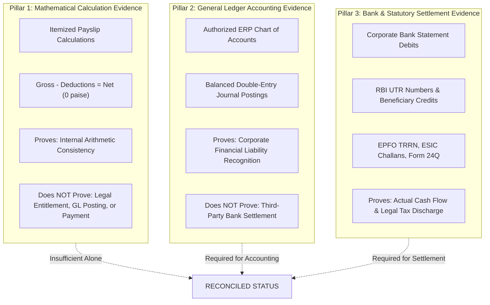

# DAY 11 — STAGE 3: POLICY E EXTERNAL MAPPING AND EVIDENCE VALIDATION
## Aura Workforce by Growmar — Horizon Portal
### Phase 3 — Teams and Insight | Day 11: Admin Payroll Run Console
### Stage 3 of 6: Governance Package Correction & Amendment

---

## Document Metadata

| Attribute | Specification |
|---|---|
| **Document ID** | `DAY11-STAGE3-POLICY-E-EXTERNAL-MAPPING-VALIDATION` |
| **Document Title** | General Ledger Account Classification, Banking Settlement Analysis & Statutory Compliance Evidence Validation |
| **Governing Baseline** | Stage 1 Revision 2.1 (`DAY11-POLICY-A-SOURCE-OF-TRUTH-DECISION.md`) & Stage 2 Forensic Report (`DAY11-STAGE2-ROOT-CAUSE-FORENSIC-REPORT.md`) |
| **Evaluated Entity** | External GL Codes, Banking Settlement Processes & Indian Statutory Remittance Standards |
| **Current Status** | `PROPOSED SPECIFICATION — EXTERNAL EVIDENCE REQUIRED` |
| **Governance Gate 1** | `LOCKED — FINANCIAL EXECUTION NOT AUTHORIZED` |
| **Date of Execution** | November 7, 2026 |

---

## 1. Executive Summary & Review Scope

Policy E establishes the governance framework for external accounting verification, corporate treasury settlement, and statutory remittance compliance. During the Stage 3 review, it was identified that initial documentation presented specific General Ledger codes (`GL-6100` etc.), an uncalibrated 100% individual UTR matching rule, and statutory tax challans as if they were established corporate configurations within the repository.

This document performs an exhaustive, evidence-based review:
1. Formally classifies all proposed GL account codes as **Unverified Illustrative Examples**, confirming that no corporate chart of accounts exists in the repository.
2. Evaluates banking settlement mechanics, distinguishing payment initiation from batch debits and individual beneficiary credits, and classifying absent banking records as `BANK_SETTLEMENT_EVIDENCE_NOT_PROVIDED`.
3. Qualifies statutory Indian compliance requirements (EPFO, ESIC, TDS under Section 192, and Professional Tax), establishing that listing regulatory standards does not constitute proof of compliance.
4. Formalizes the **Tripartite Evidence Hierarchy**, separating mathematical internal consistency, General Ledger accounting balances, and third-party settlement finality.

> [!IMPORTANT]
> **GOVERNANCE NOTICE:** Stored payroll calculations or database flags (`'PAID'`) do NOT establish that corporate funds were debited, employee bank accounts were credited, or statutory taxes were remitted. External verification remains pending.

---

## 2. General Ledger (GL) Account Mapping Review & Classification

### 2.1 Forensic Inventory of Repository Evidence
A comprehensive inspection of the repository (`03_Data_Pack/`, `src/`, `prisma/dev.db`) reveals:
- **No Chart of Accounts File Exists:** The repository contains no `chart_of_accounts.json`, ERP configuration files, or accounting balance sheets.
- **No General Ledger Journal Entries Exist:** No double-entry vouchers (debit/credit) exist for any of the 18 historical payroll runs.
- **Result:** Any GL account code cited in governance documentation represents an **architectural recommendation or illustrative example**, not a confirmed corporate account.

### 2.2 Classification of Proposed GL Accounts

| Proposed Account Code | Proposed Account Description | Intended Accounting Purpose | Evidence Source in Repo | Chart of Accounts Supplied? | Mapping Verification Status | Controller Approval Required? | Formal Governance Classification |
|---|---|---|---|---|---|---|---|
| `GL-6100` | Payroll Expense (Gross Salaries) | Debit liability for total gross compensation | Theoretical ERP convention | No | Unverified | Yes | `PROPOSED_EXAMPLE_ONLY` |
| `GL-2110` | Statutory Deductions Payable — PF | Credit liability for Employer + Employee PF | Theoretical ERP convention | No | Unverified | Yes | `PROPOSED_EXAMPLE_ONLY` |
| `GL-2120` | Statutory Deductions Payable — ESIC | Credit liability for Employer + Employee ESI | Theoretical ERP convention | No | Unverified | Yes | `PROPOSED_EXAMPLE_ONLY` |
| `GL-2130` | Statutory Deductions Payable — TDS | Credit liability for Income Tax Sec 192 | Theoretical ERP convention | No | Unverified | Yes | `PROPOSED_EXAMPLE_ONLY` |
| `GL-2140` | Statutory Deductions Payable — PT | Credit liability for State Professional Tax | Theoretical ERP convention | No | Unverified | Yes | `PROPOSED_EXAMPLE_ONLY` |
| `GL-2100` | Net Salaries Payable (Clearing Account) | Credit liability for net payout to workforce | Theoretical ERP convention | No | Unverified | Yes | `PROPOSED_EXAMPLE_ONLY` |
| `GL-1010` | Corporate Payroll Bank Account | Credit asset for actual treasury cash outflow | Theoretical ERP convention | No | Unverified | Yes | `PROPOSED_EXAMPLE_ONLY` |

### 2.3 Strict Accounting Boundaries
1. **Aggregates are Not Balances:** The mathematical sum of 2,469 itemized payslips is an **internal payroll aggregate**, not a verified General Ledger balance.
2. **Mandatory Corporate Review:** Prior to Stage 4 integration, the Corporate Controller must supply the official corporate chart of accounts and formally map Horizon Portal payroll categories to authorized ERP ledger codes.

---

## 3. Banking Settlement & UTR Evidence Review

### 3.1 Examination of the "100% UTR Matching" Requirement
The initial Policy E proposed that every employee payout must have a unique Reserve Bank of India (RBI) Unique Transaction Reference (UTR) before a run can be declared settled.  
A treasury operations analysis reveals that while UTR matching is a valid objective, the operational mechanics of corporate payroll disbursements must be respected:
- **Batch Processing vs. Itemized Clearing:** Corporate payroll is commonly executed via bulk corporate payment files (e.g., NACH credit, corporate internet banking bulk NEFT/RTGS). In bulk processing, the corporate bank statement shows a **single batch debit** for the entire run (e.g., ₹2,10,00,000), while individual beneficiary credits generate distinct bank references or batch sequence tokens.
- **Bank Gateway Tokenization:** In modern automated disbursements (e.g., RazorpayX, Cashfree, ICICI Corporate API), the immediate response is a payout transfer ID, with the final RBI UTR confirmed asynchronously 2 to 24 hours later.

### 3.2 Key Distinctions in the Settlement Chain
To prevent false assumptions of settlement, Policy E distinguishes eight distinct stages:

```
+---------------------------------------------------------------------------------------------------+
|                               PAYMENT SETTLEMENT LIFECYCLE STAGES                                 |
+---------------------------------------------------------------------------------------------------+
|  1. PAYMENT INSTRUCTION        Application generates disbursement payload (Internal)              |
|  2. PAYMENT BATCH FILE         Corporate banking file formatted (NACH / NEFT batch)                |
|  3. BANK TRANSMISSION RECEIPT  Bank acknowledges receipt of batch file                            |
|  4. BANK ACCOUNT DEBIT         Single batch debit posted to corporate statement (Cash Outflow)    |
|  5. BENEFICIARY UTR ASSIGNED   Clearing network (RBI) issues UTRs for individual transactions     |
|  6. BENEFICIARY CREDIT         Funds successfully credited to employee bank account               |
|  7. REJECTED / RETURNED SALARY Failed transfer bounced back to corporate escrow account           |
|  8. SETTLEMENT CERTIFICATION   Final tie-out confirming Batch Debit = Sum(Credits) + Returned     |
+---------------------------------------------------------------------------------------------------+
```

### 3.3 Classification of Repository Banking Evidence
Inspection of the repository confirms:
- Zero corporate bank statements are present.
- Zero bank payment instruction files exist.
- Zero RBI UTR numbers are recorded in `payslips.json` or `payroll_runs.json`.
- **Formal Status Classification:**  
  $$\mathbf{BANK\_SETTLEMENT\_EVIDENCE\_NOT\_PROVIDED}$$
- **Binding Rule:** The presence of status `'PAID'` in `payroll_runs` or `payslips` represents an internal workflow flag indicating that payment was requested or marked complete in the UI. It does **not** constitute legal or operational proof of bank settlement.

---

## 4. Statutory Compliance Evidence Review

In accordance with Indian labour and tax legislation, payroll withholdings carry strict statutory remittal deadlines and reporting requirements. Policy E defines the required evidentiary standards while explicitly noting that **zero statutory evidence exists in the repository**:

| Statutory Regime | Governing Legislation | Required Compliance Evidence | What the Evidence Demonstrates | Repository Status | External Validation Required |
|---|---|---|---|---|---|
| **Employees' Provident Fund (EPFO)** | EPF & MP Act, 1952 | Electronic Challan cum Return (ECR) + TRRN payment receipt | Proof of monthly deposit of 12% employee + 12% employer PF to EPFO trust. | `NOT_PROVIDED` | Head of Tax & EPFO portal verification required. |
| **Employees' State Insurance (ESIC)** | ESI Act, 1948 | Monthly Contribution Return + 17-digit Challan receipt | Proof of 0.75% employee + 3.25% employer ESI deposit for eligible employees ($\le ₹21,000$). | `NOT_PROVIDED` | Head of Tax & ESIC portal verification required. |
| **Tax Deducted at Source (TDS)** | Income Tax Act, 1961 (Sec 192) | Monthly Challan ITNS 281 (BSR code, CIN) + Quarterly Form 24Q | Proof of withholding tax deposited with Central Govt; employee tax credit allocation. | `NOT_PROVIDED` | Head of Tax & TRACES portal verification required. |
| **Professional Tax (PT)** | State PT Acts (e.g., Karnataka, MH) | Monthly/Annual State PT Return + Challan receipt | Proof of state professional tax withheld and deposited with state commercial tax dept. | `NOT_PROVIDED` | Head of Tax & State portal verification required. |

### 4.1 Statutory Compliance Declarations
- **No Self-Certification:** Technical systems must never declare statutory compliance without independent third-party evidence (challans, bank receipts, government portal acknowledgments).
- **Evidence Gap Disclosure:** All historical runs (`PR-2026-04` through `PR-2026-09`) are formally designated as having **Statutory Remittance Evidence Gaps**.

---

## 5. The Tripartite Evidence Hierarchy

To guarantee accounting and legal integrity, Policy E formally institutes the **Tripartite Evidence Hierarchy**:



### 5.1 Evidentiary Independence
1. **Mathematical Consistency $\ne$ Legal Entitlement:** A calculation that balances to zero paise does not prove the employee was entitled to that salary.
2. **Payroll Summary $\ne$ General Ledger Balance:** Stored run headers do not represent verified ERP journal entries.
3. **Database Flag $\ne$ Settlement Finality:** A `'PAID'` string in a database column does not prove funds moved through the banking clearing system.

---

## 6. Master Decision Register Updates (Policy E)

The following decisions govern Policy E:

| Decision ID | Decision Title | Decision Scope | Recommendation | Approving Authority | Current Status |
|---|---|---|---|---|---|
| **DEC-E-01** | Tripartite Evidence Mandate | Mandatory requirement for mathematical, GL, and banking evidence. | Adopt Tripartite Evidence Hierarchy; internal math alone cannot authorize `'RECONCILED'`. | Chief Financial Officer | `PROPOSED — APPROVAL PENDING` |
| **DEC-E-02** | Classification of Historical Evidence Gaps | Formal declaration regarding missing external bank and tax records. | Formally classify historical runs as `BANK_SETTLEMENT_EVIDENCE_NOT_PROVIDED` and `STATUTORY_EVIDENCE_NOT_PROVIDED`. | Head of Internal Audit | `PROPOSED — APPROVAL PENDING` |
| **DEC-E-03** | Audit Log Schema Expansion | Technical expansion of `audit_logs` table in Stage 4+. | Approve non-breaking migration adding `payroll_run_id`, `adjustment_id`, and hash chaining. | Lead Systems Architect | `PROPOSED — APPROVAL PENDING` |
| **DEC-E-04** *(New)* | Chart of Accounts Verification | Authorizing the official corporate GL mapping. | Require Corporate Controller to supply verified chart of accounts before Stage 4 GL export. | Corporate Controller | `PROPOSED — APPROVAL PENDING` |
| **DEC-E-05** *(New)* | Banking Settlement Matching Model | Defining the banking settlement reconciliation model. | Adopt hybrid settlement model (Batch Debit tie-out + Itemized UTR matching). | Corporate Treasurer | `PROPOSED — APPROVAL PENDING` |

---

*End of Day 11 Stage 3 Policy E External Mapping Validation.*

