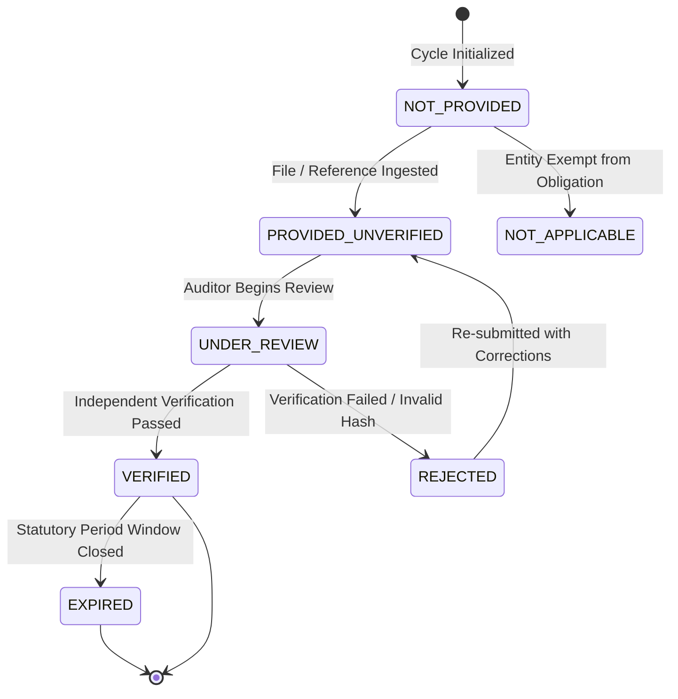

# DAY 11 — STAGE 4A: EXTERNAL EVIDENCE ARCHITECTURE
## Aura Workforce by Growmar — Horizon Portal
### Phase 3 — Teams and Insight | Day 11: Admin Payroll Run Console
### Stage 4A: Read-Only Technical Assessment & Implementation Design

---

## Document Metadata

| Attribute | Specification |
|---|---|
| **Document ID** | `DAY11-STAGE4A-EXTERNAL-EVIDENCE-ARCHITECTURE` |
| **Document Title** | Technical Architecture for General Ledger, Treasury Settlement & Statutory Compliance Evidence |
| **Governing Baseline** | Policy E (Amended) (`docs/DAY11-STAGE3-POLICY-E-AUDIT-ACCOUNTING-AND-SETTLEMENT-EVIDENCE.md`) |
| **Stage & Mode** | Stage 4A — Read-Only Technical Design (Unimplemented) |
| **Governance Gate 1** | **LOCKED — FINANCIAL EXECUTION NOT AUTHORIZED** |
| **Date of Execution** | November 7, 2026 |

---

## 1. Executive Summary & Architectural Scope

Policy E establishes that internal mathematical calculations alone cannot certify a payroll run as accounting-reconciled or operationally settled without third-party substantiation across three external pillars:
1. **General Ledger (GL) Accounting Pillar:** Formal recognition of wage expenses and statutory liabilities within corporate double-entry trial balances.
2. **Bank Settlement Pillar:** Irrevocable cash debits from corporate treasury accounts and verified credit confirmations to beneficiary employee bank accounts.
3. **Statutory Remittance Pillar:** Official governmental receipts confirming the deposit of withheld taxes, provident funds, and social insurance contributions.

This document defines the technical data structures, validation rules, lifecycle status machines, and verification authorities required to integrate external evidence into Horizon Portal during post-Gate 1 implementation.

> [!IMPORTANT]
> **EVIDENCE STATUS & SEPARATION NOTICE:**  
> $$\mathbf{EXTERNAL\ EVIDENCE\ NOT\ AVAILABLE\ IN\ THE\ INSPECTED\ PROJECT\ REPOSITORY\ —\ INDEPENDENT\ EXTERNAL\ VALIDATION\ PENDING.}$$
> 
> 1. **Repository Availability vs. External Reality:** Physical inspection of the Horizon Portal repository confirms that no GL journals, bank statements, or statutory receipts exist within the project files. However, repository absence does **NOT** prove non-existence in external enterprise ERP, banking portals, or government systems.
> 2. **Independent External Validation Pending:** No independent external validation has been demonstrated by the inspected project materials. Missing external evidence remains an active blocking validation dependency.
> 3. **Five Inviolable Evidentiary Boundaries:**
>    - Internal payroll calculations $\ne$ General Ledger journal posting.
>    - Internal payroll calculations $\ne$ Bank statement debit confirmation.
>    - Bank debit confirmation $\ne$ Beneficiary employee credit settlement.
>    - Internal deduction calculation $\ne$ Statutory tax filing and payment confirmation.
>    - A stored `PAID` flag in the database does **NOT** establish bank settlement.

---

## 2. Conceptual Evidence Status Lifecycle Model

To manage evidence items across all three domains, the system adopts a standardized seven-state evidence lifecycle:



### Evidence State Definitions

| Evidence Status Code | Definition & Operational Meaning | Permitted System Actions |
|---|---|---|
| `NOT_PROVIDED` | Default state; required external document or reference has not been submitted. | Blocks final settlement status; triggers automated evidence request. |
| `PROVIDED_UNVERIFIED` | Document, batch file, or transaction reference submitted but pending independent review. | Accessible for review in auditor queue; cannot be used for final tie-out. |
| `UNDER_REVIEW` | Designated reviewer (Controller, Treasurer, Tax Head) actively auditing evidence. | File locked against concurrent modification. |
| `VERIFIED` | Evidence independently authenticated against external bank statement or tax portal. | Authorizes financial tie-out and unlocks settlement status certification. |
| `REJECTED` | Submitted document failed cryptographic hash, amount mismatch, or portal validation. | System generates discrepancy notification; reverts to `NOT_PROVIDED`. |
| `EXPIRED` | Evidence validity window lapsed (e.g., temporary bank file token expired). | Requires updated settlement proof. |
| `NOT_APPLICABLE` | Specific payroll run exempt from statutory obligation (e.g., zero ESI eligible employees). | Bypasses specific blocking check with mandatory justification. |

---

## 3. Domain A: General Ledger (GL) Accounting Architecture

### 3.1 Design Specification & Required Schema Fields
A General Ledger integration table (`payroll_gl_entries`) is designed to capture corporate double-entry journal postings:

| Field Name | Data Type | Field Purpose & Governance Rule | Source Authority |
|---|---|---|---|
| `id` | `String (cuid)` | Unique primary key for journal mapping record | System Generated |
| `payroll_run_id` | `String` | Foreign key linking entry to `payroll_runs(id)` | Parent Run ID |
| `journal_id` | `String` | External ERP Journal Voucher ID (e.g., `JV-2026-09-0042`) | Corporate ERP (SAP/Oracle/NetSuite) |
| `posting_date` | `DateTime` | Date the transaction was posted into corporate general ledger | Corporate Controller |
| `accounting_period`| `String` | Fiscal period string (e.g., `FY2026-M09`) | ERP Fiscal Calendar |
| `entity_code` | `String` | Corporate legal entity identifier (e.g., `GROWMAR_INDIA_PVT`) | Corporate Register |
| `debit_account` | `String` | Account code receiving debit (e.g., `GL-6100` Payroll Expense) | Controller-Approved Chart of Accounts |
| `credit_account` | `String` | Account code receiving credit (e.g., `GL-2100` Net Salaries Payable)| Controller-Approved Chart of Accounts |
| `currency` | `String` | Standard ISO currency code (default: `INR`) | System Constant |
| `amount_paise` | `BigInt` | Exact transaction amount in arbitrary-precision integer paise | Authoritative Calculation |
| `source_reference` | `String` | Digest/hash of the itemized payslips backing this journal voucher | SHA-256 of Itemized Set |
| `verification_status`| `String` | Evidence status: `PROVIDED_UNVERIFIED`, `VERIFIED`, `REJECTED` | Financial Controls Specialist |

### 3.2 Domain Governance & Operational Rules
1. **Source:** Corporate ERP journal export file (CSV/JSON/API).
2. **Validation Rules:**
   - Double-entry balance invariant: $\sum \text{Debits} \equiv \sum \text{Credits} \quad (0\text{ paise residual})$.
   - GL Net Payable credit must exactly equal the itemized payroll aggregate $\sum \text{payslips.net\_pay}$.
3. **Verification Authority:** Corporate Controller (`FIN-CTRL`).
4. **Audit Requirements:** Full immutable audit log capturing user ID, ERP voucher reference, and upload timestamp.
5. **Missing-Evidence Behavior:** Run displays `GL_EVIDENCE_NOT_PROVIDED`; cannot be marked as accounting-reconciled.
6. **Rejection Behavior:** Controller records narrative rejection reason; journal mapping flagged `REJECTED`.
7. **Reassessment Behavior:** Re-upload of corrected ERP journal voucher increments revision counter.

---

## 4. Domain B: Corporate Banking & Treasury Settlement Architecture

### 4.1 Hybrid Settlement Model
Enterprise salary disbursements are processed via corporate banking batches. Policy E mandates a hybrid settlement verification architecture:
$$\mathbf{Statement\ Tie-Out:\ Batch\ Debit\ =\ \sum Beneficiary\ Credits\ +\ Returned\ Salaries}$$

```
+---------------------------------------------------------------------------------------------------+
|                                 TREASURY SETTLEMENT LIFECYCLE STAGES                              |
+---------------------------------------------------------------------------------------------------+
|  Stage 1: Payroll Marked Paid         Internal administrative flag set in Horizon Portal          |
|  Stage 2: Payment Instruction Created Host-to-host or NACH batch file generated                   |
|  Stage 3: Bank Debit Initiated        Bank clearinghouse receives file; batch processing begins   |
|  Stage 4: Bank Debit Confirmed        Single consolidated batch debit posted on corporate statement|
|  Stage 5: Beneficiary Payment Cleared RBI UTR numbers assigned; funds credited to employee bank   |
|  Stage 6: Payment Rejected / Returned Bounced payouts credited to corporate escrow liability      |
+---------------------------------------------------------------------------------------------------+
```

### 4.2 Required Schema Fields (`payroll_banking_settlements`)

| Field Name | Data Type | Field Purpose & Governance Rule | Source Authority |
|---|---|---|---|
| `id` | `String (cuid)` | Unique primary key for settlement batch record | System Generated |
| `payroll_run_id` | `String` | Foreign key linking settlement to `payroll_runs(id)` | Parent Run ID |
| `bank_batch_id` | `String` | Corporate banking transaction/file reference (e.g., `ICICI_BATCH_9912`)| Corporate Treasury |
| `bank_statement_date`| `DateTime`| Value date on corporate bank statement | Official Bank Statement |
| `batch_debit_paise` | `BigInt` | Total consolidated debit amount posted on statement in paise | Official Bank Statement |
| `employee_id` | `String` | Employee recipient ID | Master Roster |
| `utr_number` | `String` | 16-to-22 character RBI Unique Transaction Reference number | RBI Clearing / Beneficiary Bank |
| `credit_amount_paise`| `BigInt` | Exact amount credited to individual employee account in paise | Bank Clearing Manifest |
| `clearing_status` | `String` | Status: `CLEARED`, `REJECTED`, `BOUNCED`, `RETURNED` | Bank Clearing Manifest |
| `statement_hash` | `String` | SHA-256 cryptographic digest of ingested bank statement PDF/CSV | Security System |
| `verification_status`| `String` | Evidence status: `PROVIDED_UNVERIFIED`, `VERIFIED`, `REJECTED` | Corporate Treasurer |

### 4.3 Domain Governance & Operational Rules
1. **Source:** Corporate bank account statement (CAMT.053 / MT940 / CSV) and payment gateway clearing manifest.
2. **Validation Rules:**
   - 100% of employees in the run must have either a verified `CLEARED` status with a valid UTR or a documented `RETURNED` status.
   - Batch Debit tie-out: $\text{batch\_debit\_paise} \equiv \sum \text{credit\_amount\_paise} + \text{bank\_fees}$.
3. **Verification Authority:** Corporate Treasurer (`TREAS-MGR`).
4. **Missing-Evidence Behavior:** Formally classified as `BANK_SETTLEMENT_EVIDENCE_NOT_PROVIDED`. Stored `'PAID'` flag is ignored for settlement purposes.
5. **Rejection Behavior:** Flagged to Treasury; failed payments isolated in liability account `GL-2105`.

---

## 5. Domain C: Statutory Remittance Compliance Architecture

### 5.1 Regulatory Remittance Matrix (India)
In accordance with statutory mandates, payroll deductions represent trust liabilities that must be remitted to government authorities with official acknowledgments:

| Statutory Regime | Governing Law & Form | Required Evidence Document | Mandatory Data Fields | Repository Status | Verification Authority |
|---|---|---|---|---|---|
| **Employees' Provident Fund (EPFO)** | EPF & MP Act, 1952 | Electronic Challan cum Return (ECR) + Payment Receipt | Temporary Return Reference Number (TRRN), Challan Amount, Total Member Count, CRN | `NOT_PROVIDED` | Head of Tax Operations |
| **Employees' State Insurance (ESIC)** | ESI Act, 1948 | Monthly Contribution Return + Challan | 17-digit Challan Reference Number (CPIN), Real-Time Payment Transaction ID, IP Count | `NOT_PROVIDED` | Head of Tax Operations |
| **Income Tax Withholding (TDS)** | Income Tax Act, 1961 (Sec 192) | Monthly Challan ITNS 281 + Quarterly Form 24Q | BSR Code (7 digits), Challan Serial No (CIN), Date of Payment, Minor Head 200, NSDL Token | `NOT_PROVIDED` | Head of Tax Operations |
| **Professional Tax (PT)** | Respective State PT Acts | Monthly State Challan Receipt | State PT Enrollment Certificate (EC) No, Payment Reference, Period Month | `NOT_PROVIDED` | Head of Tax Operations |

### 5.2 Required Schema Fields (`payroll_statutory_remittances`)

| Field Name | Data Type | Field Purpose & Governance Rule | Source Authority |
|---|---|---|---|
| `id` | `String (cuid)` | Unique primary key for statutory remittance record | System Generated |
| `payroll_run_id` | `String` | Foreign key linking remittance to `payroll_runs(id)` | Parent Run ID |
| `statutory_regime` | `String` | Enum: `EPFO_PF`, `ESIC_ESI`, `INCOME_TAX_TDS`, `PROFESSIONAL_TAX`| Statutory Tax Code |
| `challan_reference` | `String` | Official government challan number (TRRN / CPIN / CIN) | Government Tax Portal |
| `bsr_code` | `String?` | 7-digit Reserve Bank of India bank branch code (TDS) | Collecting Bank |
| `deposit_date` | `DateTime` | Exact date funds were debited and received by treasury | Government Receipt |
| `remitted_paise` | `BigInt` | Total statutory deposit amount in integer paise | Government Receipt |
| `filing_token` | `String?` | NSDL / EPFO electronic submission acknowledgment token | Government Portal |
| `receipt_document_hash`| `String` | SHA-256 hash of uploaded official government receipt PDF | Security System |
| `verification_status` | `String` | Evidence status: `PROVIDED_UNVERIFIED`, `VERIFIED`, `REJECTED` | Head of Tax Operations |

### 5.3 Domain Governance & Operational Rules
1. **Source:** Official receipts downloaded directly from government portals (unifiedportal-epfo.epfindia.gov.in, esic.gov.in, tin-nsdl.com).
2. **Validation Rules:**
   - Amount deposited must equal or exceed total withheld component in payslips: $\text{remitted\_paise} \ge \sum \text{withheld\_component\_paise}$.
   - Deposit date must precede the statutory deadline (e.g., 15th of following month for PF/ESI; 7th for TDS).
3. **Verification Authority:** Head of Tax Operations (`TAX-HEAD`).
4. **Missing-Evidence Behavior:** Formally classified as `STATUTORY_EVIDENCE_NOT_PROVIDED`.
5. **No Self-Certification:** The application cannot infer legal tax compliance from database records alone.

---

## 6. Workstream 5 Conclusion

1. **Architecture is Independent:** GL, Treasury, and Statutory evidence models operate independently of application payroll calculations.
2. **Mandatory Evidence Availability Classification:**  
   $$\mathbf{EXTERNAL\ EVIDENCE\ NOT\ AVAILABLE\ IN\ THE\ INSPECTED\ PROJECT\ REPOSITORY\ —\ INDEPENDENT\ EXTERNAL\ VALIDATION\ PENDING.}$$
   Repository inspection confirms zero GL journals, bank statements, UTR records, or tax receipts exist in the repository files. However, this does not establish their non-existence in external systems. No independent external validation has been demonstrated by the inspected materials.
3. **Blocking Dependency:** Missing external evidence remains an active blocking validation dependency for final settlement certification.
4. **Gate 1 Status:** `GATE 1 LOCKED — FINANCIAL EXECUTION NOT AUTHORIZED.`

---

*End of Day 11 Stage 4A External Evidence Architecture.*

