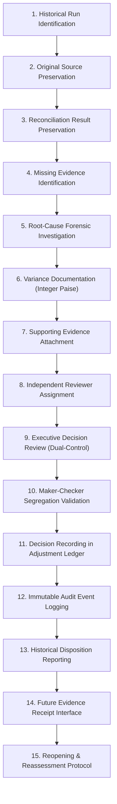

# DAY 11 — STAGE 4A: HISTORICAL PAYROLL EXCEPTION AND DISPOSITION DESIGN
## Aura Workforce by Growmar — Horizon Portal
### Phase 3 — Teams and Insight | Day 11: Admin Payroll Run Console
### Stage 4A: Read-Only Technical Assessment & Implementation Design

---

## Document Metadata

| Attribute | Specification |
|---|---|
| **Document ID** | `DAY11-STAGE4A-HISTORICAL-EXCEPTION-AND-DISPOSITION-DESIGN` |
| **Document Title** | Technical Design for Historical Payroll Exception Handling & Qualified Governance Dispositions |
| **Governing Baseline** | Stage 3 Approved-for-Review Governance Package (`DAY11-STAGE3-*`) |
| **Stage & Mode** | Stage 4A — Read-Only Implementation Design (Unimplemented) |
| **Governance Gate 1** | **LOCKED — FINANCIAL EXECUTION NOT AUTHORIZED** |
| **Date of Execution** | November 7, 2026 |

---

## 1. Executive Summary & Design Rationale

Stage 4A Workstream 4 addresses a foundational governance challenge identified in Stage 3:
- In the six historical payroll runs (`PR-2026-04` through `PR-2026-09`), stored batch headers diverge from underlying itemized payslips due to upstream data pack defects.
- Furthermore, external General Ledger journals, corporate bank statement debits, and statutory tax challans were not provided in the inspected repository:
  $$\mathbf{EXTERNAL\ EVIDENCE\ NOT\ AVAILABLE\ IN\ THE\ INSPECTED\ PROJECT\ REPOSITORY\ —\ INDEPENDENT\ EXTERNAL\ VALIDATION\ PENDING.}$$
- Under strict Policy B rules, these runs can **never achieve a mathematical or operational `MATCH`** against original headers without fabricating data or destroying audit trails.

To resolve this deadlock without falsifying records or mutating the database, this document designs a formal **Historical Payroll Exception and Disposition Workflow**.

> [!IMPORTANT]
> **GOVERNANCE & FINANCIAL CONTROL NOTICE — PROPOSED DESIGN ONLY:**  
> A Historical Disposition is a **proposed governance and technical design**, NOT an approved or implemented workflow.  
> It is **NOT** a mathematical match, **NOT** an approval of cash disbursement, **NOT** payment authorization, and **NOT** financial approval.  
> A Historical Disposition does **NOT** establish:
> 1. External settlement verification.
> 2. General Ledger posting.
> 3. Beneficiary payment.
> 4. Statutory compliance.
> 5. Payment authorization.
> 6. Financial approval.
> Zero code, schema, or database changes are executed during Stage 4A.

---

## 2. Evaluation of Proposed Reconciliation & Disposition Statuses

To prevent ambiguous states, the target architecture evaluates candidate status classifications. **ALL CANDIDATE STATUSES ARE STRICTLY:**  
$$\mathbf{PROPOSED\ —\ PENDING\ FORMAL\ GOVERNANCE\ APPROVAL}$$

```
+---------------------------------------------------------------------------------------------------+
|                        CANDIDATE STATUS CLASSIFICATIONS (ALL PROPOSED)                            |
+---------------------------------------------------------------------------------------------------+
|  1. MATCH                              [PROPOSED] Exact arithmetic tie-out (0 paise delta)        |
|  2. MISMATCH                           [PROPOSED] Unresolved arithmetic difference (Operational)  |
|  3. SOURCE_DATA_MISMATCH               [PROPOSED] Forensically proven upstream data pack anomaly  |
|  4. EXTERNAL_EVIDENCE_PENDING          [PROPOSED] Internal math verified; external evidence pend. |
|  5. UNDER_INVESTIGATION                [PROPOSED] Variance detected; root-cause forensic active   |
|  6. HISTORICAL_DISPOSITION_PENDING     [PROPOSED] Exception package submitted for review          |
|  7. HISTORICAL_DISPOSITION_APPROVED    [PROPOSED] Qualified governance approval of exception      |
|  8. HISTORICAL_PAID_RECONCILED         [PROPOSED] Qualified historical label (no settlement imply)|
|  9. HISTORICAL_PAID_UNRESOLVED_DISC.   [PROPOSED] Qualified label preserving visible mismatch     |
|  10. REJECTED                          [PROPOSED] Exception package rejected                      |
|  11. BLOCKED                           [PROPOSED] System hard-lock due to integrity violation     |
+---------------------------------------------------------------------------------------------------+
```

### Detailed Status Definitions, Mandatory Criteria & Specific Qualifications

| Status Candidate | Governance Proposal Status | Trigger Condition & Operational Meaning | Specific Governance Qualifications & Restrictions |
|---|---|---|---|
| `MATCH` | `PROPOSED — PENDING FORMAL GOVERNANCE APPROVAL` | Stored header exactly equals itemized aggregate down to 0 paise across Gross, Deductions, and Net, and headcount matches. | Purely arithmetic tie-out; does not imply external banking settlement. |
| `MISMATCH` | `PROPOSED — PENDING FORMAL GOVERNANCE APPROVAL` | Non-zero variance detected between header and itemized sums ($|\Delta| > 0$). | Standard approval hard-blocked. Triggers investigation. |
| `SOURCE_DATA_MISMATCH` | `PROPOSED — PENDING FORMAL GOVERNANCE APPROVAL` | Discrepancy conclusively traced to original ingested data pack files prior to database seeding. | Eligible to enter the Historical Disposition workflow. Original mismatch remains preserved. |
| `EXTERNAL_EVIDENCE_PENDING` | `PROPOSED — PENDING FORMAL GOVERNANCE APPROVAL` | Internal payslip calculations verified, but external GL, bank statements, or statutory challans are missing. | `EXTERNAL EVIDENCE NOT AVAILABLE IN THE INSPECTED PROJECT REPOSITORY — INDEPENDENT EXTERNAL VALIDATION PENDING.` |
| `UNDER_INVESTIGATION` | `PROPOSED — PENDING FORMAL GOVERNANCE APPROVAL` | Variance logged; forensic data analyst assigned to investigate employee cohorts and calculation logs. | Approval disabled; investigation findings attached to run. |
| `HISTORICAL_DISPOSITION_PENDING` | `PROPOSED — PENDING FORMAL GOVERNANCE APPROVAL` | Forensic investigation complete; append-only adjustment proposal drafted; submitted for review. | Routed to authorized executive review queue. |
| `HISTORICAL_DISPOSITION_APPROVED` | `PROPOSED — PENDING FORMAL GOVERNANCE APPROVAL` | Formal sign-off ratifying the historical variance and locking the adjustment record. | Does NOT establish financial approval, settlement, or GL posting. |
| `HISTORICAL_PAID_RECONCILED` | `PROPOSED — PENDING FORMAL GOVERNANCE APPROVAL` | Internal payslip calculations tie out to itemized vouchers for historical periods marked PAID. | **MANDATORY RESTRICTION:** Must **NOT** imply verified bank settlement, verified GL posting, or statutory compliance. Its final definition and permitted use must be approved before implementation. |
| `HISTORICAL_PAID_UNRESOLVED_DISCREPANCY` | `PROPOSED — PENDING FORMAL GOVERNANCE APPROVAL` | Historical period where stored header diverges from itemized slips and no true-up is authorized. | **MANDATORY RESTRICTION:** The original mismatch and unresolved variance must remain visible, unhidden, and preserved across all views and reports. |
| `REJECTED` | `PROPOSED — PENDING FORMAL GOVERNANCE APPROVAL` | Reviewing authority rejects proposed disposition due to insufficient forensic evidence. | Returned to `UNDER_INVESTIGATION` with mandatory notes. |
| `BLOCKED` | `PROPOSED — PENDING FORMAL GOVERNANCE APPROVAL` | Integrity failure (e.g., duplicate payslips, negative salaries, foreign key violations) detected. | Complete operational halt on the cycle. |

---

## 3. The 15-Step Historical Disposition Workflow Architecture

The planned technical workflow for managing historical payroll exceptions is structured into fifteen auditable stages:



### Detailed Workflow Step Specifications:

1. **Historical Run Identification:** The system flags any run whose period end predates the active operational window and displays reconciliation status $\ne$ `'MATCH'`.
2. **Original Source Preservation:** The raw ingested database records (`payroll_runs` header and `payslips` vouchers) are locked in read-only mode with SHA-256 baseline hashing.
3. **Reconciliation Result Preservation:** The exact BigInt paise discrepancies are captured via `reconciliation-engine.ts` and serialized into a tamper-evident snapshot.
4. **Missing Evidence Identification:** The system queries GL, banking, and statutory tables, cataloging absent external evidence records.
5. **Root-Cause Forensic Investigation:** The analyst verifies whether discrepancies originate from data pack truncation, hire-date lag, or calculation artifacts.
6. **Variance Documentation:** Exact deltas (`variance_gross_paise`, `variance_net_paise`, `variance_employees`) are calculated using the signed formula ($\text{Itemized} - \text{Header}$).
7. **Supporting Evidence Attachment:** Forensic reports and Stage 2 findings are linked to the run record via `source_dataset_reference`.
8. **Independent Reviewer Assignment:** The system assigns a qualified data auditor (independent of the run's original creator) to review the package.
9. **Authorized Decision-Maker Approval:** Package is routed to the authorized decision-maker: `AUTHORITY NOT YET APPROVED — GOVERNANCE DECISION REQUIRED`.
10. **Maker-Checker Segregation Validation:** The system programmatically asserts $\text{preparer\_id} \ne \text{reconciled\_by\_id} \ne \text{approved\_by\_id}$.
11. **Decision Recording:** An append-only record is inserted into `payroll_adjustments` with status `'APPROVED'` and revision sequence incremented.
12. **Immutable Audit Event Logging:** `logPayrollApproval()` writes a structured audit event to `audit_logs` capturing the before/after snapshots and justification.
13. **Historical Disposition Reporting:** The Admin Payroll Console updates the run's badge to `HISTORICAL DISPOSITION APPROVED` with an explanatory tooltip.
14. **Future Evidence Receipt Interface:** A dedicated ingestion portal is established to receive late-arriving bank statements or tax challans.
15. **Reopening & Reassessment Protocol:** If new primary evidence emerges, the run may be reopened via a compensating adjustment without deleting historical records.

---

## 4. Inviolable Governance Safeguards & Explicit Boundaries

Under Policy D and Policy E, a Historical Disposition must strictly adhere to ten inviolable negative boundaries:

```
+---------------------------------------------------------------------------------------------------+
|                                  HISTORICAL DISPOSITION SAFEGUARDS                                |
+---------------------------------------------------------------------------------------------------+
|  [X] CANNOT convert an original MISMATCH into a MATCH (original mismatch remains preserved)       |
|  [X] CANNOT constitute or establish financial approval or cash disbursement authorization         |
|  [X] CANNOT constitute or establish General Ledger posting or journal liability recognition       |
|  [X] CANNOT constitute or establish commercial bank settlement or beneficiary credit transfer     |
|  [X] CANNOT constitute or establish statutory tax compliance or governmental filing confirmation  |
|  [X] CANNOT execute SQL UPDATE or DELETE on historical payroll_runs or payslips records           |
|  [X] CANNOT alter original payslip line-item figures or employee voucher totals                   |
|  [X] CANNOT automatically approve future operational payroll runs or lower future thresholds      |
|  [X] CANNOT conceal or obscure the original discrepancy from internal or external auditors        |
|  [X] CANNOT bypass dual-control segregation of duties between preparer and approver               |
+---------------------------------------------------------------------------------------------------+
```

### Specific Status Qualifications:
- **`HISTORICAL_PAID_RECONCILED`:** Must **NOT** imply verified bank settlement, verified GL posting, or statutory compliance. Its final definition, authority, and permitted use must be formally approved before any implementation.
- **`HISTORICAL_PAID_UNRESOLVED_DISCREPANCY`:** The original mismatch and unresolved variance must remain visible, unhidden, and preserved across all views, database rows, and reports.

---

## 5. Decision Framework & Authority Matrix

The table below defines the required governance determination, qualifying conditions, and approving authorities for historical payroll exceptions:

| Operational State | Qualifying Technical Condition | System Action | Required Approval Authority | Governance Decision Status |
|---|---|---|---|---|
| **Remain Blocked** | Run contains unresolved data corruption, duplicate payslips, or negative net pay vouchers. | Hard block on all approval and adjustment actions; HTTP 422 returned. | Lead Systems Architect | Automated System Constraint |
| **Pending External Evidence** | Internal payslips are zero-residual balanced, but GL trial balance, bank statement, or tax challans are absent. | Display `EXTERNAL_EVIDENCE_PENDING` badge; allow operational review but block settlement. | `AUTHORITY NOT YET APPROVED — GOVERNANCE DECISION REQUIRED` | Pending Resolution of `DEC-E-01` |
| **Escalate for Investigation** | Unclassified variance detected where root cause cannot be established from data pack analysis. | Assign ticket to Forensic Data Analyst; attach system logs. | `AUTHORITY NOT YET APPROVED — GOVERNANCE DECISION REQUIRED` | Pending Resolution of `DEC-B-02` |
| **Authorize Qualified Historical Disposition** | Discrepancy conclusively established as pre-ingestion data pack mismatch; append-only adjustment record drafted with exact paise deltas; zero in-place overwrites. | Insert approved row in `payroll_adjustments`; issue digital disposition certificate; update UI badge. | `AUTHORITY NOT YET APPROVED — GOVERNANCE DECISION REQUIRED` | Pending Resolution of `DEC-D-01` and `DEC-D-02` |
| **Reopen Following New Evidence** | Certified bank clearing statement or statutory tax filing is subsequently supplied by corporate treasury. | Generate compensating revision row in `payroll_adjustments`; link bank/tax transaction ID. | `AUTHORITY NOT YET APPROVED — GOVERNANCE DECISION REQUIRED` | Pending Resolution of `DEC-E-05` |

---

## 6. Workstream 4 Summary & Gate 1 Status

- **Workflow Status:** Fully specified 15-step workflow designed; implementation strictly prohibited.
- **Statuses Status:** All 9 candidate statuses labeled `PROPOSED — PENDING FORMAL GOVERNANCE APPROVAL`.
- **Approving Authority:** Formally classified as `AUTHORITY NOT YET APPROVED — GOVERNANCE DECISION REQUIRED`.
- **Gate 1 Status:** `GATE 1 LOCKED — FINANCIAL EXECUTION NOT AUTHORIZED.`

---

*End of Day 11 Stage 4A Historical Payroll Exception and Disposition Design.*

