# DAY 11 — STAGE 4A: TARGET ARCHITECTURE AND IMPLEMENTATION PLAN
## Aura Workforce by Growmar — Horizon Portal
### Phase 3 — Teams and Insight | Day 11: Admin Payroll Run Console
### Stage 4A: Read-Only Technical Assessment & Implementation Design

---

## Document Metadata

| Attribute | Specification |
|---|---|
| **Document ID** | `DAY11-STAGE4A-TARGET-ARCHITECTURE-AND-IMPLEMENTATION-PLAN` |
| **Document Title** | Post-Gate 1 Target Software Architecture, Data Flows & Phased Implementation Blueprint |
| **Governing Baseline** | Stage 3 Approved-for-Review Governance Package (`DAY11-STAGE3-*`) |
| **Stage & Mode** | Stage 4A — Read-Only Implementation Design (Unimplemented) |
| **Governance Gate 1** | **LOCKED — FINANCIAL EXECUTION NOT AUTHORIZED** |
| **Date of Execution** | November 7, 2026 |

---

## 1. Executive Notice & Scope Restriction

> [!WARNING]
> **DOCUMENTATION ONLY — EXECUTION STRICTLY PROHIBITED:**  
> This document specifies the planned technical architecture, schema models, API endpoints, and phased delivery sequence for subsequent implementation phases. **No implementation described herein may be initiated while Gate 1 is LOCKED.** This design is published strictly for stakeholder review.

---

## 2. Target Component Topology & Data Flow Architecture

The target software architecture organizes payroll operations into four decoupled, audit-instrumented layers:

```mermaid
flowchart TD
    subgraph UI ["User Interface Layer (Next.js 16 App Router)"]
        APC["AdminPayrollConsole.tsx<br/>(Badge & Status Dashboard)"]
        PRD["PayrollRunDetails.tsx<br/>(9D Cards & Audit Tabs)"]
        ACM["ApprovalConfirmationModal.tsx<br/>(Maker-Checker & Notes)"]
        HDM["HistoricalDispositionModal.tsx<br/>(Executive Sign-Off)"]
    end

    subgraph API ["Serverless API Route Layer (Next.js 16 Route Handlers)"]
        R_RUNS["/api/v1/payroll/runs<br/>(Unified List & MoM Variance)"]
        R_PREV["/api/v1/payroll/runs/[id]/preview<br/>(9D Read-Only Engine)"]
        R_APPR["/api/v1/payroll/runs/[id]/approve<br/>(Dual-Tier Invariant Check)"]
        R_ADJ["/api/v1/payroll/adjustments<br/>(36-Col Ledger CRUD)"]
        R_DISP["/api/v1/payroll/runs/[id]/disposition<br/>(Historical Exception Route)"]
        R_EVID["/api/v1/payroll/evidence<br/>(GL, UTR & Tax Upload)"]
    end

    subgraph Core ["Business & Calculation Core (TypeScript Engine)"]
        ENG["reconciliation-engine.ts<br/>(Arbitrary-Precision BigInt Math)"]
        SEC["payroll-security.ts<br/>(Actor & Maker-Checker Validation)"]
        ADJ["adjustment-service.ts<br/>(Double-Entry Delta Calculator)"]
        AUD["audit-logger.ts<br/>(Merkle Hash Chaining)"]
    end

    subgraph Data ["Data Persistence Layer (Prisma 6 + SQLite)"]
        T_RUNS["payroll_runs<br/>(Header Snapshots)"]
        T_SLIPS["payslips<br/>(Itemized Vouchers)"]
        T_ADJ["payroll_adjustments<br/>(36-Column Ledger)"]
        T_AUD["audit_logs<br/>(Tamper-Evident Chaining)"]
        T_GL["payroll_gl_entries<br/>(Double-Entry ERP Mappings)"]
        T_BANK["payroll_banking_settlements<br/>(Batch & UTR Tracking)"]
        T_TAX["payroll_statutory_remittances<br/>(Govt Challans & Hashes)"]
    end

    UI --> API
    API --> Core
    Core --> Data
```



---

## 3. Target Prisma Schema Additions (Non-Breaking Design)

To support the Tripartite Evidence Architecture and historical exceptions without mutating existing data, three additive models and minor non-breaking fields are designed:

### 3.1 Proposed Additive Models

```prisma
// 1. General Ledger Double-Entry Integration Model
model PayrollGlEntry {
  id               String      @id @default(cuid())
  payrollRunId     String      @map("payroll_run_id")
  payrollRun       PayrollRun  @relation(fields: [payrollRunId], references: [id], onDelete: Restrict)
  journalId        String      @map("journal_id")
  postingDate      DateTime    @map("posting_date")
  accountingPeriod String      @map("accounting_period")
  entityCode       String      @default("GROWMAR_INDIA") @map("entity_code")
  debitAccount     String      @map("debit_account")
  creditAccount    String      @map("credit_account")
  currency         String      @default("INR")
  amountPaise      BigInt      @map("amount_paise")
  sourceReference  String      @map("source_reference")
  verificationStatus String    @default("PROVIDED_UNVERIFIED") @map("verification_status")

  createdAt        DateTime    @default(now()) @map("created_at")
  updatedAt        DateTime    @updatedAt @map("updated_at")

  @@index([payrollRunId])
  @@index([journalId])
  @@map("payroll_gl_entries")
}

// 2. Corporate Banking & Treasury Settlement Model
model PayrollBankingSettlement {
  id                 String      @id @default(cuid())
  payrollRunId       String      @map("payroll_run_id")
  payrollRun         PayrollRun  @relation(fields: [payrollRunId], references: [id], onDelete: Restrict)
  bankBatchId        String      @map("bank_batch_id")
  bankStatementDate  DateTime    @map("bank_statement_date")
  batchDebitPaise    BigInt      @map("batch_debit_paise")
  employeeId         String      @map("employee_id")
  utrNumber          String      @map("utr_number")
  creditAmountPaise  BigInt      @map("credit_amount_paise")
  clearingStatus     String      @default("CLEARED") @map("clearing_status") // CLEARED | REJECTED | BOUNCED | RETURNED
  statementHash      String      @map("statement_hash")
  verificationStatus String      @default("PROVIDED_UNVERIFIED") @map("verification_status")

  createdAt          DateTime    @default(now()) @map("created_at")
  updatedAt          DateTime    @updatedAt @map("updated_at")

  @@unique([payrollRunId, employeeId])
  @@index([utrNumber])
  @@map("payroll_banking_settlements")
}

// 3. Statutory Remittance Compliance Model
model PayrollStatutoryRemittance {
  id                  String      @id @default(cuid())
  payrollRunId        String      @map("payroll_run_id")
  payrollRun          PayrollRun  @relation(fields: [payrollRunId], references: [id], onDelete: Restrict)
  statutoryRegime     String      @map("statutory_regime") // EPFO_PF | ESIC_ESI | INCOME_TAX_TDS | PROFESSIONAL_TAX
  challanReference    String      @map("challan_reference")
  bsrCode             String?     @map("bsr_code")
  depositDate         DateTime    @map("deposit_date")
  remittedPaise       BigInt      @map("remitted_paise")
  filingToken         String?     @map("filing_token")
  receiptDocumentHash String      @map("receipt_document_hash")
  verificationStatus  String      @default("PROVIDED_UNVERIFIED") @map("verification_status")

  createdAt           DateTime    @default(now()) @map("created_at")
  updatedAt           DateTime    @updatedAt @map("updated_at")

  @@unique([payrollRunId, statutoryRegime])
  @@map("payroll_statutory_remittances")
}
```

### 3.2 Non-Breaking Enhancements to Existing Models
- **`AuditLog` additions:**
  - `payrollRunId String? @map("payroll_run_id")`
  - `adjustmentId String? @map("adjustment_id")`
  - `recordHash String? @map("record_hash")`
  - `parentHash String? @map("parent_hash")`
- **`PayrollRun` additions:**
  - `secondaryApprovedById String? @map("secondary_approved_by_id")`
  - `secondaryApprovedAt DateTime? @map("secondary_approved_at")`
  - `dispositionStatus String? @map("disposition_status")`

---

## 4. API Endpoint Specifications

The planned API endpoints enforce strict server-side validation and audit logging:

| Method | Endpoint Path | Functionality | Permitted Roles | Required Governance Guard |
|---|---|---|---|---|
| `GET` | `/api/v1/payroll/runs` | Chronological list with unified 9D reconciliation badges | `HR`, `ADMIN` | Non-mutating read |
| `GET` | `/api/v1/payroll/runs/[id]/preview` | Point-in-time BigInt paise reconciliation snapshot | `HR`, `ADMIN` | Explicit read transaction |
| `POST`| `/api/v1/payroll/runs/[id]/approve` | Dual-tier maker-checker approval execution | `HR`, `ADMIN` | Invariant match & $\text{preparer} \ne \text{approver}$. Fails closed on null preparer. |
| `POST`| `/api/v1/payroll/adjustments` | Append-only double-entry adjustment creation | `HR`, `ADMIN` | Validates BigInt paise & idempotency key |
| `POST`| `/api/v1/payroll/adjustments/[id]/approve`| Independent checker sign-off for adjustments | `AUTHORITY NOT YET APPROVED — GOVERNANCE DECISION REQUIRED` | $\text{reconciler} \ne \text{approver}$ |
| `POST`| `/api/v1/payroll/runs/[id]/disposition` | Historical exception qualification sign-off | `AUTHORITY NOT YET APPROVED — GOVERNANCE DECISION REQUIRED` | All statuses `PROPOSED — PENDING FORMAL GOVERNANCE APPROVAL`. Does NOT establish financial approval, settlement, or GL posting. |
| `GET` | `/api/v1/payroll/runs/[id]/gl-export` | Balanced double-entry CSV/JSON export | `FINANCE`, `ADMIN` | Controller-verified chart of accounts required |
| `POST`| `/api/v1/payroll/evidence/bank` | Ingest and tie-out corporate bank statements & UTRs | `TREASURY`, `ADMIN` | `EXTERNAL EVIDENCE NOT AVAILABLE IN THE INSPECTED PROJECT REPOSITORY — INDEPENDENT EXTERNAL VALIDATION PENDING.` |
| `POST`| `/api/v1/payroll/evidence/statutory` | Ingest and verify official tax/PF challan receipts | `TAX`, `ADMIN` | `EXTERNAL EVIDENCE NOT AVAILABLE IN THE INSPECTED PROJECT REPOSITORY — INDEPENDENT EXTERNAL VALIDATION PENDING.` |
| `GET` | `/api/v1/payroll/runs/[id]/certificate` | Issue digitally signed Reconciliation Certificate | `HR`, `ADMIN`, `AUDIT` | Run must be `RECONCILED` or `DISPOSITIONED` |

---

## 5. Phased Implementation Sequence (Post-Gate 1)

Implementation is planned across five sequential, gated phases once Gate 1 is unlocked:

```
+---------------------------------------------------------------------------------------------------+
|                               PHASED POST-GATE 1 IMPLEMENTATION TIMELINE                          |
+---------------------------------------------------------------------------------------------------+
|  PHASE 4B-1: Core Calculation Engine & Audit Hash Chaining (Days 1 - 2)                           |
|  * Resolve RECONCILIATION CONSISTENCY DEFECT — OPPOSITE VARIANCE SIGN CONVENTIONS                 |
|  * Unify consumers onto proposed BigInt calculation authority (reconciliation-engine.ts)         |
|  * Non-breaking Prisma migration adding Merkle hash chaining to audit_logs                        |
|                                                                                                   |
|  PHASE 4B-2: Adjustment Ledger & Maker-Checker Hardening (Days 3 - 4)                             |
|  * Deploy adjustment-service.ts and CRUD endpoints for payroll_adjustments                        |
|  * Remediate CRITICAL CONTROL GAP — HISTORICAL MAKER-CHECKER BYPASS POSSIBLE WHEN preparerId NULL |
|  * Deploy fail-closed validation strategy and SQLite database triggers                            |
|                                                                                                   |
|  PHASE 4B-3: Multi-Tier Approval & Historical Exception Workflow (Days 5 - 6)                     |
|  * Deploy threshold evaluator once DEC-C-02 is formally decided (₹5,00,000 illustrative)          |
|  * Deploy 15-step Historical Disposition API (all candidate statuses PROPOSED - PENDING APPROVAL)|
|  * Ensure disposition authority is formally established (AUTHORITY NOT YET APPROVED)             |
|                                                                                                   |
|  PHASE 4B-4: External Evidence Ingestion & Verification Services (Days 7 - 8)                     |
|  * Non-breaking migration adding GL, Banking, and Statutory tables                                |
|  * Address EXTERNAL EVIDENCE NOT AVAILABLE IN THE INSPECTED PROJECT REPOSITORY                    |
|  * Ingest Controller-approved chart of accounts and Treasury settlement matching manifests       |
|                                                                                                   |
|  PHASE 4B-5: Console UI Upgrades & Compliance Certificate Export (Days 9 - 10)                     |
|  * Upgrade AdminPayrollConsole.tsx and PayrollRunDetails.tsx with 9D and audit tabs              |
|  * Deploy automated Reconciliation Certificate PDF/JSON generator                                |
+---------------------------------------------------------------------------------------------------+
```

---

## 6. Non-Breaking Database Migration Strategy

To guarantee zero data loss and preserve historical database integrity:
1. **Additive Only:** All database migrations will strictly add new tables (`payroll_gl_entries`, etc.) or nullable columns (`payrollRunId`, `recordHash` on `audit_logs`).
2. **Zero Modification to Historical Rows:** Existing rows in `payroll_runs`, `payslips`, and `audit_logs` will not be updated during migration.
3. **Pre-Migration Snapshot:** A full binary snapshot of `prisma/dev.db` with SHA-256 verification will be archived prior to running `prisma migrate deploy`.
4. **No Destructive Commands:** Under no circumstances shall `prisma migrate reset` or `prisma db push --force-reset` be used.

---

## 7. Architecture Review Summary & Gate 1 Guard

- **Target Blueprint Status:** Fully specified; implementation strictly blocked.
- **Stage 4B Authorization Status:** NOT AUTHORIZED.
- **Governance Gate 1 Status:** `GATE 1 LOCKED — FINANCIAL EXECUTION NOT AUTHORIZED.`

---

*End of Day 11 Stage 4A Target Architecture and Implementation Plan.*

