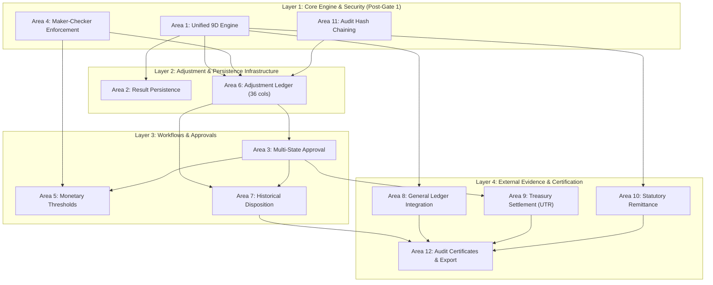

# DAY 11 — STAGE 4A: TECHNICAL IMPLEMENTATION GAP ANALYSIS
## Aura Workforce by Growmar — Horizon Portal
### Phase 3 — Teams and Insight | Day 11: Admin Payroll Run Console
### Stage 4A: Read-Only Technical Assessment & Implementation Design

---

## Document Metadata

| Attribute | Specification |
|---|---|
| **Document ID** | `DAY11-STAGE4A-TECHNICAL-IMPLEMENTATION-GAP-ANALYSIS` |
| **Document Title** | Detailed Technical Gap Analysis: Stage 3 Governance Requirements vs. Application Architecture |
| **Governing Baseline** | Stage 3 Governance Package (Policies A through E) (`DAY11-STAGE3-*`) |
| **Stage & Mode** | Stage 4A — Read-Only Technical Assessment (Unimplemented) |
| **Governance Gate 1** | **LOCKED — FINANCIAL EXECUTION NOT AUTHORIZED** |
| **Date of Execution** | November 7, 2026 |

---

## 1. Executive Summary & Assessment Scope

Stage 4A Workstream 6 performs a structured gap analysis mapping the eighteen Stage 3 governance decisions (Policies A–E) against the existing Horizon Portal software architecture. 

The evaluation covers twelve discrete architectural subsystems:
1. Multi-Dimensional Reconciliation Engine (Dimensions A–I).
2. Reconciliation Result Persistence & Snapshot History.
3. Payroll Run Approval Engine & Invariant Checking.
4. Maker-Checker Segregation & Dual-Control Guards.
5. Monetary Approval Threshold Escalation & Tiers.
6. Payroll Adjustment Ledger Lifecycle (`payroll_adjustments`).
7. Historical Payroll Exception & Disposition Workflow.
8. General Ledger Evidence Integration (`payroll_gl_entries`).
9. Banking Settlement & UTR Clearing Integration.
10. Statutory Remittance Compliance Integration.
11. Audit Logging Architecture & Cryptographic Chaining.
12. Reporting, Reconciliation Certificates & Downstream Exports.

> [!IMPORTANT]
> **READ-ONLY ASSURANCE:** This gap analysis identifies technical deficits and outlines target implementation specifications. **No code, database, or schema mutations have been performed.** Gate 1 remains unconditionally LOCKED.

---

## 2. Structured Twelve-Area Technical Gap Analysis

The tables below provide the complete 16-point evaluation for each of the twelve architectural areas:

### Area 1: Multi-Dimensional Reconciliation Engine (Dimensions A–I)
- **Governance Requirement:** Automated evaluation of nine distinct dimensions (A: Payslip Line Math, B: Component Aggregation, C: Itemized Sum, D: Signed Header-to-Itemized Variance, E: Integer Paise Rounding, F: GL Tie-out, G: Bank Settlement, H: Statutory Withholding, I: Population vs Roster).
- **Existing Application Behavior:** Implements Dimensions A, C, D, and E in `reconciliation-engine.ts` using BigInt paise ($\text{Variance} = \text{Itemized} - \text{Header}$). However, `reconciliation-service.ts` uses floating-point numbers and inverted variance signs ($\text{grossDiff} = \text{Header} - \text{Items}$). Dimensions F, G, H, and I are completely absent.
- **Existing Code Location:** `src/lib/payroll/reconciliation-engine.ts#L380-L495` `src/lib/payroll/reconciliation-service.ts#L172-L220`
- **Current Test Evidence:** `scripts/test-day11-step2a1-remediation.ts` (Test Groups 1, 2, 3)
- **Identified Gap:** `RECONCILIATION CONSISTENCY DEFECT — OPPOSITE VARIANCE SIGN CONVENTIONS`. The two services define opposite formulas, creating inverted signs (+ vs -) across APIs, UI labels, variance interpretation, and reports.
- **Proposed Implementation:** The BigInt arbitrary-precision engine (`reconciliation-engine.ts`) is the **proposed future calculation authority**, subject to formal governance approval. In post-Gate 1 Phase 4B-1, all consumers will be consolidated onto this authority. Consolidation has **NOT** occurred. Current behaviors are preserved.
- **Required Database Changes:** None (Pure calculation logic).
- **Required API Changes:** Refactor `GET /api/v1/payroll/runs` and `[runId]` to consume unified engine.
- **Required UI Changes:** Display 9-dimensional status breakdown tabs in `PayrollRunDetails.tsx`.
- **Required Audit Changes:** None.
- **Security Implications:** Eliminates precision drift and sign confusion.
- **Backward Compatibility:** Preserves existing UI card formats.
- **Migration Risk:** Low (Internal calculation refactor).
- **Test Requirements:** Enforce regression test suite covering: (1) Header > Itemized, (2) Header < Itemized, (3) Header == Itemized, (4) Positive and negative variance, (5) Zero variance, (6) Integer paise precision, (7) API/UI consistency.
- **Required External Approval:** Corporate Controller (`DEC-B-01`).
- **Implementation Dependency:** Core calculation foundation.

---

### Area 2: Reconciliation Result Persistence & Snapshot History
- **Governance Requirement:** Store immutable reconciliation run results, component variances, and historical snapshots to prevent repeated expensive on-the-fly table aggregations.
- **Existing Application Behavior:** `PayrollRun` model has snapshot columns (`originalTotalGross`, `reconciledAt`, `reconciliationNotes`), but they are currently `NULL` for all 18 runs. Calculations execute on every API read.
- **Existing Code Location:** `prisma/schema.prisma#L45-L55`
- **Current Test Evidence:** None (Columns unpopulated in `dev.db`).
- **Identified Gap:** Reconciliation results are transient; no caching or persisted audit snapshot exists on `PayrollRun`.
- **Proposed Implementation:** Populate snapshot columns upon run reconciliation transition; lock on approval.
- **Required Database Changes:** None (Columns already exist in schema).
- **Required API Changes:** Add update mutation in reconciliation service.
- **Required UI Changes:** Display persistent reconciliation timestamp and certifying auditor ID.
- **Required Audit Changes:** Log reconciliation snapshot event.
- **Security Implications:** Prevents tampering with underlying payslips post-reconciliation.
- **Backward Compatibility:** 100% backward compatible (nullable columns).
- **Migration Risk:** Zero (No schema change).
- **Test Requirements:** Persistence verification test on mock database.
- **Required External Approval:** Lead Systems Architect.
- **Implementation Dependency:** Area 1.

---

### Area 3: Payroll Run Approval Engine & Invariant Checking
- **Governance Requirement:** Multi-state approval engine allowing authorized transitions while enforcing reconciliation guards and blocking double approvals.
- **Existing Application Behavior:** Implemented in `approve/route.ts`. Checks role (HR/Admin), blocks double approval (409), blocks paid runs (409), blocks mismatches (422), executes in atomic transaction.
- **Existing Code Location:** `src/app/api/v1/payroll/runs/[runId]/approve/route.ts#L44-L220`
- **Current Test Evidence:** `scripts/test-day11-step2a1-remediation.ts` (Test Groups 4, 5, 6)
- **Identified Gap:** Rejects all historical runs (`PR-2025-04` through `PR-2026-08` as `'PAID'` with 409; `PR-2026-09` as `'MISMATCH'` with 422). Does not support historical exception approval.
- **Proposed Implementation:** Add secondary branch for `HISTORICAL_DISPOSITION_APPROVAL` with dual executive signatures.
- **Required Database Changes:** Expand `approvalStatus` enum values in documentation.
- **Required API Changes:** Update `approve/route.ts` to accept disposition payloads.
- **Required UI Changes:** Add "Approve Historical Disposition" button in console for authorized executives.
- **Required Audit Changes:** Capture disposition rationale in `audit_logs`.
- **Security Implications:** Prevents unauthorized approval of historical mismatches.
- **Backward Compatibility:** Preserves standard operational approval path.
- **Migration Risk:** Low.
- **Test Requirements:** Concurrency and negative-path tests for historical disposition.
- **Required External Approval:** Corporate Controller & CFO (`DEC-C-03`).
- **Implementation Dependency:** Area 4, Area 7.

---

### Area 4: Maker-Checker Segregation & Dual-Control Guards
- **Governance Requirement:** Strict segregation of duties: $\text{preparer\_id} \ne \text{approved\_by\_id}$ enforced at API and database layers; rejection of self-approval.
- **Existing Application Behavior:** Checked conditionally in `approve/route.ts` (`if (run.preparerId) { isPreparer = ... }`).
- **Existing Code Location:** `src/app/api/v1/payroll/runs/[runId]/approve/route.ts#L88-L104` `src/lib/payroll/payroll-security.ts#L142-L173`
- **Current Test Evidence:** `scripts/test-day11-step2a1-remediation.ts` (Test Group 6)
- **Identified Gap:** `CRITICAL CONTROL GAP — HISTORICAL MAKER-CHECKER BYPASS POSSIBLE WHEN preparerId IS NULL`. All 18 historical runs in `dev.db` have `preparer_id = NULL`. Because check is wrapped in `if (run.preparerId)`, the check is completely skipped for all historical runs. Existing role checks (`ADMIN`/`HR`) do NOT establish maker-checker separation. The approval API is NOT safe for historical runs based solely on role and reconciliation checks. Maker-checker is NOT universally implemented.
  - *Distinctions:* (1) Role-based auth exists for HR/Admin; (2) Conditional maker-checker exists in code; (3) Historical maker-checker is ineffective/missing due to nulls; (4) Future remediation is proposed only.
- **Proposed Implementation (Design Only — Not Implemented):** Fail-closed validation strategy requiring: (1) rejecting approval when preparer identity is missing; (2) requiring independently verified preparation attribution; (3) enforcing distinct preparer and approver identities; (4) server-side enforcement; (5) database-level protections (triggers/CHECK constraints); (6) comprehensive testing on null/missing/invalid/identical actors.
- **Required Database Changes:** Non-breaking database trigger preventing `approved_by_id == preparer_id`.
- **Required API Changes:** Return HTTP 400 if `preparerId` is missing on operational runs; reject approval.
- **Required UI Changes:** Display explicit preparer badge in UI console.
- **Required Audit Changes:** Log maker-checker validation status.
- **Security Implications:** Closes critical administrative self-approval loophole.
- **Backward Compatibility:** Requires legacy handling for un-preparer historical runs.
- **Migration Risk:** Medium (Requires careful migration for null historical fields).
- **Test Requirements:** Automated tests asserting rejection when `preparerId === userId`, when `preparerId` is null, and when identities match.
- **Required External Approval:** Head of Internal Audit (`DEC-C-01`).
- **Implementation Dependency:** Area 3.

---

### Area 5: Monetary Approval Threshold Escalation & Tiers
- **Governance Requirement:** Two-tier approval escalation (e.g., secondary Controller/CFO sign-off) when a cycle or adjustment exceeds an authorized monetary threshold.
- **Existing Application Behavior:** Zero implementation in application code. Single HR/Admin click completes approval.
- **Existing Code Location:** None (Zero matches in `src/`).
- **Current Test Evidence:** None.
- **Identified Gap:** `DEC-C-02 — MONETARY THRESHOLD BASIS UNDECIDED — FORMAL CONTROLLER/CFO DECISION REQUIRED.` The ₹5,00,000 value remains illustrative unless formally approved. Complete absence of monetary threshold evaluation and multi-tier approval workflows in code.
- **Proposed Implementation:** Deploy configurable threshold evaluator once Controller/CFO formally decide threshold basis (Gross, Net, Variance Delta) and amount.
- **Required Database Changes:** Add `secondaryApprovedById` and `secondaryApprovedAt` columns to `PayrollRun`.
- **Required API Changes:** Add two-phase approval endpoint (`/approve/stage1` and `/approve/stage2`).
- **Required UI Changes:** Add secondary approval modal and notification banner.
- **Required Audit Changes:** Capture dual-signature audit entries.
- **Security Implications:** Prevents unilateral authorization of high-value payroll cycles.
- **Backward Compatibility:** Runs below threshold require only single tier.
- **Migration Risk:** Low.
- **Test Requirements:** Tests verifying tier-1 vs. tier-2 escalation and boundary values.
- **Required External Approval:** Corporate Controller & CFO (`DEC-C-02`).
- **Implementation Dependency:** Area 3, Area 4.

---

### Area 6: Payroll Adjustment Ledger Lifecycle (`payroll_adjustments`)
- **Governance Requirement:** Append-only double-entry adjustment ledger storing deltas in integer paise, revision numbers, and idempotency keys without mutating historical records.
- **Existing Application Behavior:** Table exists in `prisma/schema.prisma` with 36 columns and indexes. Table exists in `dev.db` with **0 rows**. Zero runtime APIs or frontend components interact with it.
- **Existing Code Location:** `prisma/schema.prisma#L60-L125`
- **Current Test Evidence:** `scripts/test-day11-step2a1-remediation.ts` (Test Group 7 — validates schema structure only).
- **Identified Gap:** Runtime software is completely unbuilt (no adjustment service, no creation routes, no UI modal).
- **Proposed Implementation:** Build `src/lib/payroll/adjustment-service.ts` and API endpoints (`POST /api/v1/payroll/adjustments`).
- **Required Database Changes:** None (Table already exists).
- **Required API Changes:** Deploy adjustment CRUD routes (Maker create draft $\rightarrow$ Checker approve).
- **Required UI Changes:** Add "Post Adjustment" modal in `AdminPayrollConsole.tsx`.
- **Required Audit Changes:** Log `PAYROLL_ADJUSTMENT_PROPOSED` and `PAYROLL_ADJUSTMENT_APPROVED`.
- **Security Implications:** Enforces immutable auditability of all post-hoc balance corrections.
- **Backward Compatibility:** 100% backward compatible (isolated table).
- **Migration Risk:** Low.
- **Test Requirements:** Full CRUD and concurrency tests using idempotency keys.
- **Required External Approval:** Corporate Controller & Lead Systems Architect (`DEC-D-01`, `DEC-D-04`).
- **Implementation Dependency:** Area 1, Area 4.

---

### Area 7: Historical Payroll Exception & Disposition Workflow
- **Governance Requirement:** Distinct workflow and status (`HISTORICAL_DISPOSITION_APPROVED`) to formally resolve historical data pack mismatches without falsifying records or mutating history.
- **Existing Application Behavior:** Zero implementation. Mismatched historical runs remain permanently blocked in the UI. All historical runs locked out from approval.
- **Existing Code Location:** None.
- **Current Test Evidence:** None.
- **Identified Gap:** All candidate statuses are `PROPOSED — PENDING FORMAL GOVERNANCE APPROVAL`. The approval authority is `AUTHORITY NOT YET APPROVED — GOVERNANCE DECISION REQUIRED`. Historical disposition does NOT establish financial approval, settlement, GL posting, or convert mismatch to match.
  - *`HISTORICAL_PAID_RECONCILED`:* Must NOT imply verified bank settlement, verified GL posting, or statutory compliance.
  - *`HISTORICAL_PAID_UNRESOLVED_DISCREPANCY`:* Original mismatch and unresolved variance must remain visible and preserved.
- **Proposed Implementation (Design Only — Not Implemented):** Deploy the 15-step disposition workflow designed in `DAY11-STAGE4A-HISTORICAL-EXCEPTION-AND-DISPOSITION-DESIGN.md` once Gate 1 is unlocked and authority is formally approved.
- **Required Database Changes:** None (Handled via `payroll_adjustments` with type `HISTORICAL_REPORTING_ADJUSTMENT`).
- **Required API Changes:** Deploy `POST /api/v1/payroll/runs/[runId]/historical-disposition`.
- **Required UI Changes:** Add "Historical Exception Review" card in `PayrollRunDetails.tsx`.
- **Required Audit Changes:** Record `HISTORICAL_DISPOSITION_ISSUED` audit event.
- **Security Implications:** Enforces strict executive sign-off for historical anomalies.
- **Backward Compatibility:** Does not impact active operational runs.
- **Migration Risk:** Low.
- **Test Requirements:** End-to-end simulation of historical run disposition for August/September 2026.
- **Required External Approval:** Corporate Controller, CFO & Internal Audit (`DEC-D-02`).
- **Implementation Dependency:** Area 3, Area 6.

---

### Area 8: General Ledger Evidence Integration (`payroll_gl_entries`)
- **Governance Requirement:** Integration with corporate ERP chart of accounts; verification of balanced double-entry journals before certifying reconciliation.
- **Existing Application Behavior:** Zero implementation. No chart of accounts file, no GL tables, no journal exports.
- **Existing Code Location:** None.
- **Current Test Evidence:** None.
- **Identified Gap:** `EXTERNAL EVIDENCE NOT AVAILABLE IN THE INSPECTED PROJECT REPOSITORY — INDEPENDENT EXTERNAL VALIDATION PENDING.` Repository inspection confirms zero GL trial balances exist in the repo. Does not determine absence in external ERP systems. Missing evidence remains a blocking validation dependency.
- **Proposed Implementation:** Create `PayrollGlEntry` model and GL export service linking to Controller-verified accounts.
- **Required Database Changes:** Add `payroll_gl_entries` table in Stage 4B migration.
- **Required API Changes:** Deploy `GET /api/v1/payroll/runs/[runId]/gl-export`.
- **Required UI Changes:** Add "General Ledger Journal" tab in `PayrollRunDetails.tsx`.
- **Required Audit Changes:** Log GL export generation events.
- **Security Implications:** Prevents unauthorized modifications to accounting export files.
- **Backward Compatibility:** 100% additive.
- **Migration Risk:** Low.
- **Test Requirements:** Double-entry debit/credit balancing assertion tests.
- **Required External Approval:** Corporate Controller (`DEC-E-04`).
- **Implementation Dependency:** Area 1.

---

### Area 9: Banking Settlement & UTR Clearing Integration
- **Governance Requirement:** Hybrid banking settlement model tie-out (Bank statement batch debit + itemized beneficiary UTR credits).
- **Existing Application Behavior:** Zero implementation. Stored `'PAID'` flag is used as a surrogate for settlement in UI chips. Stored `PAID` flag does NOT establish bank settlement.
- **Existing Code Location:** None.
- **Current Test Evidence:** None.
- **Identified Gap:** `EXTERNAL EVIDENCE NOT AVAILABLE IN THE INSPECTED PROJECT REPOSITORY — INDEPENDENT EXTERNAL VALIDATION PENDING.` Complete absence of banking file ingesters, statement tie-out services, or UTR tracking tables in repository. Missing bank evidence remains a blocking validation dependency.
- **Proposed Implementation:** Create `PayrollBankingSettlement` model; deploy batch statement reconciliation module.
- **Required Database Changes:** Add `payroll_banking_settlements` table in Stage 4B migration.
- **Required API Changes:** Deploy `POST /api/v1/payroll/runs/[runId]/bank-settlement`.
- **Required UI Changes:** Add "Treasury Settlement" tab in `PayrollRunDetails.tsx` displaying UTR matching status.
- **Required Audit Changes:** Log settlement certification events.
- **Security Implications:** Prevents false claims of salary payment.
- **Backward Compatibility:** 100% additive.
- **Migration Risk:** Low.
- **Test Requirements:** Batch debit tie-out and UTR deduplication tests.
- **Required External Approval:** Corporate Treasurer (`DEC-E-05`).
- **Implementation Dependency:** Area 3.

---

### Area 10: Statutory Remittance Compliance Integration
- **Governance Requirement:** Verification of government portal payment receipts (EPFO ECR/TRRN, ESIC Challan, Income Tax ITNS 281/Form 24Q).
- **Existing Application Behavior:** Zero implementation. Tax withholdings are calculated on payslips but never tied out to statutory receipts.
- **Existing Code Location:** None.
- **Current Test Evidence:** None.
- **Identified Gap:** `EXTERNAL EVIDENCE NOT AVAILABLE IN THE INSPECTED PROJECT REPOSITORY — INDEPENDENT EXTERNAL VALIDATION PENDING.` Complete absence of statutory remittance receipts or document hash archiving in repository. Missing statutory evidence remains a blocking validation dependency.
- **Proposed Implementation:** Create `PayrollStatutoryRemittance` model; deploy challan receipt upload and hash verification.
- **Required Database Changes:** Add `payroll_statutory_remittances` table in Stage 4B migration.
- **Required API Changes:** Deploy `POST /api/v1/payroll/runs/[runId]/statutory-receipts`.
- **Required UI Changes:** Add "Statutory Filings" compliance checklist in `PayrollRunDetails.tsx`.
- **Required Audit Changes:** Log tax compliance certification events.
- **Security Implications:** Protects corporate officers against statutory non-remittance liability.
- **Backward Compatibility:** 100% additive.
- **Migration Risk:** Low.
- **Test Requirements:** Statutory formula tie-out and receipt document hash verification tests.
- **Required External Approval:** Head of Tax Operations (`DEC-E-02`).
- **Implementation Dependency:** Area 1.

---

### Area 11: Audit Logging Architecture & Cryptographic Chaining
- **Governance Requirement:** Tamper-evident audit logging with dedicated `payroll_run_id` and `adjustment_id` foreign keys, and Merkle hash chaining (`record_hash`, `parent_hash`).
- **Existing Application Behavior:** `AuditLog` table has 12 columns. Existing 87 rows log HR actions. `logPayrollApproval()` serializes payroll details into unstructured JSON string in `details`. No hash chaining.
- **Existing Code Location:** `prisma/schema.prisma#L300-L325` `src/lib/audit/audit-logger.ts`
- **Current Test Evidence:** `scripts/test-day11-step2a1-remediation.ts` (Test Group 5)
- **Identified Gap:** Lacks dedicated entity relational columns; lacks cryptographic hash chaining for tamper-detection.
- **Proposed Implementation:** Non-breaking Prisma migration adding `payrollRunId`, `adjustmentId`, `recordHash`, and `parentHash` to `AuditLog`.
- **Required Database Changes:** Add 4 nullable columns to `audit_logs` table.
- **Required API Changes:** Update `audit-logger.ts` to compute SHA-256 hash chains.
- **Required UI Changes:** Add "Audit Trail" tab in `PayrollRunDetails.tsx`.
- **Required Audit Changes:** Self-referential Merkle chaining.
- **Security Implications:** Provides SOC 1 Type II compliance and cryptographic tamper-evidence.
- **Backward Compatibility:** 100% backward compatible (nullable columns).
- **Migration Risk:** Very Low.
- **Test Requirements:** Chain integrity and tamper-detection assertion tests.
- **Required External Approval:** Head of Internal Audit (`DEC-E-03`).
- **Implementation Dependency:** Core security infrastructure.

---

### Area 12: Reporting, Reconciliation Certificates & Downstream Exports
- **Governance Requirement:** Generation of digitally signed Reconciliation Certificates and automated executive variance summaries.
- **Existing Application Behavior:** Basic summary cards in `AdminPayrollConsole.tsx` and `PayrollRunDetails.tsx`. No formal certificate generation or PDF export.
- **Existing Code Location:** `src/components/payroll/AdminPayrollConsole.tsx` `src/components/payroll/PayrollRunDetails.tsx`
- **Current Test Evidence:** `scripts/capture-day11-screenshots.mjs`
- **Identified Gap:** No downloadable audit certificates or formal compliance exports exist.
- **Proposed Implementation:** Deploy `src/lib/payroll/certificate-generator.ts` producing JSON and PDF audit certificates.
- **Required Database Changes:** None.
- **Required API Changes:** Deploy `GET /api/v1/payroll/runs/[runId]/reconciliation-certificate`.
- **Required UI Changes:** Add "Download Reconciliation Certificate" button in Run Details.
- **Required Audit Changes:** Log certificate issuance event.
- **Security Implications:** Guarantees authenticity of compliance submissions.
- **Backward Compatibility:** 100% additive.
- **Migration Risk:** Low.
- **Test Requirements:** Certificate structure and digital signature validation tests.
- **Required External Approval:** Lead Systems Architect & Controller.
- **Implementation Dependency:** Area 1, Area 3, Area 6.

---

## 3. Workstream 6 Implementation Dependency Graph

---

## 4. Gap Analysis Summary & Gate 1 Guard

- **Total Areas Assessed:** 12 Subsystems evaluated.
- **Stage 4B Authorization Status:** NOT AUTHORIZED.
- **Governance Gate 1 Status:** `GATE 1 LOCKED — FINANCIAL EXECUTION NOT AUTHORIZED.`

---

*End of Day 11 Stage 4A Technical Implementation Gap Analysis.*

