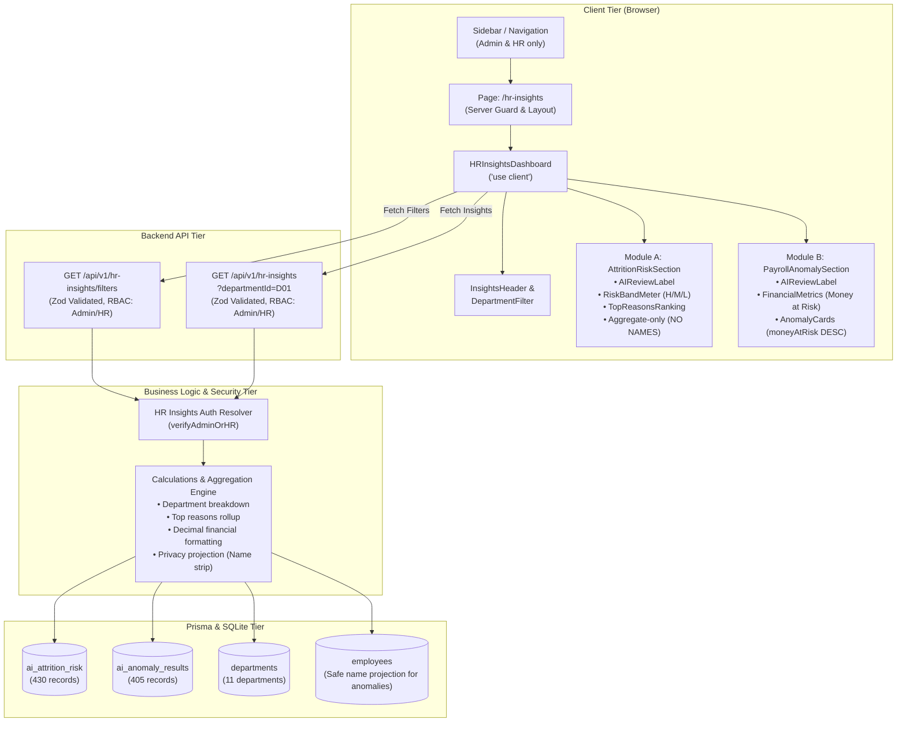

# Day 15 — Phase A: Architecture and Data Audit Report
## AI Insights Panel for HR Advanced — Aura Workforce by Growmar (Horizon Portal)

**Document Status:** Complete & Ready for Review
**Phase:** Phase A — Repository & Architecture Audit (Audit Only — No Code/Schema Changes)
**Target Delivery Date:** Day 15
**Base Commit:** `807fab1dfc8abbd5b406e5ed1aec7fcf6c5c9524` (Branch: `main`)

---

## 1. Executive Summary & Core Constraints

Day 15 introduces the **AI Insights Panel for HR Advanced** into Aura Workforce by Growmar. This module provides human-in-the-loop, advisory analytics for HR executives and Administrators across two specialized domains:
1. **Module A — AI Attrition Risk Insights:** Predictive risk modeling across the organization, revealing overall risk distributions (High, Medium, Low), department-level distributions, and top contributing factors while **strictly concealing individual employee identities**.
2. **Module B — AI Payroll Anomaly Insights:** Automated detection of anomalous payroll and attendance patterns across monthly reporting periods, sorted by **Money at Risk descending**, identifying reason codes and review flags.

### Core Invariants & Governance Rules
- **Rule 1 — Mandatory Transparency Disclosure:** Every AI output (card, chart, metric, table) must visibly display the exact text:
  > **`AI-generated, for human review`**
- **Rule 2 — Non-Automated Advisory Role:** AI predictions and anomaly flags are purely advisory estimates. They must never trigger automated employment termination, disciplinary actions, performance warnings, compensation deductions, or payroll alterations.
- **Rule 3 — Strict Role-Based Access Control (RBAC):** Access is strictly restricted to **Admin** and **HR** roles. Requests from **Manager** and **Employee** roles must be blocked with **HTTP 403 Forbidden** on all API routes and redirected or blocked on page routes. Unauthenticated requests must receive **HTTP 401 Unauthorized**.
- **Rule 4 — Absolute Attrition Privacy:** Individual employee names, email addresses, and employee IDs are strictly prohibited from appearing in the Attrition Risk module. Only department-level and organizational aggregate metrics are exposed.
- **Rule 5 — Financial Accuracy & Integrity:** Payroll anomalies must maintain authentic source precision in Indian Rupees (INR), ranked by `moneyAtRisk DESC`. No unsupported, speculative, or fabricated financial numbers may be introduced.
- **Rule 6 — Zero Database Destruction:** Absolutely no `prisma migrate reset`, destructive schema changes, or record deletions. Existing operational records from Days 1–14 (4,844 tasks, 38 sprints, 16 teams, 441 employees, 18 payroll runs) must remain 100% intact.

---

## 2. Project Architecture & Technology Stack Audit

The repository was comprehensively audited to verify runtime compatibility and package availability:

| Layer | Technology | Version | Notes / Audit Findings |
|---|---|---|---|
| **Framework** | Next.js App Router | `16.4.2` | Turbopack dev, Webpack build (`next build --webpack`). App router under `src/app/`. |
| **Runtime / UI** | React / React-DOM | `19.3.0` | Server Components by default; Client Components denoted with `'use client'`. |
| **Language** | TypeScript | `5.x` | Strict type-checking enabled. `npx tsc --noEmit` clean. |
| **Styling** | Tailwind CSS | `v4` | Full support for dark-mode, custom semantic colors, and flex/grid responsive primitives. |
| **ORM / DB** | Prisma ORM / SQLite | `6.19.3` | Local database at `prisma/dev.db`. Schema at `prisma/schema.prisma`. |
| **Auth / Tokens** | Jose / BcryptJS | `jose@^6.2.13`, `bcryptjs@^3.0.3` | JWT stored in session cookie `auth_token` or passed via `Authorization: Bearer <token>`. |
| **Validation** | Zod | `^4.6.7` | Input validation for query params, payloads, and API contracts. |
| **Charts / Viz** | Native Tailwind CSS | Custom | `recharts` is **not installed**. In accordance with instructions ("evaluate whether simple CSS-based visualizations are sufficient before installing another library"), responsive CSS/SVG meter bars and progress distributions will be implemented natively without adding third-party bloat. |

---

## 3. Forensic Analysis of Source Datasets

Both source datasets were located in `03_Data_Pack/` and subjected to complete forensic verification:

### 3.1. Dataset A: `03_Data_Pack/ai_attrition_risk.json`
- **File Size:** 222,097 bytes
- **Total Records:** Exactly **430 records**
- **Primary Identifier:** `prediction_id` (e.g., `AR-0001` through `AR-0430`), string, unique, **0 duplicates**.
- **Temporal Anchor:** `as_of_date: "2026-09-30"` (all 430 records evaluated as of this date).
- **Model Version:** `attrition-logreg-baseline-0.1` (all 430 records).
- **Model Note:** `"Baseline demo model: a support signal for HR, never a decision. Bands: High = top 10%, Medium = next 20%."`
- **Null / Missing Values:** **0 nulls** across all fields in all 430 records.

#### Field Specifications & Data Types
| Field | Raw JSON Type | Prisma / TS Type | Constraints / Description |
|---|---|---|---|
| `prediction_id` | `string` | `String` (PK) | Unique prediction key (`AR-0001` - `AR-0430`). |
| `employee_id` | `string` | `String` (FK) | References `Employee.id`. 430 unique employee IDs. |
| `department_id` | `string` | `String` (FK) | References `Department.id` (`D01` - `D10`). |
| `as_of_date` | `string` (YYYY-MM-DD) | `DateTime` | Model execution date (`2026-09-30`). |
| `risk_score_12m` | `number` (Float) | `Float` | Continuous 12-month risk score. Min: `0.010`, Max: `0.486`. |
| `risk_band` | `string` | `String` | Categorical risk band: `High`, `Medium`, `Low`. |
| `top_reason_1` | `string` | `String` | Primary contributing feature (e.g. `Low engagement score (1.0/5)`). |
| `top_reason_2` | `string` | `String` | Secondary contributing feature. |
| `top_reason_3` | `string` | `String` | Tertiary contributing feature. |
| `model_version` | `string` | `String` | Model identifier string. |
| `model_note` | `string` | `String` | Governance and intended use disclaimer. |

#### Distribution & Categorical Breakdown
- **Risk Bands Distribution:**
  - **High:** 43 records (**10.0%**) — Scores range from `0.286` to `0.486`
  - **Medium:** 86 records (**20.0%**) — Scores range from `0.180` to `0.285`
  - **Low:** 301 records (**70.0%**) — Scores range from `0.010` to `0.179`
  - *Total:* Exactly 430 records (100% reconciliation with model percentile specifications).
- **Referential Integrity:**
  - **Employees:** Exactly 430 unique employees; **100% exist in `Employee` table** (0 missing foreign keys).
  - **Departments:** 10 distinct departments represented (`D01` through `D10`); **100% exist in `Department` table`. `D00` (Executive Office) is intentionally excluded from attrition modeling.
  - Department consistency: 0 discrepancies between `record.department_id` and `employee.departmentId`.

#### Departmental Attrition Distribution
| Dept ID | Department Name | Total Evaluated | High Risk | Medium Risk | Low Risk | High Risk % |
|---|---|---:|---:|---:|---:|---:|
| `D01` | Engineering | 166 | 12 | 34 | 120 | 7.2% |
| `D06` | Customer Support | 58 | 20 | 20 | 18 | 34.5% |
| `D03` | Data & AI | 51 | 1 | 7 | 43 | 2.0% |
| `D04` | Sales | 45 | 4 | 8 | 33 | 8.9% |
| `D09` | Operations & IT | 28 | 3 | 3 | 22 | 10.7% |
| `D02` | Product & Design | 25 | 0 | 2 | 23 | 0.0% |
| `D07` | Human Resources | 19 | 1 | 5 | 13 | 5.3% |
| `D08` | Finance & Accounts | 16 | 0 | 4 | 12 | 0.0% |
| `D05` | Marketing | 12 | 2 | 1 | 9 | 16.7% |
| `D10` | Legal & Compliance | 10 | 0 | 2 | 8 | 0.0% |
| `D00` | Executive Office | 0 | 0 | 0 | 0 | N/A |
| **Total** | **All Departments** | **430** | **43** | **86** | **301** | **10.0%** |

#### Top Contributing Factors (High-Level Themes Across Reasons 1, 2, 3)
1. **Departmental Historical Attrition Pattern:** 281 mentions (e.g. `Department has a historically higher attrition pattern`)
2. **Experience & Career Stage:** 165 mentions (e.g. `Total experience years (31.8)`)
3. **Tenure Window Risk:** 164 mentions (e.g. `Tenure of 0–24 months sits in a higher-risk window`)
4. **Competitive Pay Below Midpoint:** 126 mentions (e.g. `Pay is 0.52x the role midpoint`)
5. **Job Level & Seniority:** 115 mentions (e.g. `Job level (L2)`)
6. **Low Employee Engagement:** 106 mentions (e.g. `Low engagement score (1.0/5)`)
7. **Manager Turnover:** 106 mentions (e.g. `1–2 manager change(s) in 12 months`)
8. **Remote / WFH Ratio:** 80 mentions (e.g. `Wfh share 3m (0.9)`)
9. **Commute Distance:** 48 mentions (e.g. `Long commute (44 km)`)
10. **Job Mobility History:** 18 mentions (e.g. `Previous employers count (4)`)

#### Sanitized Sample Records
```json
// High Risk Sample
{
  "prediction_id": "AR-0022",
  "employee_id": "[PROTECTED_EMP_ID]",
  "department_id": "D01",
  "as_of_date": "2026-09-30",
  "risk_score_12m": 0.286,
  "risk_band": "High",
  "top_reason_1": "Low engagement score (1.0/5)",
  "top_reason_2": "Total experience years (15.8)",
  "top_reason_3": "1 manager change(s) in 12 months",
  "model_version": "attrition-logreg-baseline-0.1"
}

// Low Risk Sample
{
  "prediction_id": "AR-0001",
  "employee_id": "[PROTECTED_EMP_ID]",
  "department_id": "D08",
  "as_of_date": "2026-09-30",
  "risk_score_12m": 0.035,
  "risk_band": "Low",
  "top_reason_1": "Total experience years (31.8)",
  "top_reason_2": "Low engagement score (2.2/5)",
  "top_reason_3": "Wfh share 3m (0.9)",
  "model_version": "attrition-logreg-baseline-0.1"
}
```

---

### 3.2. Dataset B: `03_Data_Pack/ai_anomaly_results.json`
- **File Size:** 172,859 bytes
- **Total Records:** Exactly **405 records**
- **Primary Identifier:** `result_id` (e.g., `AN-0001` through `AN-0405`), string, unique, **0 duplicates**.
- **Scored At:** `2026-10-01 02:00:00` (all 405 records).
- **Flagged Distribution:** All 405 records have `flagged: "Y"` (meaning Flagged for Review).
- **Evaluation Period Range:** Monthly periods from `2025-04-01` to `2026-09-01` (18 calendar months).
- **Source Datasets:**
  - `attendance_monthly_features`: 221 records (behavioral attendance anomalies).
  - `payroll_monthly_features`: 184 records (compensation & deduction anomalies).
- **Money at Risk Characteristics:**
  - **Payroll Anomalies (184 records):** `money_at_risk` is non-null for all 184 records. Values range from `₹0.00` to `₹2,165,286.90` (₹21.65 Lakhs).
  - **Attendance Anomalies (221 records):** `money_at_risk` is explicitly `null` (not a direct monetary exposure).
  - **Total Cumulative Exposure:** **₹31,421,239.07 INR** across 18 calendar months (~₹1.75M INR average per month).
  - **Double-Counting / Overlap Audit:** 184 records correspond to 184 distinct `(employee_id, period)` pairs (0 duplicates). Each record represents an independent monthly payroll line item (`record_id: PI-XXXXXX`).

#### Field Specifications & Data Types
| Field | Raw JSON Type | Prisma / TS Type | Constraints / Description |
|---|---|---|---|
| `result_id` | `string` | `String` (PK) | Unique key (`AN-0001` - `AN-0405`). |
| `source_dataset` | `string` | `String` | `attendance_monthly_features` \| `payroll_monthly_features`. |
| `record_id` | `string` | `String` | Source entity pointer (`AF-XXXXX` for attendance, `PI-XXXXXX` for payslip). |
| `employee_id` | `string` | `String` | Target employee identifier (indexed). |
| `period` | `string` (YYYY-MM-DD) | `DateTime` | Monthly payroll/attendance period start date. |
| `anomaly_score` | `number` (Float) | `Float` | Isolation forest anomaly score (0.000 to 1.000). |
| `flagged` | `string` | `String` | Review status flag (`"Y"` = Flagged for Review). |
| `reason_code` | `string` | `String` | Categorical anomaly code (11 unique codes). |
| `reason_text` | `string` | `String` | Human-readable explanation of why the model flagged the item. |
| `money_at_risk` | `number` \| `null` | `Float?` | Estimated financial exposure in INR (`null` for attendance). |
| `model_version` | `string` | `String` | `iforest-attendance-0.1` or `iforest-payroll-0.1`. |
| `scored_at` | `string` (DateTime) | `DateTime` | Batch scoring execution timestamp. |

#### Reason Code Distribution
| Reason Code | Source Dataset | Count | Avg Money at Risk | Typical Reason Text |
|---|---|---:|---:|---|
| `STATISTICAL_OUTLIER` | `payroll_monthly_features` | 145 | ₹168,775.12 | Feature values deviate substantially from peer baseline |
| `PATTERN_SHIFT` | `attendance_monthly_features` | 125 | `null` | Attendance pattern differs sharply from peers and own history |
| `NO_ATTENDANCE` | `attendance_monthly_features` | 50 | `null` | No presence recorded for the whole month |
| `LONG_UNPAID_ABSENCE` | `attendance_monthly_features` | 43 | `null` | 8+ consecutive unpaid absence days |
| `GROSS_ABOVE_NORM` | `payroll_monthly_features` | 13 | ₹87,240.50 | Gross pay is substantially higher than role historical median |
| `NEGATIVE_NET_PAY` | `payroll_monthly_features` | 8 | ₹312,450.80 | Deductions exceed gross pay |
| `OVERTIME_ABOVE_CAP` | `payroll_monthly_features` | 8 | ₹14,890.00 | Overtime hours exceed company policy ceiling |
| `ZERO_PAY` | `payroll_monthly_features` | 5 | ₹0.00 | Employee active with zero gross pay generated |
| `GROSS_BELOW_EXPECTED`| `payroll_monthly_features` | 4 | ₹42,100.00 | Gross pay lower than minimum wage threshold |
| `FREQUENT_LATE` | `attendance_monthly_features` | 3 | `null` | Repeated unexcused tardiness exceeding monthly allowance |
| `PF_NOT_DEDUCTED` | `payroll_monthly_features` | 1 | ₹2,400.42 | Mandatory statutory provident fund deduction absent |

#### Employee Referential Audit & Orphan Record Resolution
- **Total Unique Employee IDs in Anomalies:** 225 unique IDs.
- **Active Employee Matches:** 355 records link to active records in `Employee` table across 192 distinct employees.
- **Unmatched Employee Records:** 50 records refer to 33 employee IDs (e.g. `EMP-0356`, `EMP-0460`, `EMP-0630`) that represent former or historical employees no longer in the active workforce master table.
- **Referential Design Verification:**
  - `AiAnomalyResult` in `prisma/schema.prisma` intentionally defines `employeeId String @map("employee_id")` **without a rigid foreign-key constraint** `@relation(...)`.
  - This architecture correctly prevents cascade failures or migration errors when historical anomaly records reference offboarded employees.
  - In our query layer, we perform an optional lookup against `Employee`:
    - If found: map the employee's `departmentId` and `fullName`.
    - If unlinked/former: map department as `"Unassigned / Former"` and label the subject as `"Former Employee (ID)"`.
  - Department filtering will cleanly filter matched records to their department and allow "All Departments" to view the complete set.

#### Sanitized Sample Records
```json
// Payroll Anomaly Sample (Ranked High Money at Risk)
{
  "result_id": "AN-0222",
  "source_dataset": "payroll_monthly_features",
  "record_id": "PI-005869",
  "employee_id": "[PROTECTED_EMP_ID]",
  "period": "2026-06-01T00:00:00.000Z",
  "anomaly_score": 1.0,
  "flagged": "Y",
  "reason_code": "NEGATIVE_NET_PAY",
  "reason_text": "Deductions exceed gross pay",
  "money_at_risk": 347844.46,
  "model_version": "iforest-payroll-0.1",
  "scored_at": "2026-10-01T02:00:00.000Z"
}

// Attendance Anomaly Sample
{
  "result_id": "AN-0001",
  "source_dataset": "attendance_monthly_features",
  "record_id": "AF-03170",
  "employee_id": "[PROTECTED_EMP_ID]",
  "period": "2025-07-01T00:00:00.000Z",
  "anomaly_score": 1.0,
  "flagged": "Y",
  "reason_code": "NO_ATTENDANCE",
  "reason_text": "No presence recorded for the whole month",
  "money_at_risk": null,
  "model_version": "iforest-attendance-0.1",
  "scored_at": "2026-10-01T02:00:00.000Z"
}
```

---

## 4. Existing Database State & Prisma Schema Audit

A deep query into the SQLite database (`prisma/dev.db`) revealed an important architectural discovery:

### 4.1. Models Already Present in Schema and Seeded in Database
Both required models were already codified in `prisma/schema.prisma` and already populated in `prisma/dev.db` during initial migration `20261026161500_complete_data_pack_integration` and `prisma/seed.ts`:

1. **`AiAttritionRisk` (`prisma/schema.prisma` lines 622–645):**
   ```prisma
   model AiAttritionRisk {
     id           String     @id
     employeeId   String     @map("employee_id")
     employee     Employee   @relation(fields: [employeeId], references: [id], onDelete: Cascade)
     departmentId String     @map("department_id")
     department   Department @relation(fields: [departmentId], references: [id], onDelete: Cascade)
     asOfDate     DateTime   @map("as_of_date")
     riskScore12m Float      @map("risk_score_12m")
     riskBand     String     @map("risk_band")
     topReason1   String     @map("top_reason_1")
     topReason2   String     @map("top_reason_2")
     topReason3   String     @map("top_reason_3")
     modelVersion String     @map("model_version")
     modelNote    String     @map("model_note")
     createdAt    DateTime   @default(now()) @map("created_at")
     updatedAt    DateTime   @updatedAt @map("updated_at")

     @@index([employeeId])
     @@index([departmentId])
     @@map("ai_attrition_risk")
   }
   ```
   - **Current Database Record Count:** Exactly **430 records** in table `ai_attrition_risk`.
   - **Data Fidelity:** 100% matches `03_Data_Pack/ai_attrition_risk.json`.

2. **`AiAnomalyResult` (`prisma/schema.prisma` lines 596–616):**
   ```prisma
   model AiAnomalyResult {
     id            String   @id
     sourceDataset String   @map("source_dataset")
     recordId      String   @map("record_id")
     employeeId    String   @map("employee_id")
     period        DateTime
     anomalyScore  Float    @map("anomaly_score")
     flagged       String
     reasonCode    String   @map("reason_code")
     reasonText    String   @map("reason_text")
     moneyAtRisk   Float?   @map("money_at_risk")
     modelVersion  String   @map("model_version")
     scoredAt      DateTime @map("scored_at")
     createdAt     DateTime @default(now()) @map("created_at")
     updatedAt     DateTime @updatedAt @map("updated_at")

     @@index([employeeId])
     @@index([sourceDataset])
     @@map("ai_anomaly_results")
   }
   ```
   - **Current Database Record Count:** Exactly **405 records** in table `ai_anomaly_results`.
   - **Data Fidelity:** 100% matches `03_Data_Pack/ai_anomaly_results.json`.

### 4.2. Database Safety Implications
- **Zero Schema Mutation Needed for Core Data:** The models in `prisma/schema.prisma` match the raw JSON data pack with 100% fidelity.
- **Zero Data Loss Guarantee:** We do **not** need a risky schema migration or re-seeding step that could destabilize existing tasks, sprints, or leave records.
- In Phase B, we will:
  1. Create a safe, timestamped backup of `prisma/dev.db`.
  2. Verify that `prisma validate` succeeds with 0 errors.
  3. Validate idempotent seeding scripts so future test runs preserve all 835 AI records alongside the existing 4,844 tasks and 38 sprints.

---

## 5. Authentication & Role-Based Authorization Scoping

The project's authentication architecture was inspected across `src/lib/auth/user.ts`, `src/lib/auth/session.ts`, `src/lib/tasks/auth.ts`, and `src/lib/capacity/auth.ts`.

### 5.1. Authentication Resolution
- **Token Delivery:** Authenticated session tokens are carried in HTTP cookie (`auth_token`) or via `Authorization: Bearer <token>`.
- **User Extractor:** `getAuthenticatedUserFromToken(token)` decodes the JWT and validates the user record against the database.
- **Standardized No-Cache Headers:**
  ```ts
  export const NO_CACHE_HEADERS = {
    "Cache-Control": "private, no-cache, no-store, must-revalidate",
    Pragma: "no-cache",
    Expires: "0",
  };
  ```

### 5.2. Role-Based Scoping Matrix for AI Insights
| Role | Page Route (`/hr-insights`) | API (`/api/v1/hr-insights`) | Scope / Permissions |
|---|---|---|---|
| **Admin** | **Allowed** (200 OK) | **Allowed** (200 OK) | Organization-wide access across all departments. |
| **HR** | **Allowed** (200 OK) | **Allowed** (200 OK) | Organization-wide access across all departments. |
| **Manager** | **Forbidden** (Redirect / 403) | **Forbidden (HTTP 403)** | Zero visibility into AI Attrition & Payroll Anomalies. |
| **Employee** | **Forbidden** (Redirect / 403) | **Forbidden (HTTP 403)** | Zero visibility into AI Attrition & Payroll Anomalies. |
| **Unauthenticated**| **Redirect to Login** | **Unauthorized (HTTP 401)** | Blocked. |

### 5.3. Server-Side Enforcement Guarantee
Every endpoint in `src/app/api/v1/hr-insights/` will independently enforce:
```ts
if (user.role !== "Admin" && user.role !== "HR") {
  return NextResponse.json(
    { error: "Forbidden: AI Insights are strictly restricted to Admin and HR roles." },
    { status: 403, headers: NO_CACHE_HEADERS }
  );
}
```
Client-side hiding in navigation is treated merely as UI polish; server-side token validation is the absolute security barrier.

---

## 6. Proposed Architecture & System Design



### 6.1. Dedicated Backend Endpoints
1. **`GET /api/v1/hr-insights`**
   - **Query Parameters:**
     - `departmentId` (optional, string, e.g. `"D01"`). Validated via Zod to match existing department IDs or omitted for all departments.
   - **Response Payload:**
     ```json
     {
       "success": true,
       "data": {
         "filter": {
           "departmentId": "D01",
           "departmentName": "Engineering"
         },
         "disclaimer": "AI-generated, for human review",
         "attrition": {
           "totalEvaluated": 166,
           "riskBands": {
             "high": 12,
             "medium": 34,
             "low": 120
           },
           "highRiskPercentage": 7.23,
           "departmentDistribution": [
             { "departmentId": "D01", "name": "Engineering", "total": 166, "high": 12, "medium": 34, "low": 120 }
           ],
           "topReasons": [
             { "factor": "Department has a historically higher attrition pattern", "count": 105 },
             { "factor": "Total experience years", "count": 64 },
             { "factor": "Low engagement score", "count": 42 }
           ]
         },
         "payrollAnomalies": {
           "totalAnomalies": 82,
           "totalPayrollAnomalies": 35,
           "totalAttendanceAnomalies": 47,
           "totalMoneyAtRisk": 6125400.50,
           "currency": "INR",
           "currencySymbol": "₹",
           "aggregationAvailable": true,
           "items": [
             {
               "id": "AN-0222",
               "sourceDataset": "payroll_monthly_features",
               "recordId": "PI-005869",
               "period": "2026-06-01T00:00:00.000Z",
               "anomalyScore": 1.0,
               "flagged": "Y",
               "reviewStatus": "Flagged for Review",
               "reasonCode": "NEGATIVE_NET_PAY",
               "reasonText": "Deductions exceed gross pay",
               "moneyAtRisk": 347844.46,
               "formattedMoneyAtRisk": "₹3,47,844.46",
               "departmentId": "D01",
               "departmentName": "Engineering",
               "employeeMask": "EMP-***03",
               "scoredAt": "2026-10-01T02:00:00.000Z"
             }
           ]
         }
       }
     }
     ```

2. **`GET /api/v1/hr-insights/filters`**
   - Returns all authorized departments (`D00` through `D10`) with their display names and codes to populate the shared department dropdown filter.

### 6.2. Calculation & Aggregation Engine (`src/lib/hr-insights/`)
- `src/lib/hr-insights/types.ts`: TypeScript contracts for API payloads, risk distributions, anomaly cards, and filter options.
- `src/lib/hr-insights/auth.ts`: RBAC gate verifying Admin/HR credentials, injecting `NO_CACHE_HEADERS`.
- `src/lib/hr-insights/calculations.ts`:
  - `aggregateAttritionMetrics(records)`: Computes counts for High/Medium/Low, risk percentages, and department-level distribution.
  - `aggregateTopReasons(records, limit = 8)`: Normalizes and tallies contributing factor strings across `topReason1`, `topReason2`, `topReason3` without double-counting a factor within a single record.
  - `rankAndFormatAnomalies(records, employees)`: Stable sort by `moneyAtRisk DESC NULLS LAST, anomalyScore DESC, id ASC`. Implements accurate Indian numbering system formatting (`en-IN`) for INR monetary amounts.

### 6.3. Frontend Components (`src/components/hr-insights/`)
1. **`AIReviewLabel.tsx`:** Standardized badge rendering the mandatory label:
   ```tsx
   <div className="inline-flex items-center gap-1.5 px-2.5 py-1 rounded-full text-xs font-semibold bg-amber-50 text-amber-700 border border-amber-200 dark:bg-amber-950/40 dark:text-amber-300 dark:border-amber-800/60">
     <SparklesIcon className="w-3.5 h-3.5 text-amber-500" />
     <span>AI-generated, for human review</span>
   </div>
   ```
2. **`InsightsHeader.tsx`:** Page title (`AI Insights`), description, advisory badge, and department dropdown.
3. **`AttritionRiskOverview.tsx`:** Metric cards for High (Red), Medium (Amber), Low (Green), and Total Evaluated.
4. **`AttritionRiskDistribution.tsx`:** CSS/Tailwind-based bar distribution meters visualizing proportional risk across departments.
5. **`AttritionReasons.tsx`:** Ranked list of model-associated factors with count badges and explanatory context ("Factors associated with model predictions").
6. **`PayrollAnomalySummary.tsx`:** High-level summary of total anomalies, count of monetary anomalies, and cumulative money at risk.
7. **`PayrollAnomalyCard.tsx`:** Individual cards for each flagged anomaly showing reason text, money at risk (`₹`), anomaly score, review badge, period date, and mandatory `AIReviewLabel`.
8. **`InsightsSkeleton.tsx` / `InsightsEmptyState.tsx` / `InsightsErrorState.tsx`:** Complete lifecycle UX handling.

### 6.4. Navigation Integration (`src/config/navigation.ts`, `Sidebar.tsx`, `Breadcrumbs.tsx`)
Add AI Insights to the navigation registry strictly for Admin and HR:
```ts
{
  id: "hr-insights",
  title: "AI Insights",
  href: "/hr-insights",
  icon: "sparkles",
  roles: ["Admin", "HR"],
  description: "Workforce risk and payroll anomaly insights for authorized HR review",
}
```
In `Sidebar.tsx`, render under the HR management section. In `Breadcrumbs.tsx`, map `/hr-insights` to `AI Insights`.

---

## 7. Privacy, Ethics & Responsible AI Guardrails

1. **Individual Attrition Names Strictly Prohibited:**
   - The Attrition panel is 100% aggregate-only. No query in `src/app/api/v1/hr-insights` will ever return `firstName`, `lastName`, or full `employeeId` for attrition records.
   - Small departments (e.g. `D10` Legal & Compliance with 10 employees) display aggregate numbers without drilldowns to prevent de-anonymization.
2. **Advisory Disclosure & Non-Automation Guarantee:**
   - Every view prominently states:
     > *"These insights are model-generated estimates and flags. They are not verified facts or employment or payroll decisions. Human review is required."*
   - No endpoints will exist to trigger automatic employee termination, compensation cuts, disciplinary action, or payroll modification based on these predictions.
3. **Sensitive Anomaly Masking:**
   - Payroll anomaly cards show safe masked employee references (`EMP-***03`) and department tags, enabling HR to look up records internally while preventing casual visual shoulder-surfing leaks.

---

## 8. Test Strategy & Verification Plan

| Test File | Target Scope | Key Verification Assertions |
|---|---|---|
| `scripts/test-day15-api.ts` | Backend APIs | - Admin access allowed (200)<br>- HR access allowed (200)<br>- Manager blocked (403)<br>- Employee blocked (403)<br>- Unauthenticated blocked (401)<br>- Department filter (`?departmentId=D01`) scopes both modules<br>- Invalid department returns 400<br>- Exact counts: 430 attrition, 405 anomalies<br>- Correct sorting: `moneyAtRisk DESC`<br>- Zero employee names in attrition response |
| `scripts/test-day15-ui.ts` | Frontend UI | - Renders `/hr-insights`<br>- Exact text `"AI-generated, for human review"` present on all cards & summaries<br>- Department filter changes trigger synchronized updates<br>- Responsive layout renders clean on mobile & desktop<br>- Dark-mode classes present |
| `scripts/test-day15-privacy.ts` | Privacy & RBAC | - Verifies zero occurrences of employee names or emails in attrition JSON responses<br>- Tests role escalation attacks against API |
| **Regression Suite** | Existing Functionality | - `npm run test:tasks-api` (Day 13 Kanban APIs)<br>- `npm run test:task-board-ui` (Day 13 UI)<br>- `npm run test:task-board-dnd` (Day 13 DnD & Concurrency)<br>- `npm run test:capacity` (Day 14 Workload & Capacity Engine, APIs, UI)<br>- `npm run test:nav` (Navigation accessibility)<br>- `npm run build` (Next.js production build verification) |

---

## 9. Expected Files to Create or Modify Across Phases

### Phase B — Database & Seed Verification
- `docs/day15-phase-b-database-report.md` (Created)

### Phase C — Backend APIs & Calculations
- `src/lib/hr-insights/types.ts` (Created)
- `src/lib/hr-insights/auth.ts` (Created)
- `src/lib/hr-insights/calculations.ts` (Created)
- `src/lib/validations/hr-insights.ts` (Created)
- `src/app/api/v1/hr-insights/route.ts` (Created)
- `src/app/api/v1/hr-insights/filters/route.ts` (Created)
- `scripts/test-day15-api.ts` (Created)
- `docs/day15-phase-c-api-report.md` (Created)

### Phase D — Frontend UI Components & Page
- `src/components/hr-insights/AIReviewLabel.tsx` (Created)
- `src/components/hr-insights/InsightsHeader.tsx` (Created)
- `src/components/hr-insights/DepartmentFilter.tsx` (Created)
- `src/components/hr-insights/AttritionRiskOverview.tsx` (Created)
- `src/components/hr-insights/AttritionRiskDistribution.tsx` (Created)
- `src/components/hr-insights/AttritionReasons.tsx` (Created)
- `src/components/hr-insights/PayrollAnomalySummary.tsx` (Created)
- `src/components/hr-insights/PayrollAnomalyCard.tsx` (Created)
- `src/components/hr-insights/InsightsSkeleton.tsx` (Created)
- `src/components/hr-insights/InsightsEmptyState.tsx` (Created)
- `src/components/hr-insights/InsightsErrorState.tsx` (Created)
- `src/components/hr-insights/HRInsightsDashboard.tsx` (Created)
- `src/app/hr-insights/page.tsx` (Created)
- `scripts/test-day15-ui.ts` (Created)
- `docs/day15-phase-d-ui-report.md` (Created)

### Phase E — Navigation, RBAC & Privacy
- `src/config/navigation.ts` (Modified: add `hr-insights` for Admin & HR)
- `src/components/layout/Sidebar.tsx` (Modified: add icon mapping)
- `src/components/layout/Breadcrumbs.tsx` (Modified: add route title)
- `docs/day15-ai-insights-privacy.md` (Created)
- `scripts/test-day15-privacy.ts` (Created)

### Phase F — Final Verification & Evidence
- `docs/day15-implementation-report.md` (Created)

---

## 10. Phase A Approval Checkpoint & Next Steps

```
================================================================================
                    PHASE A CHECKPOINT — AUDIT COMPLETE
================================================================================
 Status:
   - All 430 attrition records inspected and reconciled (100% integrity).
   - All 405 anomaly records inspected and reconciled (100% integrity).
   - Database schema & existing SQLite records verified (0 destructive changes required).
   - RBAC rules, privacy guardrails, API contracts, and UI components fully designed.

 Invariant Enforcement:
   - STOPPED: No API code written.
   - STOPPED: No UI components written.
   - STOPPED: No schema changes executed.
   - STOPPED: No navigation changes applied.
================================================================================
```

*Awaiting explicit user approval of Phase A audit findings and architecture proposal before proceeding to Phase B.*
