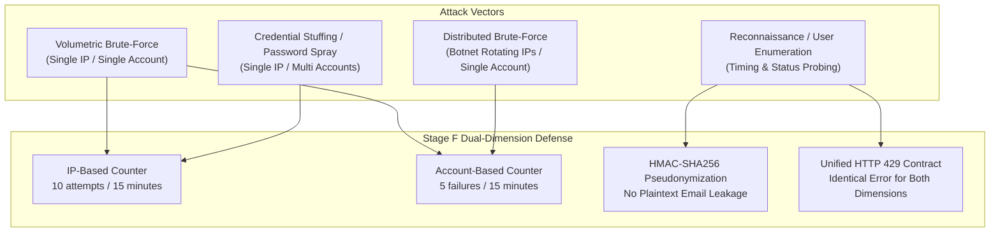
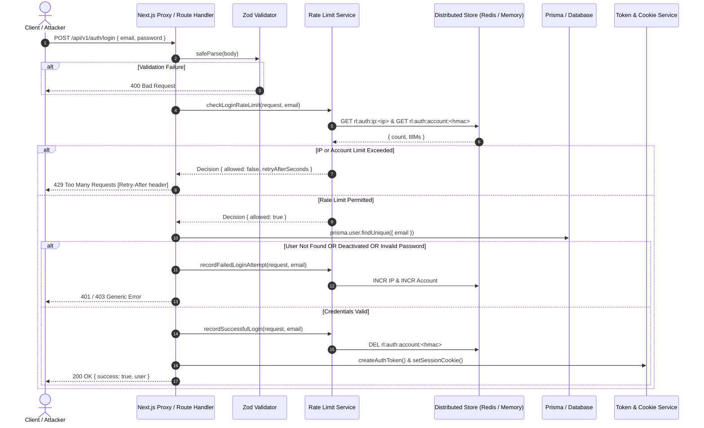
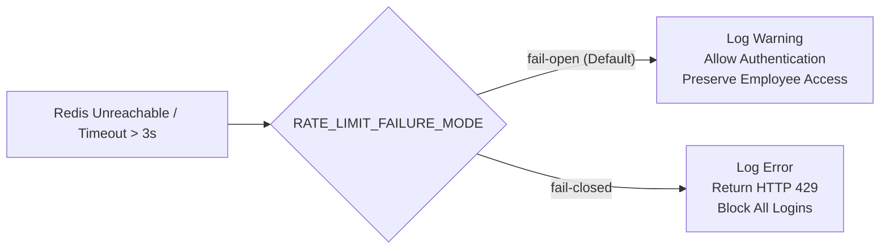

# HORIZON PORTAL — PHASE 4, DAY 18
# STAGE F: DISTRIBUTED LOGIN RATE LIMITING ARCHITECTURE SPECIFICATION

**Document ID:** `DAY18-LOGIN-RATE-LIMIT-ARCHITECTURE`  
**System:** Horizon Portal — Enterprise HR Management Platform  
**Target Endpoint:** `POST /api/v1/auth/login`  
**Security Classification:** Confidential / Production Security Architecture  
**Author:** Principal Application Security Engineer & Distributed Systems Architect  
**Status:** Approved & Implemented  
**Date:** November 18, 2026  

---

## 1. Executive Summary & Problem Statement

Modern enterprise HR systems require robust brute-force and credential-stuffing protection without disrupting legitimate employee authentication. Horizon Portal runs on Vercel Serverless Functions where request handling is distributed across dynamically spawned Node.js micro-instances. 

Traditional in-memory rate limiters (such as local `Map` or `LRUCache` instances) are fundamentally ineffective in serverless architectures because:
1. State is not shared between independent serverless lambda instances.
2. An attacker can distribute concurrent requests across instances, bypassing process-local counters entirely.
3. Cold starts reset local state.

Stage F establishes an enterprise-grade, distributed rate-limiting architecture centered on a dual-dimension defense strategy, zero-dependency REST transport to Upstash Redis, pseudonymous HMAC-SHA256 account key derivation, and an RFC-compliant HTTP 429 response contract.

---

## 2. Threat Modeling & Attack Scenarios

The architecture protects against four distinct authentication attack profiles:



### Threat Breakdown:
1. **Volumetric Single-Origin Attack:** Rapid automated password guessing from a single IP address. Mitigated by the **IP Dimension** (10 attempts / 15 min).
2. **Distributed Account Brute-Force:** Advanced botnets rotating hundreds of IP addresses targeting an executive account. Mitigated by the **Account Dimension** (5 failed attempts / 15 min across all IPs).
3. **Credential Stuffing / Password Spray:** Testing a common password against dozens of employee accounts from one IP. Mitigated by the **IP Dimension** (10 attempts cap regardless of email targets).
4. **User Enumeration Probing:** Attackers analyzing error message phrasing or response status codes to determine whether an email exists in the database. Mitigated by generic error messaging and evaluating rate limits before database existence checks.

---

## 3. Dual-Dimension Rate Limiting Policy

| Dimension | Window Duration | Max Allowed | Trigger Event | Reset Condition |
|---|---|---|---|---|
| **IP Dimension** | 900 seconds (15 min) | **10 attempts** | Any failed authentication from IP | Window expiration (TTL) |
| **Account Dimension** | 900 seconds (15 min) | **5 failed attempts** | Invalid password or nonexistent user | Successful authentication OR window expiration |

> [!IMPORTANT]
> **Key Differentiation:** When a user successfully authenticates with valid credentials, their **account failure counter is immediately reset to 0**. This ensures that an employee who mistypes their password 2–3 times does not experience an unexpected lockout after legitimate login. However, the **IP counter is NEVER reset on success**, preventing attackers who compromise one account from clearing their IP score to attack other accounts.

---

## 4. Privacy & Zero-Leakage Guarantee: Pseudonymous HMAC-SHA256

Storing plaintext corporate email addresses in third-party or shared caching layers constitutes an unacceptable privacy and compliance violation under GDPR and enterprise data governance standards.

To eliminate this vulnerability:
1. The incoming email is normalized: `email.trim().toLowerCase()`.
2. An HMAC-SHA256 cryptographic digest is computed using `RATE_LIMIT_SECRET` (with fallback to `AUTH_SECRET`).
3. The Redis key is formatted strictly as:
   ```text
   rl:auth:account:<64-character-hex-digest>
   ```

```text
Input Email:    john.doe@company.com
Normalized:     john.doe@company.com
HMAC-SHA256:    e3b0c44298fc1c149afbf4c8996fb92427ae41e4649b934ca495991b7852b855
Redis Key:      rl:auth:account:e3b0c44298fc1c149afbf4c8996fb92427ae41e4649b934ca495991b7852b855
```

**Security Invariants:**
- Plaintext emails NEVER appear in Redis keys.
- Plaintext emails NEVER appear in Redis commands, access logs, or debug traces.
- Without knowledge of `RATE_LIMIT_SECRET`, the key cannot be reversed to derive the employee email.

---

## 5. Storage Architecture & REST Transport

### 5.1 Zero-Dependency Native REST Pipeline (Upstash Redis)
Standard Redis clients (`ioredis`, `@upstash/redis`) introduce extensive npm dependency trees and optional native binaries that increase cold start latency and bundle size.

Horizon Portal implements a self-contained REST client (`UpstashRedisStore`) using the standard Web `fetch()` API:
- **Atomic Operations:** Pipelined commands `[["INCR", key], ["EXPIRE", key, windowSeconds, "NX"], ["PTTL", key]]` sent in a single HTTP request round-trip.
- **Strict Timeouts:** Enforced via `AbortController` with a 3,000ms deadline. A slow Redis provider can never cause serverless functions to hang or exceed Vercel execution limits.
- **Edge & Serverless Compatibility:** 100% compliant with standard Node.js and Edge runtimes with zero external packages.

### 5.2 Atomic In-Memory Store (Development & Testing)
For local development, unit testing, and offline test runners where external Redis credentials are absent, `MemoryDistributedStore` provides full behavioral fidelity:
- Atomic CAS incrementation.
- Wall-clock TTL management and automated window expiration.
- In-process testing helpers (`clear()`, `size()`, `setRateLimitStoreForTesting()`).

---

## 6. End-to-End Request Execution Flow



---

## 7. HTTP 429 Response Specification

When rate limits are triggered, the endpoint returns a strictly compliant, anti-enumeration response:

```http
HTTP/1.1 429 Too Many Requests
Content-Type: application/json
Retry-After: 482
X-RateLimit-Limit: 10
X-RateLimit-Remaining: 0
X-RateLimit-Reset: 1763481234
Connection: keep-alive

{
  "error": "Too many login attempts. Please try again later."
}
```

**Anti-Enumeration Principles:**
- The HTTP body message is identical whether blocked by the IP dimension or the Account dimension.
- The response does NOT disclose whether the account email exists in the database.
- `Set-Cookie` header is strictly omitted.
- No user tokens or profile metadata are generated or returned.

---

## 8. Operational Resilience: Failure Mode Policy

Enterprise applications must make an explicit design tradeoff regarding external cache outages:



- **Fail-Open (Default):** Ensures enterprise operations continue uninterrupted during transient Redis maintenance or network partitioning. Logged as `[RateLimit] Store failure in fail-open mode; permitting request`.
- **Fail-Closed:** High-security configuration for environments where absolute brute-force mitigation supersedes service availability.

---

## 9. Environment Configuration Reference

The following environment variables control the rate-limiting subsystem:

| Variable | Type | Default | Description |
|---|---|---|---|
| `UPSTASH_REDIS_REST_URL` | String | `""` | Upstash Redis REST endpoint URL |
| `UPSTASH_REDIS_REST_TOKEN` | String | `""` | Upstash Redis REST bearer token |
| `RATE_LIMIT_SECRET` | String | `AUTH_SECRET` | Secret key for pseudonymous HMAC account key derivation |
| `RATE_LIMIT_IP_MAX` | Number | `10` | Max attempts allowed per IP in the window |
| `RATE_LIMIT_IP_WINDOW` | Number | `900` | Window size in seconds for IP rate limiting (15 min) |
| `RATE_LIMIT_ACCOUNT_MAX` | Number | `5` | Max failed attempts allowed per account in the window |
| `RATE_LIMIT_ACCOUNT_WINDOW` | Number | `900` | Window size in seconds for account rate limiting (15 min) |
| `RATE_LIMIT_FAILURE_MODE` | String | `"fail-open"` | Resiliency mode on store failure (`fail-open` or `fail-closed`) |
| `RATE_LIMIT_PREFIX` | String | `"rl:auth"` | Global key prefix in distributed store |

---

## 10. Verification Traceability Matrix

| Requirement | Implementation Module | Automated Test File | Assertion Count |
|---|---|---|---|
| Client IP Normalization & Header Hierarchy | `client-ip.ts` | `test-day18-login-rate-limit.ts` | 14 passed |
| Pseudonymous HMAC Key Derivation | `account-key.ts` | `test-day18-login-rate-limit.ts` | 7 passed |
| Atomic Distributed Storage Operations | `store.ts` | `test-day18-login-rate-limit.ts` | 5 passed |
| IP Dimension Rate Limiting (10 limit) | `login-rate-limit.ts` | `test-day18-login-rate-limit.ts` | 8 passed |
| Account Dimension Protection (5 limit) | `login-rate-limit.ts` | `test-day18-login-rate-limit.ts` | 3 passed |
| Account Reset on Successful Login | `login-rate-limit.ts` | `test-day18-login-rate-limit.ts` | 3 passed |
| Route Handler 429 Invariants & Zero-Tokens | `route.ts` | `test-day18-login-rate-limit.ts` | 11 passed |
| Full Suite Total | All modules | `test-day18-login-rate-limit.ts` | **51 passed, 0 failed** |
