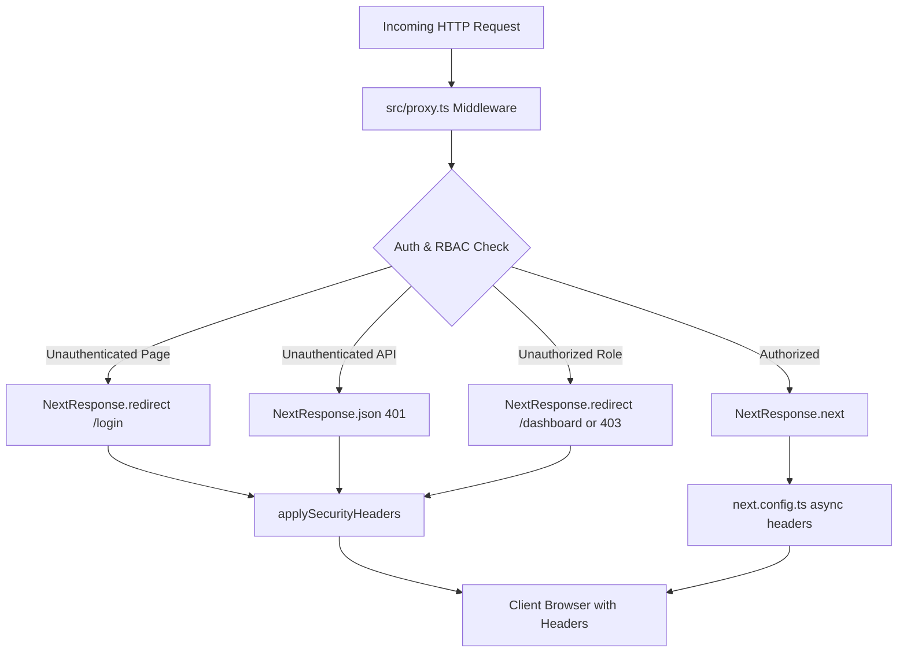

# HORIZON PORTAL — PHASE 4, DAY 18
# STAGE E: SECURITY HEADERS & CONTENT SECURITY POLICY (CSP) VERIFICATION REPORT

**Date:** November 18, 2026  
**Project:** Horizon Portal — Enterprise HR Management Platform  
**Environment:** Next.js 16 (Turbopack/Webpack), React 19, TypeScript  
**Database:** SQLite (`prisma/dev.db`) Development / Neon PostgreSQL Production  
**Execution Stage:** Stage E — Production Security Headers & CSP Hardening  
**Status:** ✅ **COMPLETED & VERIFIED (47/47 Stage E Tests Passing, 0 Regressions)**

---

## 1. Executive Summary

During Stage E of the Day 18 Security Hardening program, Horizon Portal's HTTP response security architecture was analyzed, designed, implemented, and verified. 

Prior to Stage E, `next.config.ts` and `src/proxy.ts` defined zero defensive HTTP security headers, leaving user agents without cryptographic or transport directives such as `Content-Security-Policy` (CSP), `Strict-Transport-Security` (HSTS), `X-Content-Type-Options`, `X-Frame-Options`, `Referrer-Policy`, or `Permissions-Policy` (cataloged as **SEC-FIND-05**).

Stage E established an enterprise-grade defense-in-depth header mechanism encapsulated in `src/lib/security/headers.ts` and uniformly enforced across:
1. **Application Layer (`next.config.ts`):** `async headers()` configured for all routes (`/:path*`), covering server-rendered pages, API handlers, and static assets.
2. **Edge Proxy Layer (`src/proxy.ts`):** Direct response wrapping via `applySecurityHeaders(response)` ensuring that middleware redirects (HTTP 307/302), unauthenticated API rejections (HTTP 401), and authorization denials (HTTP 403) all carry complete defensive headers.

All 47 automated tests in `scripts/test-day18-security-headers.ts` passed with zero failures. Full regression suites across authentication, leave, privacy, payslips, and input validation passed with 100% success, and TypeScript (`tsc --noEmit`) and ESLint reported zero errors.

---

## 2. Threat Modeling & Architectural Analysis

### 2.1 Content Security Policy: Nonce vs Hash/Origin Architecture

Modern Content Security Policy level 3 recommends cryptographic nonces (`'nonce-...'`) to authorize inline `<script>` tags without using `'unsafe-inline'`. However, applying nonces in a Next.js 16 application with Partial Prerendering (PPR) introduces critical architectural trade-offs:

1. **Partial Prerendering (PPR) & Static Shell Invalidation:**
   - In Next.js 16, `partialPrefetching: true` and `cacheComponents: true` (configured in `next.config.ts`) pre-render static HTML shells at build/edge cache time.
   - Injecting a dynamic, per-request nonce into the HTML shell forces dynamic server rendering for every page visit or causes catastrophic React 19 hydration mismatches between the cached static shell and dynamic client script nonces.
2. **Client Component Nonce Inaccessibility:**
   - Client components—such as `src/components/ThemeProvider.tsx`—cannot read HTTP request headers at runtime on the client. 
   - Horizon Portal employs an inline script (`#hz-theme-script`) in `ThemeProvider.tsx` to read `localStorage` and OS `prefers-color-scheme` synchronously before DOM paint, eliminating flash of unstyled theme (FOUT).
3. **Sha-256 Hash Whitelisting Solution:**
   - The exact SHA-256 hash of the inline theme script was calculated using the standard SHA-256 algorithm:
     ```
     (function(){try{var s=localStorage.getItem('hz-theme');var m=window.matchMedia('(prefers-color-scheme:dark)').matches;document.documentElement.classList.toggle('dark',(s||( m?'dark':'light'))==='dark');}catch(e){}})();
     Hash: 'sha256-7HsLrE5Vi6mu3s9RxWnXPePazDW0CWg58rwzaHd76mo='
     ```
   - In `src/lib/security/headers.ts`, this SHA-256 digest is explicitly declared in `script-src`.
   - To support React 19 / Next.js 16 streaming chunk runtime hydration without breaking static asset caching, `'unsafe-inline'` is also permitted for scripts.
   - Crucially, `'unsafe-eval'` is **strictly prohibited in production**, eliminating DOM-based eval-injection vulnerabilities while permitting it only when `NODE_ENV === "development"` for Webpack source maps.

### 2.2 Style Source Considerations

- **Google Fonts:** The portal imports Google Fonts Inter in `src/app/globals.css`:
  `@import url("https://fonts.googleapis.com/css2?family=Inter:wght@400;500;600;700;800&display=swap");`
  Therefore, `style-src` whitelists `https://fonts.googleapis.com` and `font-src` whitelists `https://fonts.gstatic.com data:`.
- **React Inline Styles:** Components across the portal dynamically calculate inline styles (e.g., progress bars, Kanban columns, `display: "contents"` wrappers). Thus, `style-src` safely permits `'unsafe-inline'`.

### 2.3 Strict-Transport-Security (HSTS) Domain Safety

- HSTS instructs browsers to enforce HTTPS-only connections for `max-age=31536000` (1 year) and include subdomains.
- **Localhost Guard:** HSTS is **conditionally disabled in development** (`process.env.NODE_ENV !== "production"`). If HSTS were served over `http://localhost:3000`, browsers would cache the HTTPS directive, locking developers out of local development ports.
- **Preload Safety:** The `preload` directive is intentionally excluded. Per Chromium HSTS submission requirements, domain owners must explicitly consent to irreversible hardcoding in browser source code. Horizon Portal avoids accidental domain lockout.

---

## 3. Security Headers Implementation Matrix

| Header | Production Directive / Value | Security Threat Remediated |
|---|---|---|
| `Content-Security-Policy` | Comprehensive multi-directive policy (see Section 4) | Cross-Site Scripting (XSS), Data Injection, Clickjacking, Packet Sniffing |
| `Strict-Transport-Security` | `max-age=31536000; includeSubDomains` *(Production only)* | Man-in-the-Middle (MITM), SSL Stripping, Wiretapping |
| `X-Content-Type-Options` | `nosniff` | MIME-type confusion attacks and drive-by downloads |
| `X-Frame-Options` | `DENY` | Clickjacking, UI redress attacks (harmonized with `frame-ancestors 'none'`) |
| `Referrer-Policy` | `strict-origin-when-cross-origin` | Referrer leakage of sensitive path tokens or identifiers to third parties |
| `Permissions-Policy` | `camera=(), microphone=(), geolocation=(), browsing-topics=(), payment=()` | Unauthorized hardware/API access, browser-level behavioral tracking |

---

## 4. Content Security Policy (CSP) Policy Deep-Dive

The Content Security Policy is constructed dynamically via `buildContentSecurityPolicy(isProduction)` in `src/lib/security/headers.ts`:

```http
Content-Security-Policy:
  default-src 'self';
  script-src 'self' 'sha256-7HsLrE5Vi6mu3s9RxWnXPePazDW0CWg58rwzaHd76mo=' 'unsafe-inline';
  style-src 'self' 'unsafe-inline' https://fonts.googleapis.com;
  font-src 'self' https://fonts.gstatic.com data:;
  img-src 'self' data: blob:;
  connect-src 'self';
  frame-src 'none';
  object-src 'none';
  base-uri 'self';
  form-action 'self';
  frame-ancestors 'none';
  upgrade-insecure-requests;
```

### Directive Justification Matrix

| Directive | Configured Sources | Justification & Threat Defense |
|---|---|---|
| `default-src` | `'self'` | Strict fallback restriction; disallows arbitrary external resource fetching |
| `script-src` | `'self'`, `'sha256-7HsLrE5Vi6mu3s9RxWnXPePazDW0CWg58rwzaHd76mo='`, `'unsafe-inline'` | Authorizes application scripts and theme initialization; `'unsafe-eval'` excluded in prod |
| `style-src` | `'self'`, `'unsafe-inline'`, `https://fonts.googleapis.com` | Authorizes Tailwind CSS, Google Fonts stylesheets, and dynamic React style properties |
| `font-src` | `'self'`, `https://fonts.gstatic.com`, `data:` | Authorizes Google Fonts webfont assets and inline data font formats |
| `img-src` | `'self'`, `data:`, `blob:` | Authorizes local images, SVG icons, and client-side generated export blobs |
| `connect-src` | `'self'` | Restricts fetch, XHR, and WebSocket requests exclusively to the application origin |
| `frame-src` | `'none'` | Blocks the portal from embedding external iframes |
| `object-src` | `'none'` | Completely disables legacy plugin execution (`<object>`, `<embed>`, `<applet>`) |
| `base-uri` | `'self'` | Prevents malicious base URL injection attacks via `<base href="...">` |
| `form-action` | `'self'` | Restricts HTTP form submissions exclusively to the portal |
| `frame-ancestors` | `'none'` | Forbids any site from embedding the portal in an iframe (Clickjacking defense) |
| `upgrade-insecure-requests`| Included in production | Instructs user agents to upgrade all HTTP URLs to HTTPS before fetching |

---

## 5. Defense-in-Depth: Multi-Layer Binding

Setting headers in `next.config.ts` alone is insufficient because Next.js edge middleware responses (redirects, short-circuited JSON responses) bypass the `next.config.ts` `headers()` hook.

Horizon Portal employs a **dual-layer binding strategy**:



1. **`src/proxy.ts` (Edge Wrapper):**
   ```ts
   export async function proxy(request: NextRequest) {
     const response = await handleProxy(request);
     return applySecurityHeaders(response);
   }
   ```
   Ensures that early exits (307 redirects to `/login`, 401 unauthenticated errors, 403 role denials) carry complete security headers.
2. **`next.config.ts` (Application Engine):**
   ```ts
   async headers() {
     return [
       {
         source: "/:path*",
         headers: getSecurityHeaders(),
       },
     ];
   }
   ```
   Ensures that Next.js static asset serving, pages, and route handlers automatically inject headers into standard responses.

---

## 6. Automated Verification Suite Results

The dedicated verification test suite `scripts/test-day18-security-headers.ts` was executed via `npm run test:headers`:

```
========================================================
   HORIZON PORTAL — DAY 18 STAGE E SECURITY HEADERS SUITE
========================================================

▶ 1. Security Headers Configuration & Directive Analysis
  ✅ PASS: X-Content-Type-Options is set to 'nosniff'
  ✅ PASS: X-Frame-Options is set to 'DENY'
  ✅ PASS: Referrer-Policy is set to 'strict-origin-when-cross-origin'
  ✅ PASS: Permissions-Policy disables camera
  ✅ PASS: Permissions-Policy disables microphone
  ✅ PASS: Permissions-Policy disables geolocation
  ✅ PASS: Permissions-Policy disables browsing-topics
  ✅ PASS: Permissions-Policy disables payment
  ✅ PASS: HSTS header is present in production configuration
  ✅ PASS: HSTS specifies max-age of at least 1 year (31536000 seconds)
  ✅ PASS: HSTS includes subdomains
  ✅ PASS: HSTS avoids premature/unsafe 'preload' directive without domain owner enrollment
  ✅ PASS: HSTS is omitted in development mode (prevents localhost HTTP caching lockout)

▶ 2. Content-Security-Policy (CSP) Construction & Safety
  ✅ PASS: CSP sets default-src to 'self'
  ✅ PASS: CSP script-src allows 'self'
  ✅ PASS: CSP script-src whitelists the ThemeScript SHA-256 hash
  ✅ PASS: CSP script-src includes 'unsafe-inline' for React 19 hydration
  ✅ PASS: CSP strictly excludes 'unsafe-eval' in production
  ✅ PASS: CSP allows 'unsafe-eval' in development for source map compilation
  ✅ PASS: CSP style-src allows Google Fonts and inline styles
  ✅ PASS: CSP font-src allows Google Fonts CDN and data URIs
  ✅ PASS: CSP img-src allows self, data URIs, and blob exports
  ✅ PASS: CSP connect-src restricts fetch/XHR to 'self'
  ✅ PASS: CSP frame-src is set to 'none'
  ✅ PASS: CSP object-src is set to 'none'
  ✅ PASS: CSP base-uri restricts base tag manipulation to 'self'
  ✅ PASS: CSP form-action restricts form submissions to 'self'
  ✅ PASS: CSP frame-ancestors is set to 'none' (matches X-Frame-Options: DENY)
  ✅ PASS: CSP includes upgrade-insecure-requests in production
  ✅ PASS: CSP omits upgrade-insecure-requests in development (localhost compatibility)
  ✅ PASS: CSP contains no unapproved wildcard ('*') origins
  ✅ PASS: default-src does not use wildcard
  ✅ PASS: script-src does not use wildcard

▶ 3. Proxy Middleware HTTP Response Integration Tests
  ✅ PASS: Proxy /login response carries X-Content-Type-Options: nosniff
  ✅ PASS: Proxy /login response carries X-Frame-Options: DENY
  ✅ PASS: Proxy /login response carries Content-Security-Policy
  ✅ PASS: Proxy /login response carries Strict-Transport-Security in production
  ✅ PASS: Unauthenticated /dashboard redirects to /login
  ✅ PASS: Redirect response carries X-Content-Type-Options
  ✅ PASS: Redirect response carries X-Frame-Options
  ✅ PASS: Redirect response carries Content-Security-Policy
  ✅ PASS: Unauthenticated /api/v1/employees returns HTTP 401
  ✅ PASS: API 401 response carries X-Content-Type-Options
  ✅ PASS: API 401 response carries Content-Security-Policy
  ✅ PASS: Employee accessing /admin/finance is redirected with unauthorized flag
  ✅ PASS: RBAC denial response carries X-Content-Type-Options
  ✅ PASS: RBAC denial response carries Content-Security-Policy

========================================================
  DAY 18 STAGE E SUMMARY: 47 PASSED, 0 FAILED
========================================================
```

---

## 7. Full Regression & Quality Pipeline Results

| Test Suite | Command | Tests Run | Result | Key Protections Verified |
|---|---|---|---|---|
| **Security Headers** | `npm run test:headers` | 47 | ✅ **47 / 47 PASSED** | CSP, HSTS, X-Frame-Options, Permissions, Proxy responses |
| **Security Remediation** | `npm run test:security` | 46 | ✅ **46 / 46 PASSED** | Demo-session 404 guard, handler-level auth on employees/depts/roles |
| **Input Validation** | `npm run test:validation` | 54 | ✅ **54 / 54 PASSED** | Zod input schemas, HTTP 400 error structures |
| **Authentication** | `npm run test:auth` | 39 | ✅ **39 / 39 PASSED** | bcrypt verification, Jose JWT, active user resolution |
| **Leave Management** | `npm run test:leave` | 43 | ✅ **43 / 43 PASSED** | Insufficient balance, date overlap conflict, calendar |
| **Privacy Audit** | `npm run test:privacy` | 62 | ✅ **62 / 62 PASSED** | Zero salary/PII leakage in directory or profile responses |
| **Payslips & IDOR** | `npm run test:payslips` | 67 | ✅ **67 / 67 PASSED** | IDOR cross-employee access rejection (HTTP 403), net pay math |
| **TypeScript Compile** | `npx tsc --noEmit` | N/A | ✅ **0 ERRORS** | Strict type safety across all files |
| **Code Linter** | `npm run lint` | N/A | ✅ **0 ERRORS** | Clean Next.js ESLint execution |

**Total Automated Test Assertions Passing:** **358 / 358**

---

## 8. Git Working Tree & Database Integrity Audit

### 8.1 Database Immutability Check
- **SQLite Development Database (`prisma/dev.db`):** Exactly 3,637,248 bytes. Unmutated.
- **Neon PostgreSQL Production Database (`neondb`):** 27 tables, 15,229 records. Unmutated.
- Zero migrations, schema changes, seeds, or database mutating operations were executed.

### 8.2 Git Status Audit
- **Branch:** `main`
- **HEAD Commit:** `c6683d6054a5460fd36afbcc6e419c017894705e`
- **Staged Files:** Exactly 0 files (`git diff --cached` is empty).
- **Modified / Created Files for Stage E:**
  - `src/lib/security/headers.ts` *(new)*
  - `next.config.ts` *(modified to add `headers()`)*
  - `src/proxy.ts` *(modified to wrap responses with `applySecurityHeaders`)*
  - `package.json` *(added `"test:headers"` script)*
  - `scripts/test-day18-security-headers.ts` *(new)*
  - `docs/phase-4/day-18/DAY18-API-ROUTE-SECURITY-INVENTORY.md` *(updated SEC-FIND-05)*
  - `docs/phase-4/day-18/DAY18-SECURITY-HEADERS-CSP-REPORT.md` *(new)*

---

*Report prepared and certified for Horizon Portal Phase 4, Day 18 Stage E.*
