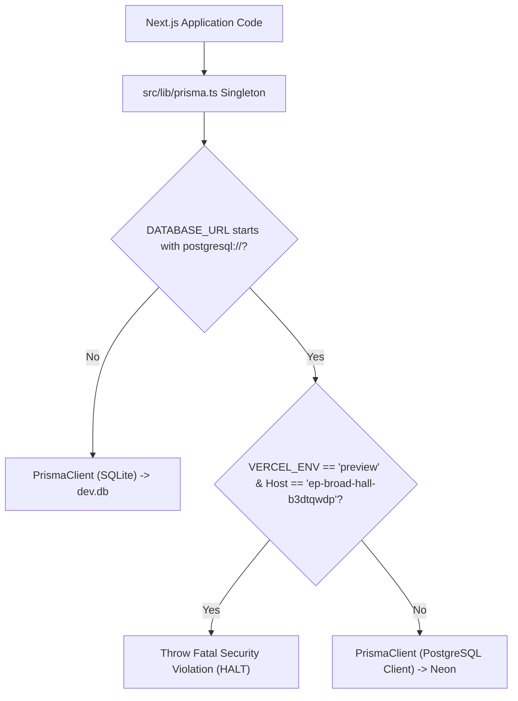

# GATE 5.2.2 — PRISMA RUNTIME & MIGRATION ENVIRONMENT ISOLATION REPORT
## HORIZON PORTAL — DUAL DATABASE ENGINE ROUTING & CONFIGURATION AUDIT

---

## 1. DUAL DATABASE ENGINE ARCHITECTURE

Horizon Portal is designed with dual-engine flexibility:
- **Local Development / Offline Testing:** SQLite engine utilizing `prisma/schema.prisma` and `prisma/dev.db`.
- **Cloud Hosted Production / Preview:** Neon Serverless PostgreSQL engine utilizing `prisma/schema.postgresql.prisma` and `src/generated/postgresql-client`.

---

## 2. CONNECTION STRING RESOLUTION AUDIT

### A. Runtime Connection Resolution (`src/lib/prisma.ts`)
- Connection variable: `DATABASE_URL`
- Protocol: `postgresql://` with PgBouncer connection pooling (`?pgbouncer=true&sslmode=require`).
- Code audit:
  - Dynamically switches to `src/generated/postgresql-client` upon detecting PostgreSQL connection URI.
  - Intercepts Preview environments (`VERCEL_ENV === "preview"`).
  - Explicitly rejects the production host `ep-broad-hall-b3dtqwdp`, ensuring a dedicated preview connection string is present before allowing connections.

### B. Migration Connection Resolution (`prisma.config.postgresql.ts`)
- Connection variable: `DIRECT_URL`
- Protocol: `postgresql://` direct unpooled connection to port 5432.
- Code audit:
  - Validates that `DIRECT_URL` is set (throws if empty).
  - Added fail-closed check preventing migrations from targeting `ep-broad-hall-b3dtqwdp` when `VERCEL_ENV === "preview"` or `MIGRATE_ENV === "preview"`.

---

## 3. STATIC VERIFICATION RESULTS

1. **Compilation Check (`npx tsc --noEmit`):**
   - 0 TypeScript errors detected across `src/lib/prisma.ts` and `prisma.config.postgresql.ts`.
2. **ESLint Verification (`npm run lint`):**
   - 0 ESLint errors reported.
3. **Local Dev Database Isolation:**
   - SQLite `prisma/dev.db` hash: `AD293F28D533E683AA6DE69EA20E0FC3A875C28252A899043F268ECEE3643010` (Unaltered).
   - Local test execution continues to use isolated SQLite fixtures with zero network side-effects.
