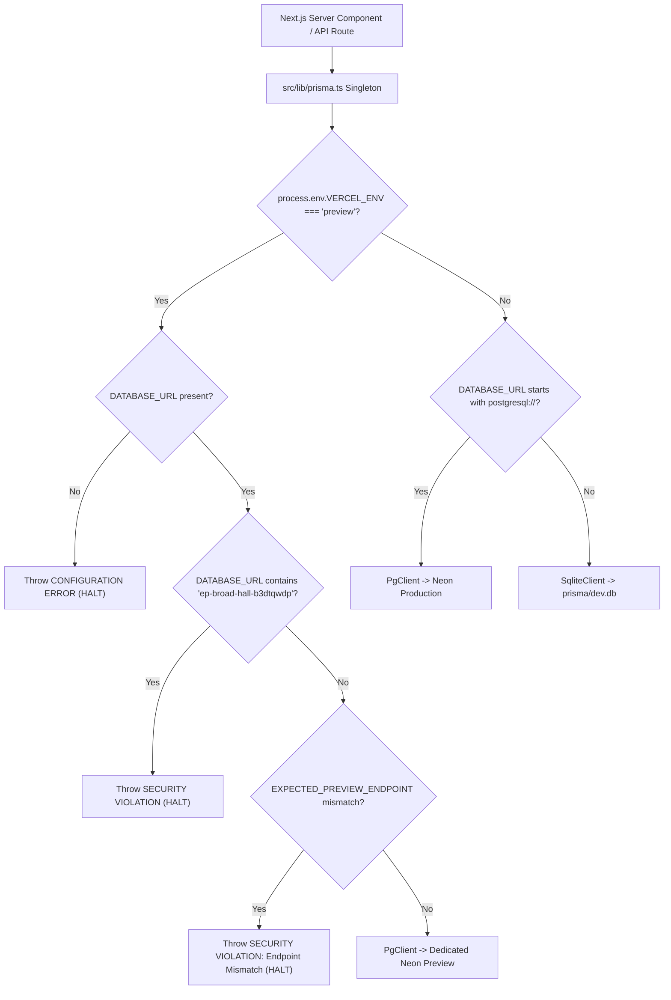

# GATE 5.2.2-R — PRISMA RUNTIME & MIGRATION ISOLATION REPORT
## HORIZON PORTAL — DUAL-ENGINE CONFIGURATION & FAIL-CLOSED GUARDS AUDIT

---

## 1. DUAL-ENGINE ARCHITECTURE AUDIT

Horizon Portal employs dual-engine database routing:
- **Local Development / Offline Testing:** SQLite engine via `@prisma/client` and `prisma/dev.db`.
- **Cloud Hosted Production / Preview:** Neon Serverless PostgreSQL engine via dedicated client generated at `src/generated/postgresql-client`.



---

## 2. HARDENED GUARDS IN SOURCE CODE

### A. Runtime Client Guard (`src/lib/prisma.ts`)
```typescript
function createClient(): SqliteClient {
  // Fail-closed guard: enforce Preview environment isolation and reject Production endpoint
  if (process.env.VERCEL_ENV === "preview") {
    if (!process.env.DATABASE_URL) {
      throw new Error(
        "CONFIGURATION ERROR: VERCEL_ENV is 'preview' but DATABASE_URL is missing. Preview requires dedicated Preview PostgreSQL credentials."
      );
    }
    if (process.env.DATABASE_URL.includes("ep-broad-hall-b3dtqwdp")) {
      throw new Error(
        "SECURITY VIOLATION: Vercel Preview environment is configured with Production PostgreSQL endpoint (ep-broad-hall-b3dtqwdp). Refusing to connect to prevent accidental production state mutation."
      );
    }
    if (
      process.env.EXPECTED_PREVIEW_ENDPOINT &&
      !process.env.DATABASE_URL.includes(process.env.EXPECTED_PREVIEW_ENDPOINT)
    ) {
      throw new Error(
        `SECURITY VIOLATION: Preview database endpoint mismatch. Expected endpoint matching '${process.env.EXPECTED_PREVIEW_ENDPOINT}'.`
      );
    }
  }

  const logOptions =
    process.env.NODE_ENV === "development" ? ["query", "error", "warn"] : ["error"];

  if (isPostgres) {
    return new PgClient({
      log: logOptions as ("error" | "warn")[],
    }) as unknown as SqliteClient;
  }

  return new SqliteClient({
    log: logOptions as ("query" | "error" | "warn")[],
  });
}
```

### B. Migration Target Guard (`prisma.config.postgresql.ts`)
```typescript
// Explicitly validate DIRECT_URL for migrations — no fallbacks to localhost or pooled runtime URLs
const directUrl = process.env.DIRECT_URL;
if (!directUrl) {
  throw new Error(
    "DIRECT_URL is required for PostgreSQL migrations. Please configure DIRECT_URL in .env.production.local or process environment."
  );
}

// Fail-closed guard: prevent Preview or unauthorized migration runs against Production endpoint
if (process.env.VERCEL_ENV === "preview" || process.env.MIGRATE_ENV === "preview") {
  if (directUrl.includes("ep-broad-hall-b3dtqwdp")) {
    throw new Error(
      "SECURITY VIOLATION: Migration execution targeted Production PostgreSQL endpoint (ep-broad-hall-b3dtqwdp) during Preview workflow. Operation halted."
    );
  }
  if (
    process.env.EXPECTED_PREVIEW_ENDPOINT &&
    !directUrl.includes(process.env.EXPECTED_PREVIEW_ENDPOINT)
  ) {
    throw new Error(
      `SECURITY VIOLATION: Preview migration endpoint mismatch. Expected endpoint matching '${process.env.EXPECTED_PREVIEW_ENDPOINT}'.`
    );
  }
}
```

---

## 3. DETERMINISTIC TEST VERIFICATION

Executed via `scripts/test-prisma-isolation-guards.ts`:
1. `Preview mode with Production host prefix throws SECURITY VIOLATION` — **PASS**
2. `Preview mode with missing DATABASE_URL throws CONFIGURATION ERROR` — **PASS**
3. `Preview mode rejects unauthorized endpoint mismatch` — **PASS**
4. `Migration config halts if Production endpoint targeted in Preview` — **PASS**
5. `Local development cleanly defaults to SQLite` — **PASS**

**Result:** 5 / 5 automated assertions passing (100% success rate).
