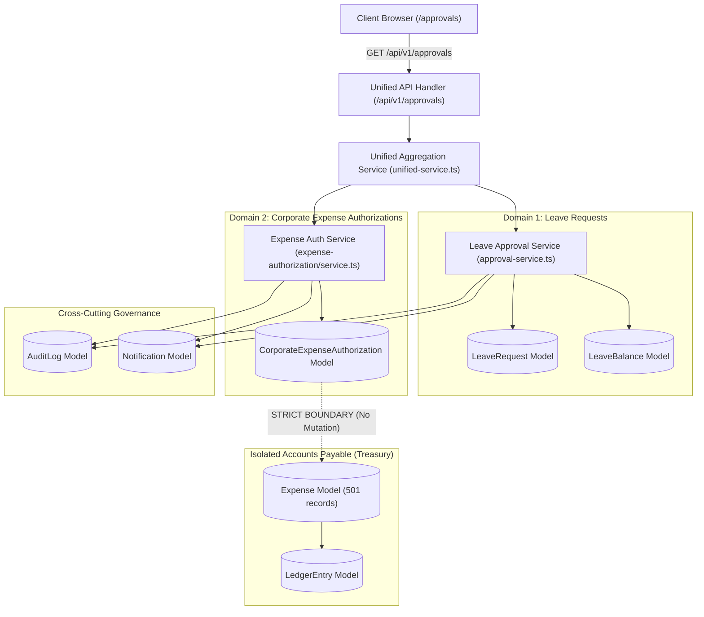
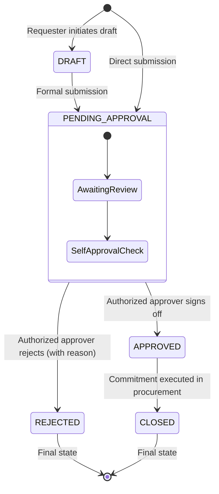

# DAY 20 — STEP 8B: TECHNICAL ARCHITECTURE
## Unified Multi-Domain Approval Center Architectural Design & Domain Decoupling

**Project:** Horizon Portal  
**Document:** Technical Architecture Document  
**Branch:** `day20-final-challenge`  
**Date:** 2026-11-20  
**Role:** Principal Software Architect & Financial Workflow Engineer  

---

## 1. Architectural Overview & Design Philosophy

The **Unified Multi-Domain Approval Center** unifies disparate business approval workflows into a single, cohesive user experience while enforcing strict architectural separation at the data and business logic layers.

### Key Architectural Pillars:
1. **Domain Decoupling:** Leave Requests and Corporate Expense Authorizations maintain independent data models, business rules, validation schemas, and state lifecycles.
2. **Accounts Payable (AP) Isolation:** Approval of a proposed corporate expenditure represents a budgetary authorization to commit company funds. It is explicitly separated from accounts payable cash disbursement (`Expense` table). Approving an authorization does not trigger payments or mutate payable ledgers.
3. **Server-Side Enforcement:** Zero trust on client UI controls. Authorization, hierarchy scoping, self-approval prohibitions, and input validation are executed strictly on the server.
4. **Idempotent Atomic Transactions:** All state transitions and audit logging execute within atomic Prisma transactions (`prisma.$transaction`) with concurrency protection (HTTP 409 Conflict).

---

## 2. Multi-Domain Entity-Relationship Architecture

The following diagram illustrates the relationship between the unified interface, domain services, database models, and the isolated accounts payable ledger:



---

## 3. The Two Supported Approval Domains

### 3.1 Domain 1: Leave Requests (Preserved)
- **Primary Model:** `LeaveRequest`
- **Purpose:** Employee requests for time off (Casual Leave, Sick Leave, Earned Leave).
- **Approval Semantics:** Manager approves/rejects; atomic deduction from `LeaveBalance` quota; release of `pendingDays`.
- **Status Enum:** `Pending` $\rightarrow$ `Approved` | `Rejected`.

### 3.2 Domain 2: Corporate Expense Authorizations (New)
- **Primary Model:** `CorporateExpenseAuthorization`
- **Purpose:** Employee requests for authorized business expenditures (Cloud hosting, software licenses, equipment, training, legal).
- **Approval Semantics:** Manager/Lead authorizes budget commitment. Does NOT disburse cash.
- **Reference Code:** `CEA-YYYY-XXXX` (sequential, human-readable).
- **Status Enum:** `DRAFT` $\rightarrow$ `PENDING_APPROVAL` $\rightarrow$ `APPROVED` | `REJECTED` $\rightarrow$ `CLOSED`.

---

## 4. State Machine & Lifecycle Transitions

### Corporate Expense Authorization Lifecycle:


### Transition Invariants:
1. Only records in `PENDING_APPROVAL` can transition to `APPROVED` or `REJECTED`.
2. Any attempt to decide an already decided record fails with `HTTP 409 Conflict`.
3. Transitioning to `REJECTED` strictly requires `rejectionReason` ($\ge 3$ characters).
4. Requesters cannot approve their own requests; attempting to do so returns `HTTP 403 Forbidden`.

---

## 5. Normalized Unified Contract

The aggregation service normalizes heterogeneous domain models into a unified schema:

```typescript
export interface UnifiedApprovalItem {
  id: string;
  domain: "leave" | "corporate-expense";
  domainLabel: string;
  referenceNumber: string;
  title: string;
  requester: {
    id: string;
    name: string;
    email: string;
    departmentName: string;
    avatarUrl?: string | null;
  };
  departmentName: string;
  requestedDate: string;
  amountOrDuration: string;
  amount?: number;
  currency?: string;
  durationDays?: number;
  status: "PENDING_APPROVAL" | "APPROVED" | "REJECTED";
  statusLabel: string;
  canApprove: boolean;
  details: Record<string, any>;
}
```

---

## 6. Authorization & Reporting Tree Traversal

Managers only have visibility into requests from subordinates within their reporting scope.
```text
Manager (emp-mgr-01)
  │
  ├── Subordinate 1 (emp-sub-01) ──> Authorized
  ├── Subordinate 2 (emp-sub-02) ──> Authorized
  │     └── Sub-Subordinate 3    ──> Authorized (transitive)
  │
  └── Peer Manager (emp-mgr-02)  ──> FORBIDDEN (HTTP 403)
```

The algorithm uses an iterative breadth-first search traversing `Employee.managerId` relations, assembling a complete transitive closure of subordinate IDs.

For HR and Admin roles, the reporting tree constraint is bypassed, granting organization-wide governance.
